# Лабораторная работа 1

Макаров Максим Вячеславович, К3420, ИСУ 412999.

## ВВЕДЕНИЕ

Цель работы — подготовить персональный стенд containerlab, развернуть контейнерный SONiC VS и исследовать его службы, порты и базы Redis. Работа выполнена локально в отдельной виртуальной машине VMware с Ubuntu.

Развёрнуты три узла, проверен прямой канал h1–h2, прослежено изменение состояния Ethernet0 и выполнено пересоздание стенда. После пересоздания несохранённое включение порта утрачено, а описанные в YAML адреса хостов восстановлены.

## 1 Персональные параметры и окружение

| Параметр | Значение |
| --- | --- |
| ФИО | Макаров Максим Вячеславович |
| Группа и ИСУ | К3420; 412999 |
| STUDENT | makarov |
| N | 99 — последние две цифры ИСУ |
| Management-подсеть | 10.101.99.0/24 |
| Прямой канал h1–h2 | 10.99.1.0/24 |
| Место выполнения | Личный ПК; VMware Workstation; VM NFV-Makarov |
| Пользователь и хост Ubuntu | makarov@nfv-makarov |
| Дата выполнения | 11.11.2026 |

| Характеристика | Фактическое значение |
| --- | --- |
| ОС и архитектура | Ubuntu 24.04.5 LTS (Noble Numbat), x86_64 |
| Вычислительные ресурсы | 4 vCPU; выделено 12 GB RAM; free -h: 11 Gi |
| containerlab | 0.83.0; commit fb20edd45 |
| Docker Engine | 27.5.1 |
| Права пользователя | Член групп docker и clab_admins |
| Поддержка сети | bridge и vxlan загружены; TUN встроен (CONFIG_TUN=y) |
| vmx / svm внутри VM | 0 |

Ubuntu служит Linux-хостом для Docker и containerlab. SONiC VS работает как контейнер и использует ядро этой Ubuntu, поэтому отсутствие vmx/svm внутри VM не препятствует ЛР1.

Для MikroTik CHR в варианте QEMU/KVM из ЛР5 аппаратная виртуализация нужна для ускорения KVM. При её отсутствии в данном стенде CHR запускался с программной эмуляцией QEMU TCG.

## 2 Проверка установленного окружения

Проверены ОС, архитектура, число процессоров, доступная память, версии Docker и containerlab, группы пользователя и сетевые модули. docker run --rm hello-world завершился успешно.

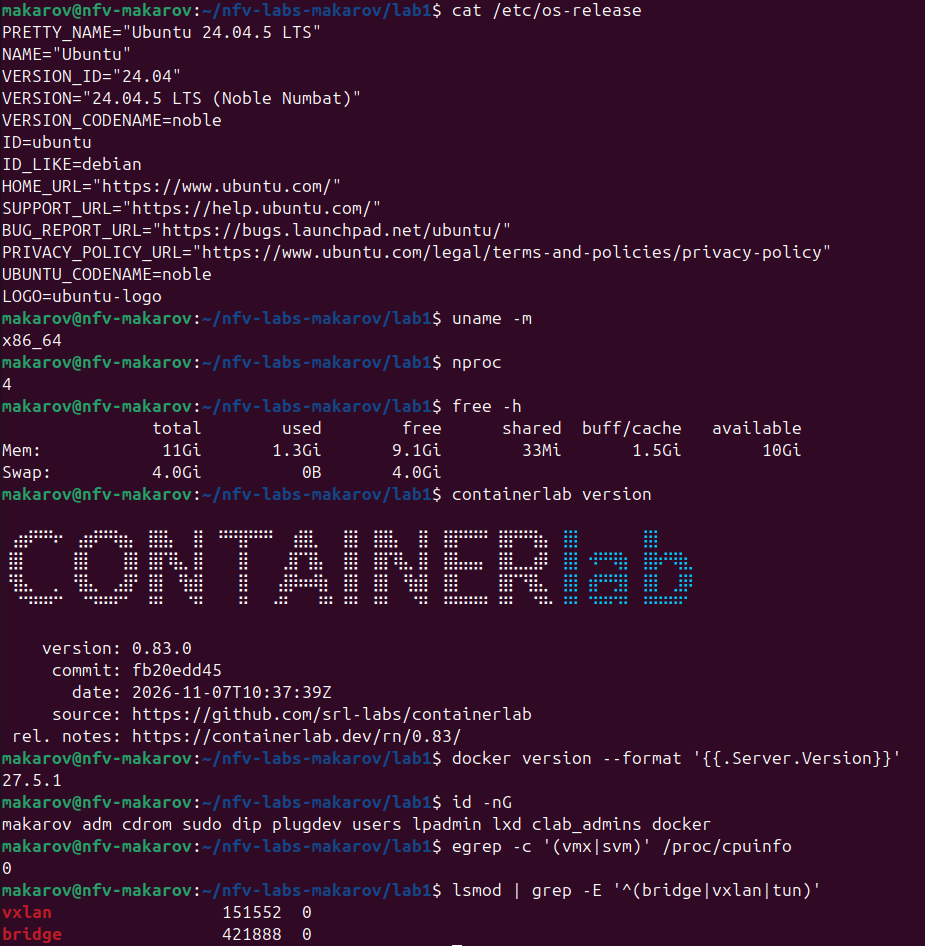

*Рисунок 1 – Характеристики Ubuntu и версии инструментов*

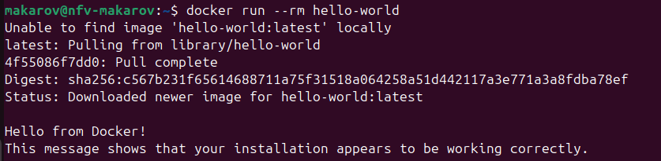

*Рисунок 2 – Успешный запуск тестового контейнера Docker*

В lsmod видны bridge и vxlan. TUN включён в ядро: CONFIG_TUN=y; поэтому он не отображается отдельным загруженным модулем.

## 3 Подготовка образов

В архиве курса присутствовали Dockerfile для sonic-course и lab-tools, но отсутствовал упомянутый в задании build-all.sh. Образы собраны вручную из предоставленных файлов. Для SONiC загружен готовый docker-sonic-vs из официальной сборки 1268989 ветки 202511.

```text
docker build -t lab-tools:1.0 \
  ~/nfv-course/labs/images/lab-tools
docker load -i docker-sonic-vs-202511.gz
docker tag docker-sonic-vs:latest docker-sonic-vs:202511
docker build -t sonic-course:202511 \
  ~/nfv-course/labs/images/sonic-course
```

| Образ | Image ID | Размер |
| --- | --- | --- |
| sonic-course:202511 | acf6e2da5183 | 817 MB |
| lab-tools:1.0 | 7bf59b3d7528 | 62.8 MB |
| docker-sonic-vs:202511 | 516122ceb905 | 817 MB |

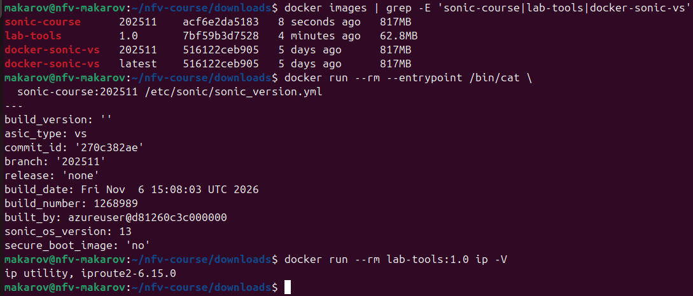

*Рисунок 3 – Курсовые образы и сведения о сборке SONiC*

В sonic_version.yml подтверждены asic_type: vs, branch: 202511, commit_id: 270c382ae и build_number: 1268989. Дата сборки — 06.11.2026. Пустой build_version и release: none являются значениями этой тестовой сборки.

sonic-course добавляет shim-команды sudo и docker для штатного CLI и ссылку rvtysh. lab-tools содержит средства диагностики Linux. Полная компиляция SONiC из исходного кода в этой работе не выполнялась.

## 4 Описание топологии

В lab.env заданы ISU=412999, STUDENT=makarov и N=99. Перед deploy переменные экспортированы в текущую оболочку командой source lab.env. Ниже приведён полный текст lab1.clab.yml.

```text
name: ${STUDENT}-l1

mgmt:
  network: clab-${STUDENT}-l1
  ipv4-subnet: 10.101.${N}.0/24

topology:
  kinds:
    sonic-vs:
      image: sonic-course:202511
    linux:
      image: lab-tools:1.0

  nodes:
    sonic1:
      kind: sonic-vs
    h1:
      kind: linux
      exec:
        - ip addr add 10.${N}.1.1/24 dev eth2
    h2:
      kind: linux
      exec:
        - ip addr add 10.${N}.1.2/24 dev eth2

  links:
    - endpoints: ["h1:eth1", "sonic1:eth1"]
    - endpoints: ["h2:eth1", "sonic1:eth2"]
    - endpoints: ["h1:eth2", "h2:eth2"]
```

containerlab подставляет STUDENT и N при чтении файла. eth0 создаётся как management-интерфейс. Адреса 10.99.1.1/24 и 10.99.1.2/24 назначаются на eth2 хостов командами exec после создания связей.

В YAML нет значений ivanov или N=0: персональные параметры передаются явно.

## 5 Развёртывание и прямой канал

```text
source lab.env
containerlab deploy -t lab1.clab.yml
containerlab inspect -t lab1.clab.yml
```

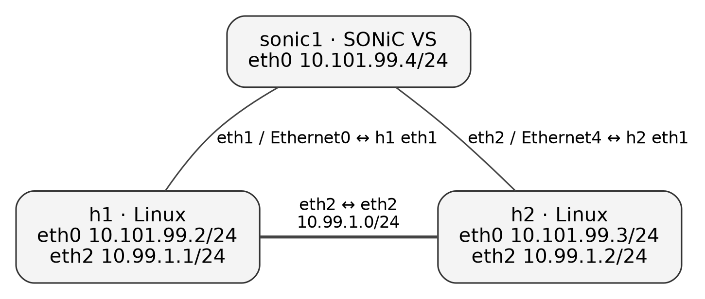

*Рисунок 4 – Три канала данных и адреса management-интерфейсов*

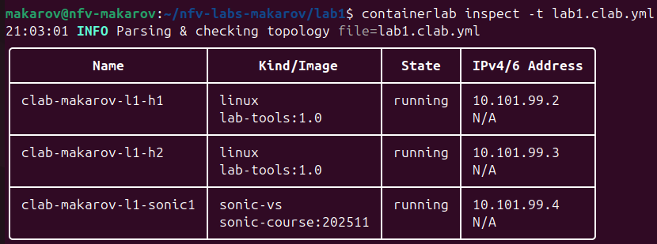

*Рисунок 5 – Все три персональных узла находятся в running*

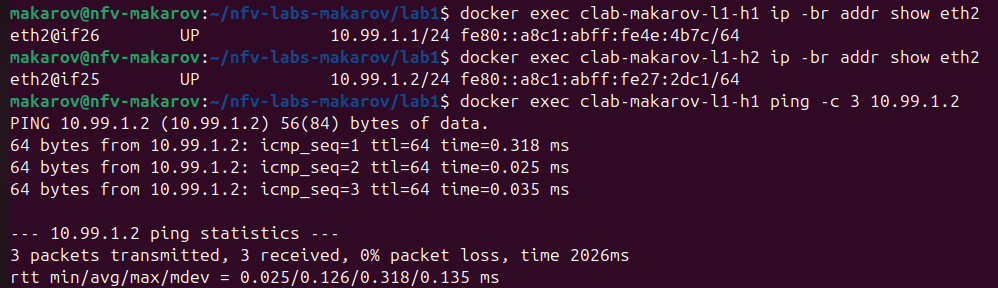

*Рисунок 6 – Адреса eth2 хостов и успешный ping*

Первичная проверка: 3 пакета передано, 3 получено, потери 0%. RTT min/avg/max/mdev = 0.025/0.126/0.318/0.135 ms. ICMP идёт по прямому каналу eth2–eth2; прохождение трафика через SONiC этой проверкой не подтверждается.

## 6 Службы SONiC

В учебном docker-sonic-vs службы объединены в одном контейнере и управляются Supervisor. В обычном SONiC они распределены по функциональным контейнерам.

| Процесс | Состояние в стенде | Контейнер SONiC и назначение |
| --- | --- | --- |
| orchagent | RUNNING | swss; обработка APPL_DB и вызовы SAI |
| portsyncd | RUNNING | swss; инициализация и наблюдение портов |
| syncd | RUNNING | syncd; применение операций через SAI |
| fpmsyncd | RUNNING | bgp; передача маршрутов FRR в APPL_DB |
| zebra | RUNNING | bgp; управление маршрутами FRR |
| bgpd | STOPPED | bgp; протокол BGP |

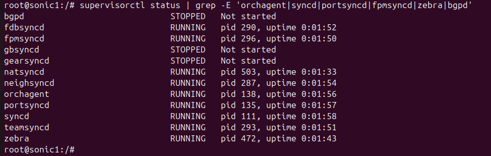

*Рисунок 7 – Состояние процессов в учебном SONiC VS*

bgpd не запущен автоматически: в Supervisor заданы autostart=false и autorestart=false. Поэтому STOPPED объясняется конфигурацией запуска, а не отсутствием BGP-соседей.

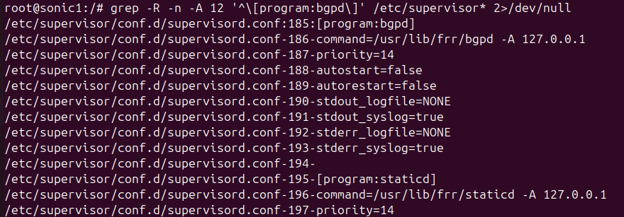

*Рисунок 8 – Отключённый автоматический запуск bgpd*

## 7 Соответствие портов

Порты sonic1 сопоставлены по show interfaces status, show interfaces alias и таблице PORT в CONFIG_DB.

| Порт YAML | Порт SONiC | Lanes | Alias |
| --- | --- | --- | --- |
| sonic1:eth1 | Ethernet0 | 25,26,27,28 | fortyGigE0/0 |
| sonic1:eth2 | Ethernet4 | 29,30,31,32 | fortyGigE0/4 |

В выбранном профиле порт использует четыре lanes, поэтому за Ethernet0 следует Ethernet4, затем Ethernet8. Конкретные lanes и alias задаются конфигурацией профиля.

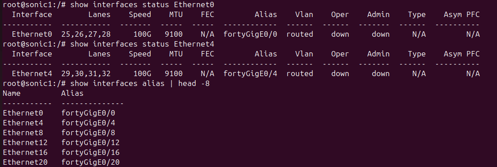

*Рисунок 9 – Начальные состояния портов и их alias*

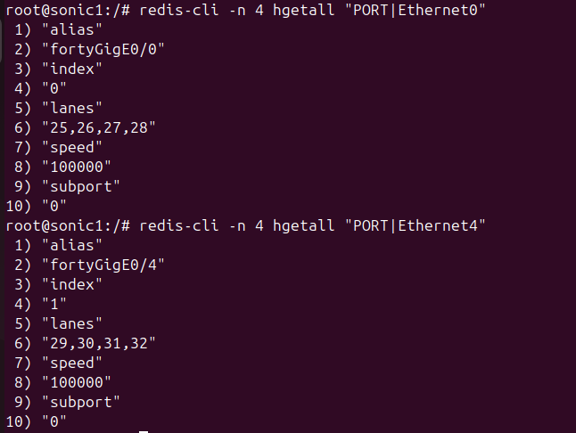

*Рисунок 10 – Параметры Ethernet0 и Ethernet4 в CONFIG_DB*

Исходное состояние портов — down/down; MTU — 9100. Alias является именем порта и не определяет измеренную пропускную способность.

## 8 Состояние Redis до изменения

До включения Ethernet0 поле admin_status в CONFIG_DB отсутствовало: интерактивный redis-cli вернул (nil). В APPL_DB уже присутствовали admin_status=down и oper_status=down. CLI также показывал down/down.

```text
redis-cli -n 4 hget "PORT|Ethernet0" admin_status
redis-cli -n 0 hgetall "PORT_TABLE:Ethernet0"
redis-cli -n 1 --scan \
  --pattern 'ASIC_STATE:SAI_OBJECT_TYPE_PORT:*' | wc -l
show interfaces status Ethernet0
```

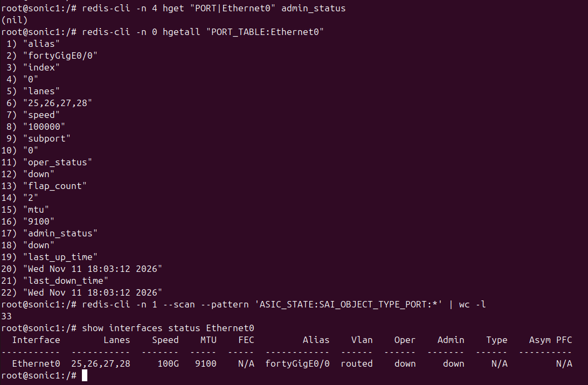

*Рисунок 11 – CONFIG_DB, APPL_DB, ASIC_DB и CLI до startup*

В ASIC_DB найдено 33 ключа типа SAI_OBJECT_TYPE_PORT. Это число объектов портов выбранного профиля VS, а не количество подключённых к SONiC линий YAML. В топологии используются только два data-подключения SONiC.

Отсутствие поля в CONFIG_DB не означает отсутствие порта: параметры alias, index, lanes и speed уже существуют, а прикладная база отражает исходное состояние down.

## 9 Включение Ethernet0

Внутри SONiC выполнена команда sudo config interface startup Ethernet0. После неё в CONFIG_DB появилось admin_status=up. Python SyntaxWarning в config/aaa.py не прервал выполнение: изменение подтверждено базами и CLI.

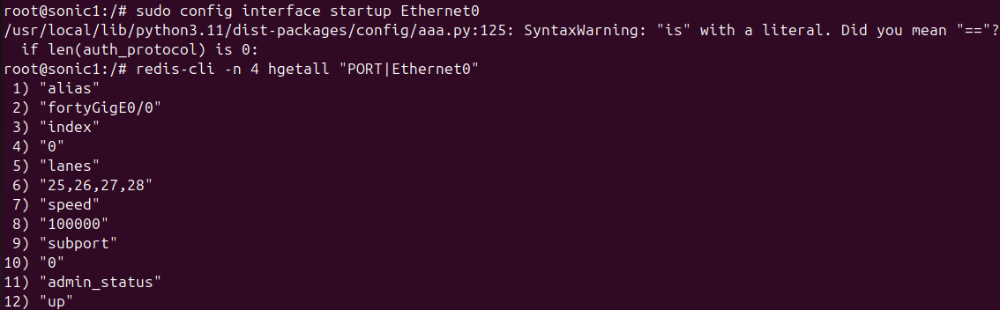

*Рисунок 12 – Команда startup и admin_status=up в CONFIG_DB*

В APPL_DB значения admin_status и oper_status изменились на up; show interfaces status подтвердил Admin up и Oper up. Число портовых SAI-объектов осталось равным 33.

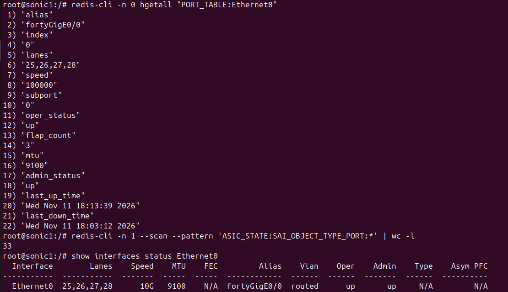

*Рисунок 13 – APPL_DB, число SAI-объектов и CLI после startup*

В показанном выводе Speed после включения равен 10G, а до включения отображалось 100G. Эти значения интерфейса VS не являются результатом измерения скорости передачи данных.

## 10 Интерпретация результатов Redis

| База | Назначение |
| --- | --- |
| CONFIG_DB (4) | Желаемая конфигурация; ключ PORT\|Ethernet0. |
| APPL_DB (0) | Данные приложений, обрабатываемые orchagent; PORT_TABLE:Ethernet0. |
| ASIC_DB (1) | Представление объектов и атрибутов SAI для взаимодействия с syncd. |
| STATE_DB (6) | Операционное состояние и готовность компонентов; используется для проверки зависимостей. |

| Проверка | До startup | После startup |
| --- | --- | --- |
| CONFIG_DB: admin_status | Отсутствует, (nil) | up |
| APPL_DB: admin_status | down | up |
| APPL_DB: oper_status | down | up |
| ASIC_DB: число PORT | 33 | 33 |
| CLI: Admin / Oper | down / down | up / up |

CLI записывает конфигурацию в CONFIG_DB. Для admin_status portmgrd передаёт изменения в APPL_DB; orchagent формирует операции SAI, которые через SAI Redis и ASIC_DB поступают syncd.

portsyncd загружает описание портов и обрабатывает netlink. Другие типы конфигурации обслуживают свои менеджеры; единой службы переноса всех баз нет.

APPL_DB содержит параметры и состояние порта; STATE_DB хранит готовность компонентов. Число 33 не изменилось, но подсчёт ключей не показывает атрибуты SAI. В этом опыте переход в up подтверждён CONFIG_DB, APPL_DB и CLI.

## 11 Жизненный цикл и итоговая проверка

```text
containerlab destroy -t lab1.clab.yml --cleanup
containerlab deploy -t lab1.clab.yml
```

После пересоздания admin_status отсутствует, CLI показывает down/down. Без TTY redis-cli использует raw-вывод: отсутствующее значение отображается пустой строкой.

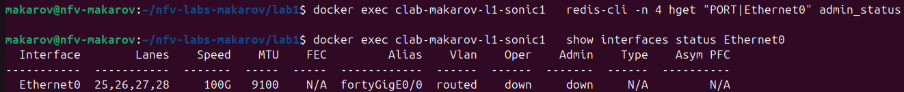

*Рисунок 14 – Отсутствующее поле и down/down после пересоздания*

Изменение удалённого контейнера утрачено. Стартовые настройки нужно хранить снаружи и применять при deploy. Одного config save без внешнего файла или тома недостаточно.

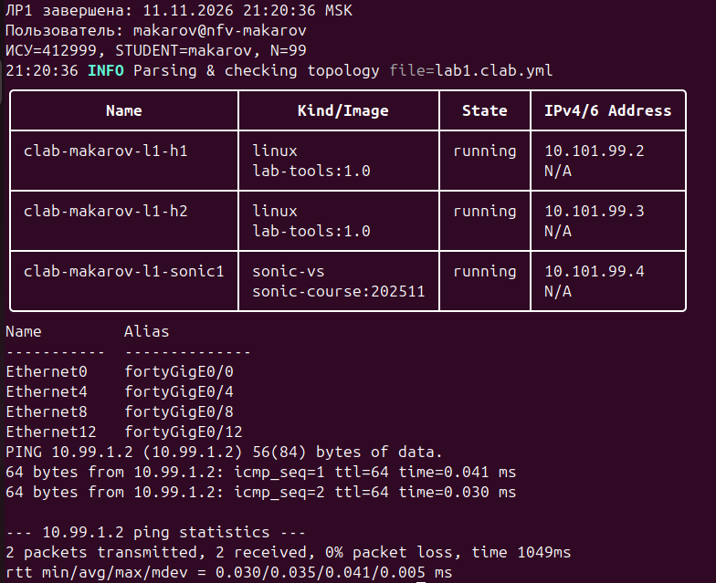

*Рисунок 15 – Итоговая проверка 11.11.2026 в 21:20:36 MSK*

Все узлы running. Финальный ping: 2/2 ответа, 0% потерь; RTT 0.030/0.035/0.041/0.005 ms. На снимке видны персональные параметры, время и соответствие портов.

## ЗАКЛЮЧЕНИЕ И МАТЕРИАЛЫ РАБОТЫ

Подготовлен персональный стенд VMware → Ubuntu → Docker/containerlab. Из YAML развёрнуты SONiC VS и два Linux-хоста. Подтверждена работоспособность прямого канала, изучены службы SONiC, сопоставлены Ethernet0/Ethernet4 и прослежено включение порта через базы Redis.

Эксперимент с destroy/deploy показал различие между текущим состоянием контейнера и внешним описанием сети. YAML восстановил топологию и адреса хостов; несохранённое включение Ethernet0 не пережило пересоздание.

Репозиторий работы: https://github.com/DeltraWard/nfv-labs-makarov. В комплект входят lab1.clab.yml, lab.env, README со схемой и ответами, скриншоты, .gitignore и файлы сборки образов.
