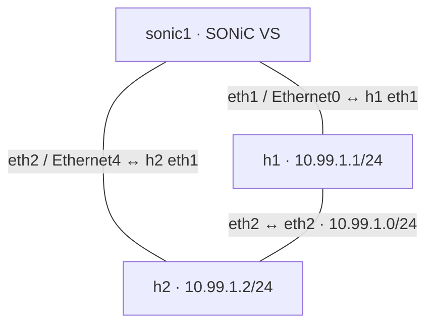
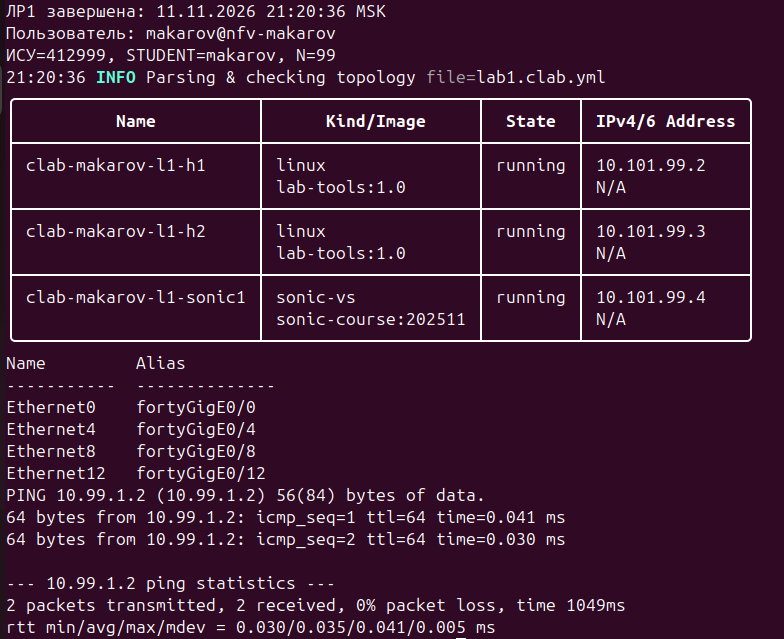

# Лабораторная работа 1

Стенд containerlab и первое знакомство с SONiC.

Макаров Максим Вячеславович, К3420, ИСУ 412999. Выполнено 11.11.2026
на личном ПК в отдельной Ubuntu VM `NFV-Makarov` в VMware Workstation.

## Персональные параметры и окружение

| Параметр | Значение |
| --- | --- |
| STUDENT / N | makarov / 99 |
| Management | 10.101.99.0/24 |
| Прямой канал h1–h2 | 10.99.1.0/24 |
| ОС | Ubuntu 24.04.5 LTS, x86_64 |
| Ресурсы | 4 vCPU, 12 GB RAM; free -h — 11 Gi |
| containerlab / Docker | 0.83.0 / 27.5.1 |
| Образы | sonic-course:202511, lab-tools:1.0 |
| SONiC | ASIC vs, branch 202511, commit 270c382ae, build 1268989 |

## Подготовка

Нужны Linux x86_64, Docker и containerlab; пользователь состоит в `docker`
и `clab_admins`. После добавления в группы нужно заново войти в сеанс.

```bash
sudo modprobe bridge
sudo modprobe vxlan
sudo modprobe tun
lsmod | grep -E '^(bridge|vxlan|tun)'
grep '^CONFIG_TUN=' "/boot/config-$(uname -r)"
```

`CONFIG_TUN=y` означает встроенный TUN, поэтому отдельной строки в lsmod нет.


```bash
bash build-images.sh
```

## Схема



Все eth0 подключены к management-сети containerlab. Фактические адреса inspect:
h1 — 10.101.99.2/24, h2 — 10.101.99.3/24, sonic1 — 10.101.99.4/24.
Линии на схеме — три канала данных из YAML.

## Развёртывание

Из корня репозитория:

```bash
cd lab1
source lab.env
containerlab deploy -t lab1.clab.yml
containerlab inspect -t lab1.clab.yml
```

После deploy 1–2 минуты на запуск служб.

```bash
docker exec clab-makarov-l1-h1 ip -br addr show eth2
docker exec clab-makarov-l1-h2 ip -br addr show eth2
docker exec clab-makarov-l1-h1 ping -c 3 10.99.1.2
docker exec -it clab-makarov-l1-sonic1 bash
```

Внутри SONiC:

```bash
cat /etc/sonic/sonic_version.yml
supervisorctl status
show interfaces status Ethernet0
show interfaces status Ethernet4
show interfaces alias
redis-cli -n 4 hgetall 'PORT|Ethernet0'
redis-cli -n 4 hgetall 'PORT|Ethernet4'
```

| Интерфейс SONiC в YAML | Порт SONiC | Lanes | Alias |
| --- | --- | --- | --- |
| eth1 | Ethernet0 | 25,26,27,28 | fortyGigE0/0 |
| eth2 | Ethernet4 | 29,30,31,32 | fortyGigE0/4 |

## Эксперимент Redis

Команды внутри SONiC:

```bash
redis-cli -n 4 hget 'PORT|Ethernet0' admin_status
redis-cli -n 0 hgetall 'PORT_TABLE:Ethernet0'
redis-cli -n 1 --scan --pattern 'ASIC_STATE:SAI_OBJECT_TYPE_PORT:*' | wc -l
show interfaces status Ethernet0
sudo config interface startup Ethernet0
redis-cli -n 4 hgetall 'PORT|Ethernet0'
redis-cli -n 0 hgetall 'PORT_TABLE:Ethernet0'
redis-cli -n 1 --scan --pattern 'ASIC_STATE:SAI_OBJECT_TYPE_PORT:*' | wc -l
show interfaces status Ethernet0
```

| Наблюдение | До | После startup |
| --- | --- | --- |
| CONFIG_DB admin_status | поле отсутствует, (nil) | up |
| APPL_DB admin_status / oper_status | down / down | up / up |
| Число SAI_OBJECT_TYPE_PORT | 33 | 33 |
| CLI Admin / Oper | down / down | up / up |

SyntaxWarning в config/aaa.py:125 не прервал команду: изменение подтверждено
базами и CLI. На снимках Speed изменился со 100G на 10G; это не измерение
пропускной способности.

## Пересоздание

```bash
source lab.env
containerlab destroy -t lab1.clab.yml --cleanup
containerlab deploy -t lab1.clab.yml
```

Через 1–2 минуты:

```bash
docker exec clab-makarov-l1-sonic1 redis-cli --no-raw -n 4 hget 'PORT|Ethernet0' admin_status
docker exec clab-makarov-l1-sonic1 show interfaces status Ethernet0
docker exec clab-makarov-l1-h1 ping -c 2 10.99.1.2
```

Исходный снимок сделан без --no-raw и без TTY: отсутствующее значение вывелось
пустой строкой. --no-raw в примере позволяет явно увидеть (nil).

## Ответы

**Почему SONiC VS не требует vmx/svm, а CHR в ЛР5 требует?**
Контейнер использует ядро Linux VM. CHR в варианте QEMU/KVM запускается как
гостевая машина; KVM внутри VMware требует вложенной аппаратной виртуализации.
Для этой ЛР vmx/svm=0 не препятствует запуску контейнеров.

**Где находятся службы настоящего SONiC?**
swss: orchagent, portsyncd; syncd: syncd; bgp: fpmsyncd, zebra, bgpd.
В учебном VS они объединены под Supervisor. bgpd STOPPED объясняется
autostart=false в /etc/supervisor/conf.d/supervisord.conf;
также задано autorestart=false. Отсутствие BGP-соседей само по себе
не объясняет состояние STOPPED.

**Почему Ethernet0, затем Ethernet4?**
Профиль использует группы по четыре lanes. Номер следующей группы увеличен на 4.
Фактические lanes и alias определяются профилем и указаны в таблице.

**Чем различаются базы и кто переносит данные?**
CONFIG_DB (4) — желаемая конфигурация; APPL_DB (0) — данные для orchagent;
ASIC_DB (1) — объекты и атрибуты SAI; STATE_DB (6) — операционное состояние
и готовность. Для admin_status типовая цепочка: CLI → CONFIG_DB → portmgrd →
APPL_DB → orchagent / SAI Redis → ASIC_DB → syncd / SAI. portsyncd участвует
в загрузке портов и обработке netlink. Единой службы копирования всех баз нет.
33 — число портовых объектов профиля, а не число связей YAML.

**Сохранилось ли up после destroy/deploy?**
Нет: поле отсутствует, CLI down/down. Изменения удалённого контейнера утрачены.
Для воспроизводимости YAML, переменные и стартовые настройки хранят вне контейнера
и применяют при deploy. Одного config save в удаляемом контейнере недостаточно
без внешнего сохранённого файла/тома.

## Результаты

Первый ping: 3/3 ответа, 0% потерь; RTT 0.025/0.126/0.318/0.135 ms.
После пересоздания: 2/2 ответа, 0% потерь; RTT 0.030/0.035/0.041/0.005 ms.
Канал eth2–eth2 прямой: этот ping не доказывает пересылку через SONiC.



Репозиторий: [DeltraWard/nfv-labs-makarov](https://github.com/DeltraWard/nfv-labs-makarov).
