# Лабораторная работа 2

Макаров Максим Вячеславович, К3420, ИСУ 412999.

## ВВЕДЕНИЕ

В работе настроены два маршрутизатора SONiC для связи между двумя локальными сетями. Сначала использовались статические маршруты, затем был настроен eBGP между AS 65099 и AS 65199.

Маршрут проверен в FRR, APPL_DB, ASIC_DB и таблице ядра Linux. Настройки вынесены в файлы. После пересоздания контейнеров сеть восстановлена скриптом.

## 1 Персональные параметры и окружение

| Параметр | Значение |
| --- | --- |
| ФИО | Макаров Максим Вячеславович |
| Группа и номер ИСУ | К3420; 412999 |
| STUDENT и N | makarov; 99 |
| Management-сеть | 10.102.99.0/24 |
| LAN r1 и LAN r2 | 10.99.1.0/24; 10.99.2.0/24 |
| Канал r1–r2 | 10.99.0.0/31 |
| Loopback r1 и r2 | 10.99.255.1/32; 10.99.255.2/32 |
| AS r1 и r2 | 65099 = 65000 + 99; 65199 = 65100 + 99 |
| Время выполнения | 11–12 ноября 2026 года |

Работа выполнена в виртуальной машине NFV-Makarov в VMware Workstation. Использовалось окружение, подготовленное в ЛР1. Перед запуском новой топологии стенд ЛР1 был удалён командой containerlab destroy с параметром --cleanup.

| Компонент | Характеристика |
| --- | --- |
| Ubuntu | 24.04.5 LTS, x86_64; хост nfv-makarov |
| Ресурсы VM | 4 vCPU, 12 GB RAM |
| Пользователь | makarov; группы docker и clab_admins |
| containerlab и Docker Engine | 0.83.0 и 27.5.1 |
| Образы | sonic-course:202511; lab-tools:1.0 |
| SONiC VS | Ветка 202511; commit 270c382ae; build 1268989 |

В этой лабораторной SONiC работает как программный маршрутизатор. Учебный VS позволяет проверить настройку сетевой ОС и её взаимодействие с SAI без физического коммутатора.

## 2 Схема сети и адресный план

Хост pc1 подключён к Ethernet0 маршрутизатора r1, а pc2 — к Ethernet0 маршрутизатора r2. Между маршрутизаторами задействованы порты Ethernet4. Прямого канала между компьютерами в этой топологии нет.

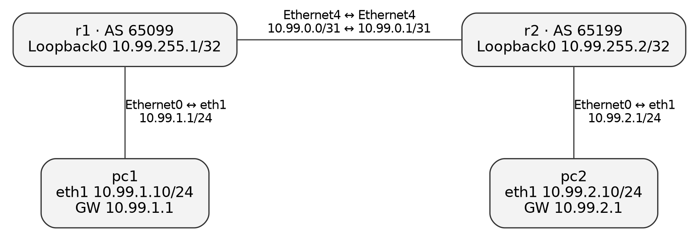

*Рисунок 1 – Топология с адресами и номерами автономных систем*

| Узел | Интерфейс | IPv4-адрес |
| --- | --- | --- |
| pc1 | eth1 | 10.99.1.10/24; шлюз 10.99.1.1 |
| r1 | Ethernet0 | 10.99.1.1/24 |
| r1 | Ethernet4 | 10.99.0.0/31 |
| r1 | Loopback0 | 10.99.255.1/32 |
| r2 | Ethernet0 | 10.99.2.1/24 |
| r2 | Ethernet4 | 10.99.0.1/31 |
| r2 | Loopback0 | 10.99.255.2/32 |
| pc2 | eth1 | 10.99.2.10/24; шлюз 10.99.2.1 |

На канале /31 используются оба адреса: 10.99.0.0 и 10.99.0.1. Management-интерфейсы eth0 относятся к общей сети 10.102.99.0/24; адреса в ней containerlab назначает автоматически.

## 3 Описание топологии в YAML

В каталоге lab2 создан файл lab.env с персональными переменными. Узлы и связи описаны в lab2.clab.yml. Команды exec назначают адреса хостам и задают им шлюзы через SONiC.

```text
name: ${STUDENT}-l2

mgmt:
  network: clab-${STUDENT}-l2
  ipv4-subnet: 10.102.${N}.0/24

topology:
  kinds:
    sonic-vs:
      image: sonic-course:202511
    linux:
      image: lab-tools:1.0

  nodes:
    r1:
      kind: sonic-vs
    r2:
      kind: sonic-vs
    pc1:
      kind: linux
      exec:
        - ip addr add 10.${N}.1.10/24 dev eth1
        - ip route replace default via 10.${N}.1.1 dev eth1
    pc2:
      kind: linux
      exec:
        - ip addr add 10.${N}.2.10/24 dev eth1
        - ip route replace default via 10.${N}.2.1 dev eth1

  links:
    - endpoints: ["pc1:eth1", "r1:eth1"]
    - endpoints: ["r1:eth2", "r2:eth2"]
    - endpoints: ["pc2:eth1", "r2:eth1"]
```

Перед deploy выполнена команда source lab.env. Значения STUDENT=makarov и N=99 используются в имени лаборатории, management-подсети и адресах хостов. AS1 и AS2 вычисляются из N и подставляются в конфигурацию BGP.

## 4 Развёртывание и проверка каналов

```text
source lab.env
containerlab deploy -t lab2.clab.yml
containerlab inspect -t lab2.clab.yml
```

После инициализации SONiC на обоих маршрутизаторах включены Ethernet0 и Ethernet4 и назначены адреса из таблицы. Затем проверена доступность шлюзов хостов и канала между r1 и r2.

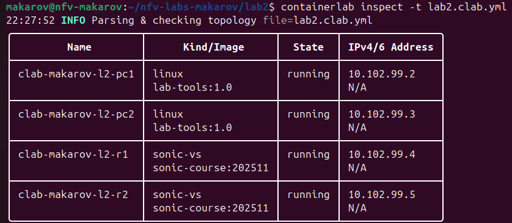

*Рисунок 2 – Первый запуск четырёх узлов лаборатории*

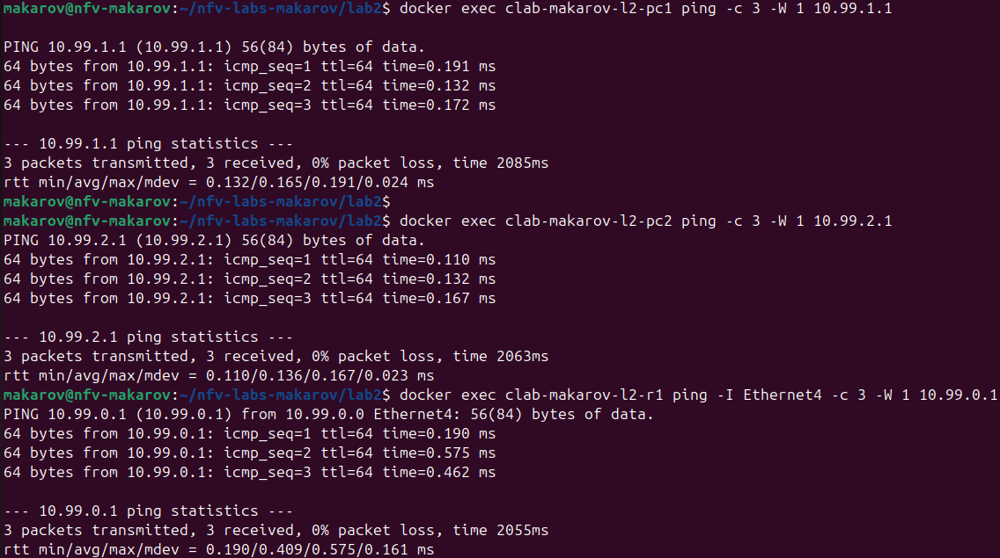

*Рисунок 3 – Проверка локальных шлюзов и канала r1–r2*

Во всех трёх проверках получены ответы на 3 из 3 пакетов. Прямой ping с r1 выполнялся с исходящего интерфейса Ethernet4, поэтому проверял именно канал 10.99.0.0/31.

## 5 Связность до настройки маршрутов

До добавления маршрутов ping с pc1 на 10.99.0.1 и на pc2 завершился со 100% потерь. При этом локальные шлюзы и прямое соединение r1–r2 уже работали.

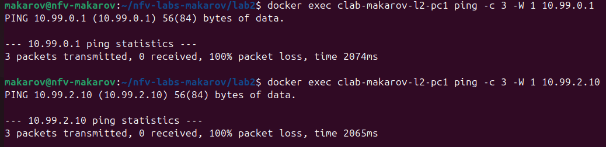

*Рисунок 4 – Неуспешные проверки до настройки маршрутизации*

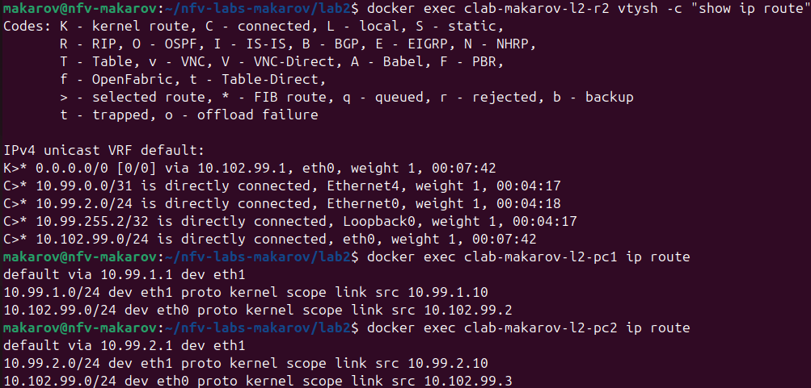

*Рисунок 5 – Исходная таблица r2 и шлюзы компьютеров*

На r2 были подключённые сети 10.99.0.0/31, 10.99.2.0/24, 10.99.255.2/32 и management-сеть. Маршрута к 10.99.1.0/24 не было, поэтому r2 не мог вернуть ответ pc1 по рабочему каналу.

Проверка показала, что до настройки маршрутов с pc1 недоступен и адрес r2 на транзитном канале. Для обмена между LAN требовалось настроить маршруты в обе стороны.

## 6 Настройка статических маршрутов

На r1 выполнена штатная команда config route add prefix 10.99.2.0/24 nexthop 10.99.0.1. В CONFIG_DB появился ключ STATIC_ROUTE|default|10.99.2.0/24, но FRR ответил Network not in table.

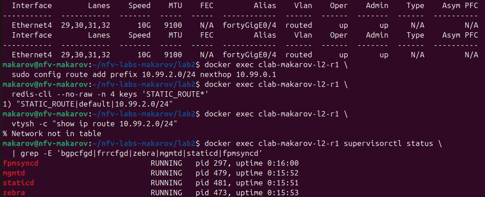

*Рисунок 6 – Запись в CONFIG_DB без установленного маршрута FRR*

zebra, mgmtd и staticd работали, а bgpcfgd/frrcfgd в списке служб отсутствовали. В полном SONiC STATIC_ROUTE обрабатывает bgpcfgd или frrcfgd в зависимости от режима. В учебном VS набор служб сокращён. Экспериментальная запись была удалена, а статические маршруты настроены через vtysh.

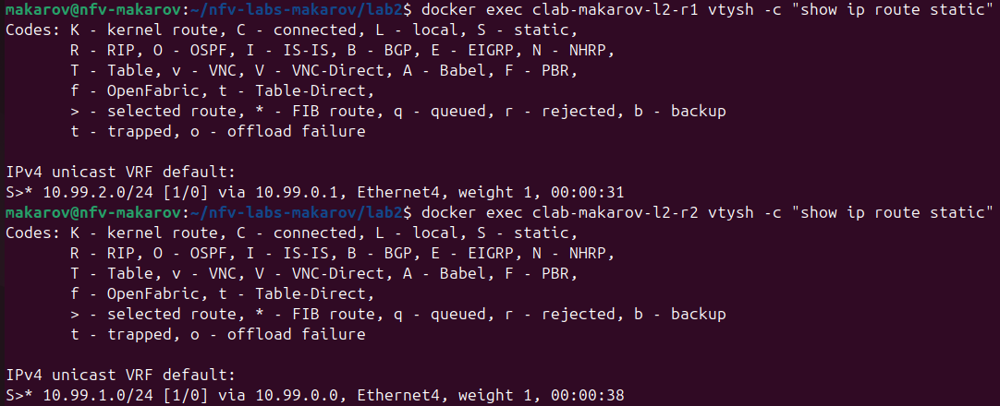

*Рисунок 7 – Установленные статические маршруты на r1 и r2*

На r1 добавлен маршрут 10.99.2.0/24 через 10.99.0.1, на r2 — 10.99.1.0/24 через 10.99.0.0. Оба маршрута получили отметку S&gt;\* и использовали Ethernet4.

## 7 Проверка статической маршрутизации

После настройки обратного маршрута повторены проверки ping между компьютерами и с pc1 на адрес 10.99.0.1. Все проверки завершились без потерь.

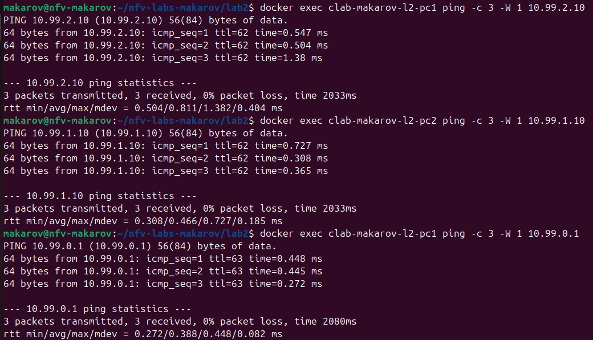

*Рисунок 8 – Связность после добавления статических маршрутов*

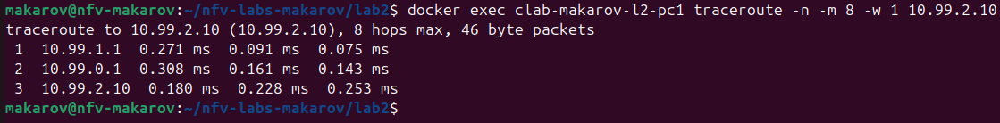

*Рисунок 9 – Трассировка pc1–pc2 при статической маршрутизации*

| Проверка | Пакеты | RTT min/avg/max/mdev, ms |
| --- | --- | --- |
| pc1 → pc2 | 3/3; потери 0% | 0.504 / 0.811 / 1.382 / 0.404 |
| pc2 → pc1 | 3/3; потери 0% | 0.308 / 0.466 / 0.727 / 0.185 |
| pc1 → r2 Ethernet4 | 3/3; потери 0% | 0.272 / 0.388 / 0.448 / 0.082 |

Трассировка показала три узла: шлюз 10.99.1.1, второй маршрутизатор 10.99.0.1 и компьютер назначения 10.99.2.10. Это подтвердило прохождение трафика через оба SONiC.

## 8 Маршрут в FRR и базах SONiC

Маршрут 10.99.2.0/24 проверен на r1. В FRR, APPL_DB и таблице Linux следующим узлом указан 10.99.0.1 через Ethernet4. В ASIC_DB найден объект SAI с dest 10.99.2.0/24.

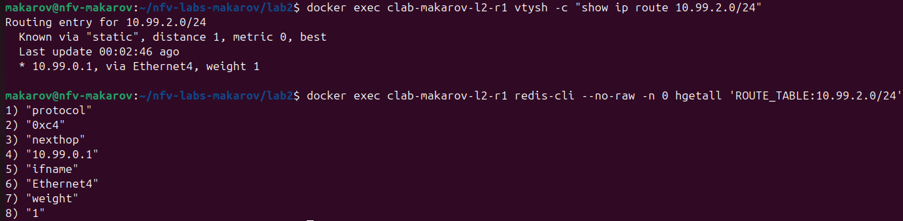

*Рисунок 10 – Маршрут в FRR и APPL_DB*

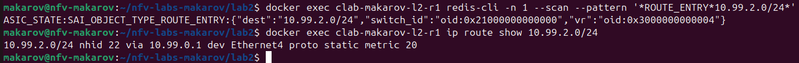

*Рисунок 11 – Объект маршрута в ASIC_DB и запись Linux*

| Уровень | Полученные данные |
| --- | --- |
| FRR | static; distance 1; metric 0; next-hop 10.99.0.1 |
| APPL_DB (0) | ROUTE_TABLE:10.99.2.0/24; protocol 0xc4; ifname Ethernet4; weight 1 |
| ASIC_DB (1) | SAI_OBJECT_TYPE_ROUTE_ENTRY с dest 10.99.2.0/24 |
| Linux FIB | nhid 22; via 10.99.0.1; dev Ethernet4; proto static; metric 20 |

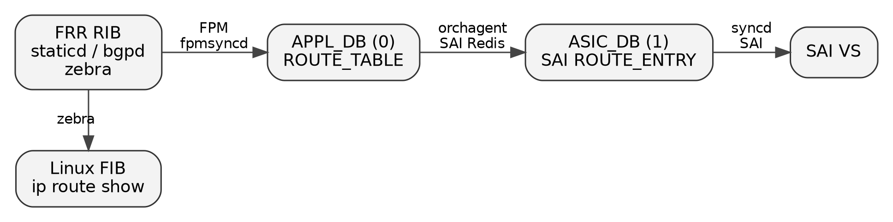

*Рисунок 12 – Передача маршрута между компонентами SONiC*

zebra управляет таблицей ядра и передаёт маршруты через FPM. fpmsyncd записывает их в APPL_DB, orchagent формирует операции SAI через ASIC_DB, а syncd применяет их к реализации SAI.

## 9 Настройка eBGP

Перед настройкой eBGP оба статических маршрута удалены, служба bgpd запущена. Соседство настроено между AS 65099 и AS 65199 по каналу 10.99.0.0/31. В качестве router-id заданы адреса Loopback0. Каждый маршрутизатор объявляет свою LAN и loopback через network.

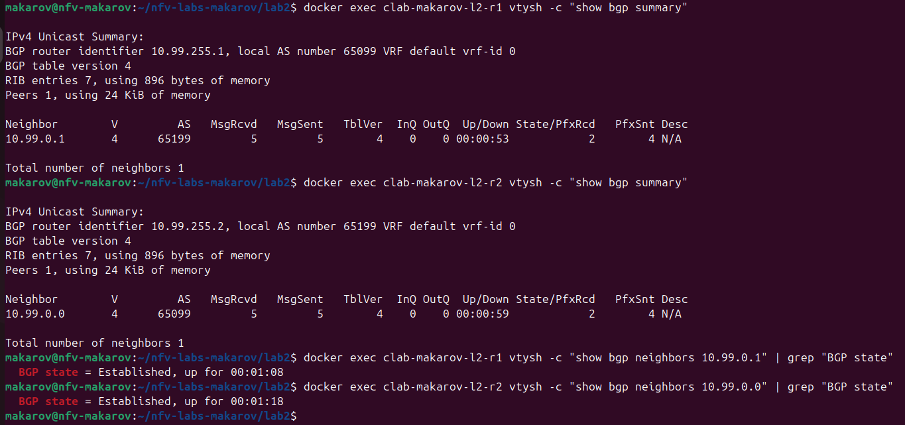

*Рисунок 13 – Сессии eBGP установлены на обоих маршрутизаторах*

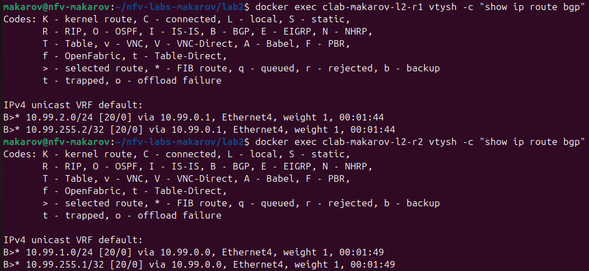

*Рисунок 14 – Маршруты, полученные по eBGP*

Обе сессии перешли в Established, каждый маршрутизатор принял два префикса. На r1 появились B&gt;\* 10.99.2.0/24 и 10.99.255.2/32 через 10.99.0.1; на r2 — обратные сети через 10.99.0.0. Дистанция маршрутов eBGP составила 20.

## 10 Проверка eBGP и выбор анонсов

После перехода на BGP проверена связь между компьютерами в обе стороны и доступность Loopback0 второго маршрутизатора. Все три проверки дали 3 ответа из 3, потери составили 0%.

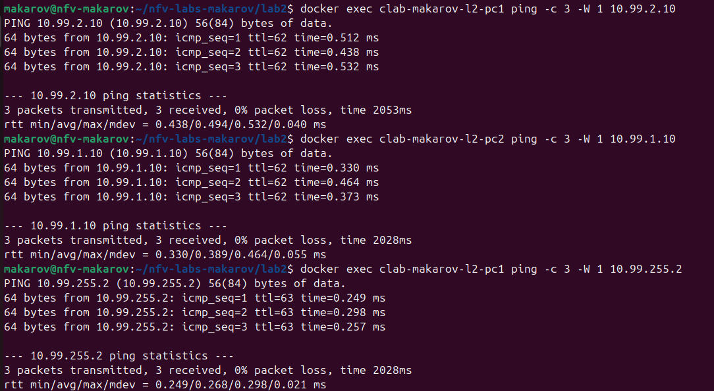

*Рисунок 15 – Проверка LAN и удалённого loopback по маршрутам BGP*

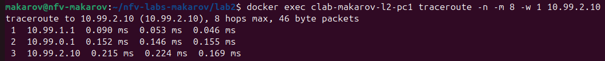

*Рисунок 16 – Трассировка после перехода на eBGP*

В конфигурации задано no bgp ebgp-requires-policy. При включённом требовании политик FRR блокирует приём или отправку eBGP-маршрутов без соответствующих фильтров. В профиле traditional требование включено по умолчанию, в datacenter выключено.

Через network выбраны только LAN и Loopback. В выводе connected также были 10.99.0.0/31 и 10.102.99.0/24: при redistribute connected эти сети могли бы попасть в анонсы. Явный список network задаёт нужный состав объявлений.

## 11 Конфигурация в файлах

Настройки интерфейсов и служб сохранены в configs/r1.sh и configs/r2.sh, параметры BGP — в r1-frr.conf и r2-frr.conf. Для N и AS используются переменные. Полные тексты приведены в приложениях.

В apply.sh предусмотрено ожидание CONFIG_DB и портов Ethernet0/Ethernet4 с ограничением в пять минут на маршрутизатор. Скрипт подставляет переменные через envsubst, выполняет настройки внутри контейнеров и загружает FRR-фрагменты командой vtysh -f.

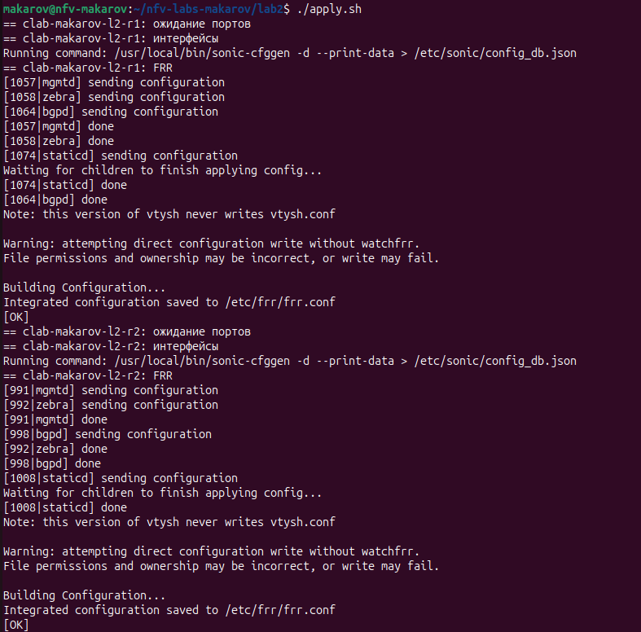

*Рисунок 17 – Первое применение файлов к работающему стенду*

Первый запуск скрипта выполнен на уже настроенной сети. Существующие адреса повторно не добавлялись, BGP оставался установленным. Ограничение списка переменных envsubst сохранило рабочие переменные самих shell-скриптов.

## 12 Повторное развёртывание

Для проверки воспроизводимости лаборатория удалена с параметром --cleanup и развёрнута заново. containerlab создал четыре контейнера и три связи, а команды exec восстановили адреса и шлюзы компьютеров.

```text
source lab.env
containerlab destroy -t lab2.clab.yml --cleanup
containerlab deploy -t lab2.clab.yml
./apply.sh
```

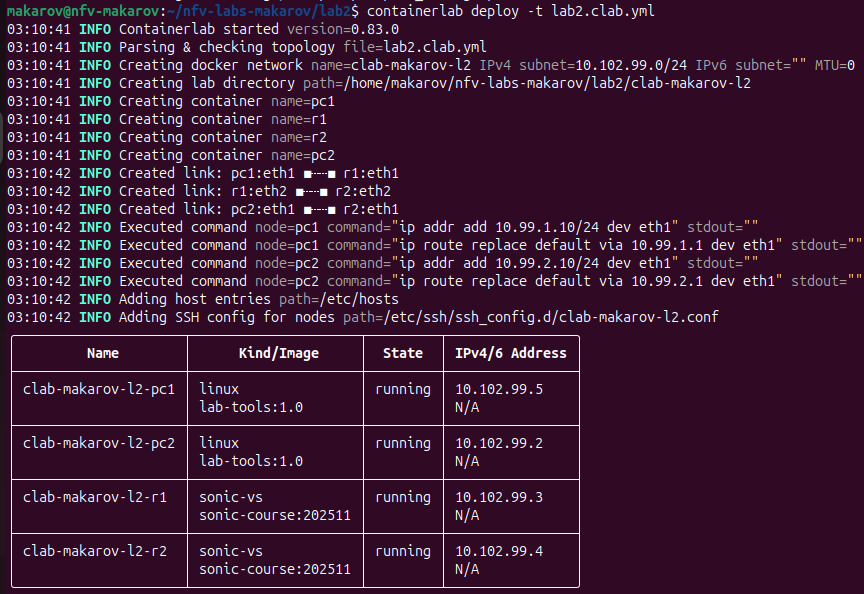

*Рисунок 18 – Новый запуск контейнеров 12 ноября в 03:10:41*

| Узел | eth0 при первом запуске | eth0 после пересоздания |
| --- | --- | --- |
| pc1 | 10.102.99.2 | 10.102.99.5 |
| pc2 | 10.102.99.3 | 10.102.99.2 |
| r1 | 10.102.99.4 | 10.102.99.3 |
| r2 | 10.102.99.5 | 10.102.99.4 |

Management-адреса изменились, поскольку в YAML задана подсеть без закрепления адресов eth0 за узлами. Рабочие адреса 10.99.x.x восстанавливаются из файлов и от этого распределения не зависят.

## 13 Применение настроек после deploy

После пересоздания контейнеров запущен скрипт apply.sh. Он запустил zebra, mgmtd, staticd и bgpd, настроил интерфейсы и сохранил конфигурацию FRR в /etc/frr/frr.conf.

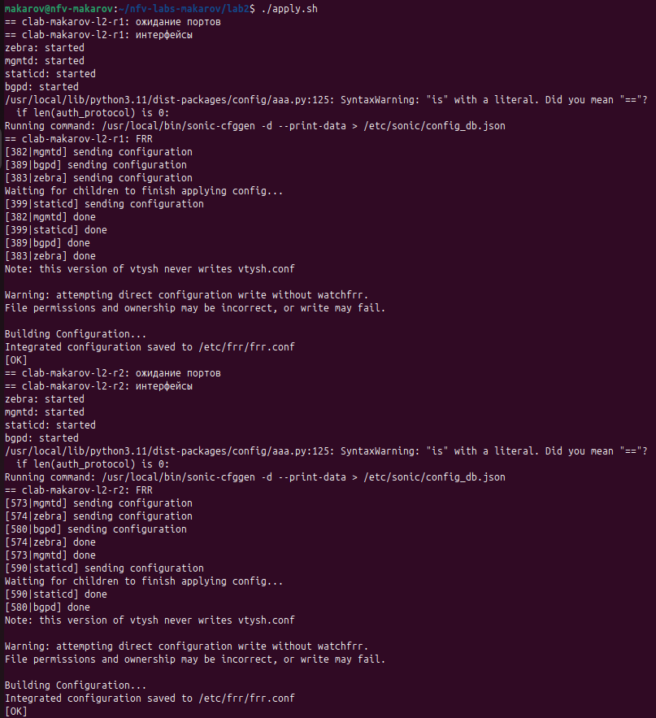

*Рисунок 19 – Применение интерфейсных настроек и FRR на новых узлах*

vtysh вывел предупреждение о прямой записи без watchfrr. Запись завершилась сообщением Integrated configuration saved и статусом [OK]. Последующая проверка BGP и передачи пакетов подтвердила применение настроек. Сообщение о vtysh.conf относится к отдельному файлу параметров оболочки.

## 14 Проверка восстановленного стенда

После пересоздания оба узла приняли по два префикса BGP. Проверены маршруты и доступность pc2 и Loopback0 r2.

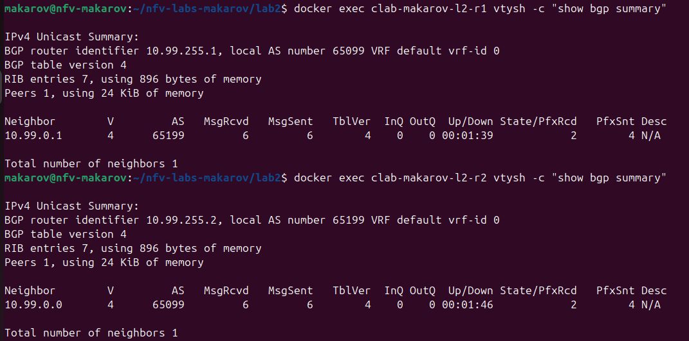

*Рисунок 20 – BGP после нового deploy и запуска apply*

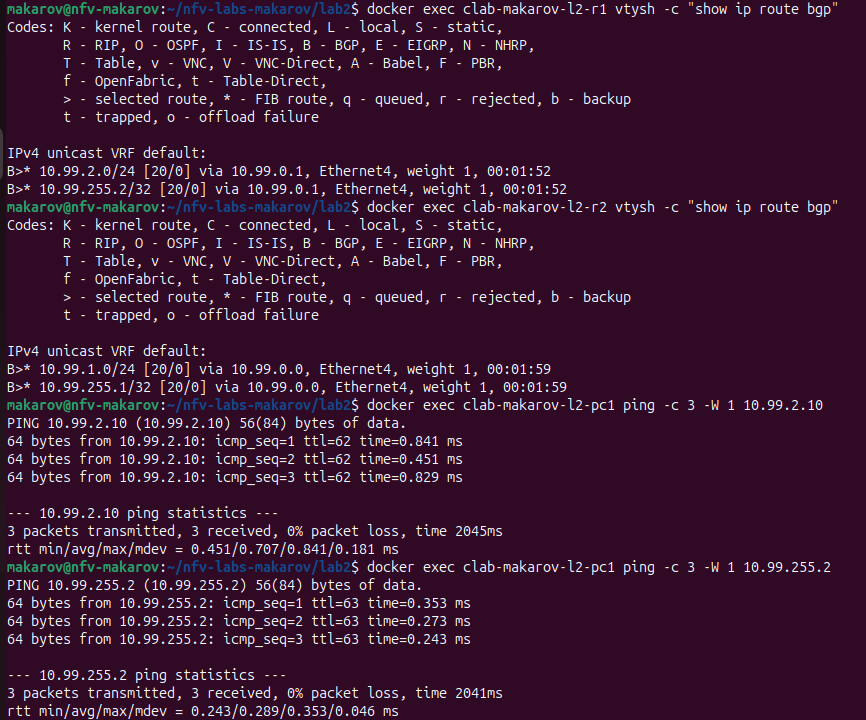

*Рисунок 21 – Восстановленные маршруты и успешная передача пакетов*

В обеих проверках получено 3 ответа из 3, потери 0%. Средний RTT до pc2 составил 0.707 ms, до Loopback0 r2 — 0.289 ms.

## 15 Финальный артефакт

Финальная проверка выполнена 12.11.2026 в 03:14:21 MSK. В одном выводе собраны персональные параметры, адреса r1, состояние BGP, таблица маршрутизации и трассировка.

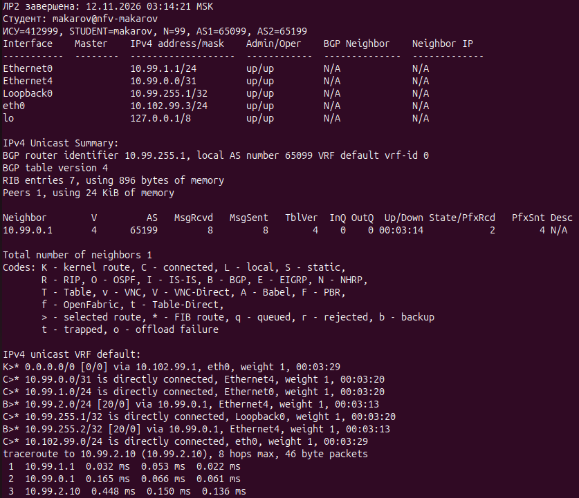

*Рисунок 22 – Итоговая проверка после восстановления сети*

| Проверка | Результат |
| --- | --- |
| Адреса r1 | 10.99.1.1/24; 10.99.0.0/31; 10.99.255.1/32 |
| BGP | AS 65099; сосед 10.99.0.1 AS 65199; принято 2 префикса |
| Удалённые сети | B&gt;\* 10.99.2.0/24 и 10.99.255.2/32 |
| Трассировка | 10.99.1.1 → 10.99.0.1 → 10.99.2.10 |

В общей таблице также сохранился K&gt;\* 0.0.0.0/0 через 10.102.99.1 dev eth0. Он создан для управления контейнером. При отсутствии рабочего маршрута трафик может уйти в management-сеть; в production её изолируют отдельным management VRF.

## ЗАКЛЮЧЕНИЕ

В ходе работы настроена маршрутизация между двумя LAN на SONiC. Статические маршруты обеспечили связь в обе стороны. После перехода на eBGP в таблицах появились удалённые LAN и loopback с отметкой B&gt;\*. Трассировка подтвердила прохождение пакетов через r1 и r2.

Конфигурация CONFIG_DB сопоставлена с состоянием FRR. Маршрут проверен в APPL_DB, ASIC_DB и ядре Linux. Эксперимент показал, что запись STATIC_ROUTE сама по себе не установила маршрут в учебном VS: для этого потребовалась настройка FRR.

Настройки сохранены в шаблонах и скрипте apply.sh. После удаления контейнеров адреса и BGP были восстановлены из файлов. Финальные ping прошли без потерь. Изменение автоматически назначенных management-адресов не повлияло на рабочие каналы.

Шаблоны содержат необходимые параметры и упрощают сравнение изменений в Git. Один config_db.json не сохраняет BGP, настроенный через vtysh. Команда config load подходит для загрузки подготовленной конфигурации CONFIG_DB на совместимое устройство. Настройки FRR хранятся отдельно.

Репозиторий лабораторных работ: https://github.com/DeltraWard/nfv-labs-makarov

## ПРИЛОЖЕНИЕ А СКРИПТ ПРИМЕНЕНИЯ КОНФИГУРАЦИИ

Файл lab2/apply.sh.

```text
#!/usr/bin/env bash
set -euo pipefail

cd -- "$(dirname -- "${BASH_SOURCE[0]}")"
: "${STUDENT:?Выполни source lab.env}" "${N:?Выполни source lab.env}"
export N AS1=$((65000 + N)) AS2=$((65100 + N))
command -v envsubst >/dev/null

for router in r1 r2; do
  test -s "configs/${router}.sh"
  test -s "configs/${router}-frr.conf"
done

for router in r1 r2; do
  router_container="clab-${STUDENT}-l2-${router}"
  echo "== ${router_container}: ожидание портов"
  ready=0

  for attempt in {1..60}; do
    if docker exec "$router_container" bash -c 'test "$(redis-cli -n 4 exists "PORT|Ethernet0")" = 1 && ip link show Ethernet0 >/dev/null 2>&1 && ip link show Ethernet4 >/dev/null 2>&1' >/dev/null 2>&1; then
      ready=1
      break
    fi
    sleep 5
  done

  if [ "$ready" = 0 ]; then
    echo "Ошибка: ${router_container} не подготовил порты за 5 минут" >&2
    exit 1
  fi

  echo "== ${router_container}: интерфейсы"
  envsubst '${N}' < "configs/${router}.sh" | docker exec -i "$router_container" bash -se

  echo "== ${router_container}: FRR"
  envsubst '${N} ${AS1} ${AS2}' < "configs/${router}-frr.conf" | docker exec -i "$router_container" bash -ec 'cat > /tmp/lab2-frr.conf; vtysh -f /tmp/lab2-frr.conf; vtysh -c "write memory"'
done

echo "Конфигурация применена. Подожди 20–30 секунд для установления BGP."
```

## ПРИЛОЖЕНИЕ Б КОНФИГУРАЦИЯ R1

Файл lab2/configs/r1.sh.

```text
#!/usr/bin/env bash
set -euo pipefail

for service in zebra mgmtd staticd bgpd; do
  if ! supervisorctl status "$service" | grep -q RUNNING; then
    supervisorctl start "$service"
  fi
done

sudo config interface startup Ethernet0
sudo config interface startup Ethernet4

if [ "$(redis-cli -n 4 exists 'LOOPBACK_INTERFACE|Loopback0')" = 0 ]; then
  sudo config loopback add Loopback0
fi

if [ "$(redis-cli -n 4 exists "INTERFACE|Ethernet0|10.${N}.1.1/24")" = 0 ]; then
  sudo config interface ip add Ethernet0 10.${N}.1.1/24
fi

if [ "$(redis-cli -n 4 exists "INTERFACE|Ethernet4|10.${N}.0.0/31")" = 0 ]; then
  sudo config interface ip add Ethernet4 10.${N}.0.0/31
fi

if [ "$(redis-cli -n 4 exists "LOOPBACK_INTERFACE|Loopback0|10.${N}.255.1/32")" = 0 ]; then
  sudo config interface ip add Loopback0 10.${N}.255.1/32
fi

sudo config save -y
```

### Конфигурация FRR

Файл lab2/configs/r1-frr.conf.

```text
router bgp ${AS1}
 bgp router-id 10.${N}.255.1
 no bgp ebgp-requires-policy
 neighbor 10.${N}.0.1 remote-as ${AS2}
 address-family ipv4 unicast
  neighbor 10.${N}.0.1 activate
  network 10.${N}.1.0/24
  network 10.${N}.255.1/32
 exit-address-family
exit
```

Значения переменных: N=99, AS1=65099, AS2=65199.

## ПРИЛОЖЕНИЕ В КОНФИГУРАЦИЯ R2

Файл lab2/configs/r2.sh.

```text
#!/usr/bin/env bash
set -euo pipefail

for service in zebra mgmtd staticd bgpd; do
  if ! supervisorctl status "$service" | grep -q RUNNING; then
    supervisorctl start "$service"
  fi
done

sudo config interface startup Ethernet0
sudo config interface startup Ethernet4

if [ "$(redis-cli -n 4 exists 'LOOPBACK_INTERFACE|Loopback0')" = 0 ]; then
  sudo config loopback add Loopback0
fi

if [ "$(redis-cli -n 4 exists "INTERFACE|Ethernet0|10.${N}.2.1/24")" = 0 ]; then
  sudo config interface ip add Ethernet0 10.${N}.2.1/24
fi

if [ "$(redis-cli -n 4 exists "INTERFACE|Ethernet4|10.${N}.0.1/31")" = 0 ]; then
  sudo config interface ip add Ethernet4 10.${N}.0.1/31
fi

if [ "$(redis-cli -n 4 exists "LOOPBACK_INTERFACE|Loopback0|10.${N}.255.2/32")" = 0 ]; then
  sudo config interface ip add Loopback0 10.${N}.255.2/32
fi

sudo config save -y
```

### Конфигурация FRR

Файл lab2/configs/r2-frr.conf.

```text
router bgp ${AS2}
 bgp router-id 10.${N}.255.2
 no bgp ebgp-requires-policy
 neighbor 10.${N}.0.0 remote-as ${AS1}
 address-family ipv4 unicast
  neighbor 10.${N}.0.0 activate
  network 10.${N}.2.0/24
  network 10.${N}.255.2/32
 exit-address-family
exit
```

Персональные переменные сохранены в lab.env:

```text
export ISU=412999
export STUDENT=makarov
export N=99
export AS1=$((65000 + N))
export AS2=$((65100 + N))
```
