# Лабораторная работа 3

Макаров Максим Вячеславович, К3420, ИСУ 412999.

## ВВЕДЕНИЕ

Цель работы — построить два изолированных L2-сегмента между коммутаторами SONiC поверх IP-сети. Для доступности VTEP настроен eBGP underlay, для обмена сведениями о сегментах и MAC-адресах — BGP EVPN.

Проверены маршруты EVPN, таблицы MAC, передача VXLAN, изоляция сегментов и восстановление настроек после пересоздания контейнеров. Выполнен разбор захвата в Wireshark.

## 1 Персональные параметры и окружение

| Параметр | Значение |
| --- | --- |
| ФИО, группа, ИСУ | Макаров Максим Вячеславович; К3420; 412999 |
| STUDENT; N | makarov; 99 |
| VLAN A / VNI A | 199 = 100 + 99; 10199 = 10000 + 199 |
| VLAN B / VNI B | 299 = 200 + 99; 10299 = 10000 + 299 |
| Сегмент A | 192.168.99.0/24; host1 .11, host2 .12 |
| Сегмент B | 192.168.199.0/24; host3 .13, host4 .14 |
| Underlay | 10.99.0.0/31; leaf1 .0, leaf2 .1 |
| Loopback / VTEP | leaf1 10.99.255.1/32; leaf2 10.99.255.2/32 |
| AS leaf1 / leaf2 | 65099 = 65000 + 99; 65199 = 65100 + 99 |
| Management-сеть | 10.103.99.0/24 |
| Дата выполнения | 12 ноября 2026 года |

| Компонент | Характеристика |
| --- | --- |
| Платформа | VMware Workstation; VM NFV-Makarov |
| ОС и ресурсы | Ubuntu 24.04.5 LTS x86_64; 4 vCPU; 12 GB RAM |
| Пользователь | makarov@nfv-makarov; группы docker и clab_admins |
| Инструменты | containerlab 0.83.0; Docker Engine 27.5.1 |
| Образы | sonic-course:202511; lab-tools:1.0 |
| SONiC VS из ЛР1 | Ветка 202511; commit 270c382ae; build 1268989 |

Использовано окружение предыдущих работ. SONiC VS представляет сетевую ОС с программной реализацией SAI; физические коммутаторы для этого стенда не требуются. Учебный образ и средства диагностики подготовлены в ЛР1.

## 2 Схема сети и адресный план

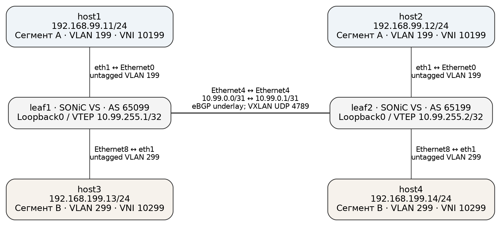

*Рисунок 1 – Каналы underlay и принадлежность хостов к сегментам VXLAN*

| Узел | Интерфейс | IPv4-адрес |
| --- | --- | --- |
| host1 | eth1 | 192.168.99.11/24 |
| host2 | eth1 | 192.168.99.12/24 |
| host3 | eth1 | 192.168.199.13/24 |
| host4 | eth1 | 192.168.199.14/24 |
| leaf1 | Ethernet4 | 10.99.0.0/31 |
| leaf2 | Ethernet4 | 10.99.0.1/31 |
| leaf1 | Loopback0 | 10.99.255.1/32 |
| leaf2 | Loopback0 | 10.99.255.2/32 |

На обоих leaf Ethernet0 — access VLAN 199, Ethernet8 — access VLAN 299. В containerlab интерфейсам eth1, eth2, eth3 соответствуют Ethernet0, Ethernet4, Ethernet8. На access-портах нет IP-адресов, хосты передают нетегированные кадры.

Между leaf выполняется VXLAN-инкапсуляция. Оба адреса сети /31 используются на канале Ethernet4. Сеть управления подключена через eth0; адреса в ней назначаются автоматически.

## 3 Описание топологии

Файл lab3.clab.yml содержит шесть узлов и пять связей. Перед развёртыванием выполнено source lab.env. Адреса host3 и host4 назначаются скриптом apply.sh при добавлении второго сегмента.

```text
name: ${STUDENT}-l3

mgmt:
  network: clab-${STUDENT}-l3
  ipv4-subnet: 10.103.${N}.0/24

topology:
  kinds:
    sonic-vs:
      image: sonic-course:202511
    linux:
      image: lab-tools:1.0
  nodes:
    leaf1:
      kind: sonic-vs
    leaf2:
      kind: sonic-vs
    host1:
      kind: linux
      exec:
        - ip link set eth1 mtu 1500
        - ip addr add 192.168.${N}.11/24 dev eth1
    host2:
      kind: linux
      exec:
        - ip link set eth1 mtu 1500
        - ip addr add 192.168.${N}.12/24 dev eth1
    host3:
      kind: linux
      exec:
        - ip link set eth1 mtu 1500
    host4:
      kind: linux
      exec:
        - ip link set eth1 mtu 1500
  links:
    - endpoints: ["host1:eth1", "leaf1:eth1"]
    - endpoints: ["leaf1:eth2", "leaf2:eth2"]
    - endpoints: ["host2:eth1", "leaf2:eth1"]
    - endpoints: ["host3:eth1", "leaf1:eth3"]
    - endpoints: ["host4:eth1", "leaf2:eth3"]
```

## 4 Развёртывание и службы

Стенд создан командой containerlab deploy -t lab3.clab.yml. Все шесть контейнеров перешли в running. На обоих leaf запущены zebra, mgmtd, staticd, bgpd и vxlanmgrd.

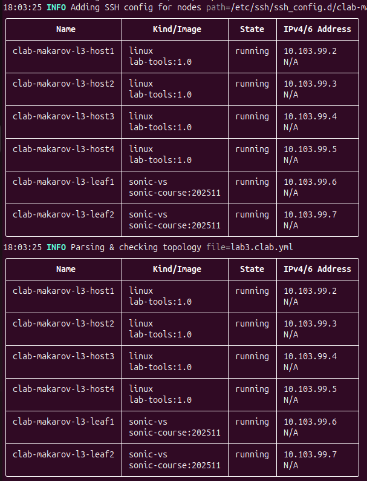

*Рисунок 2 – Первоначальное развёртывание и проверка шести узлов*

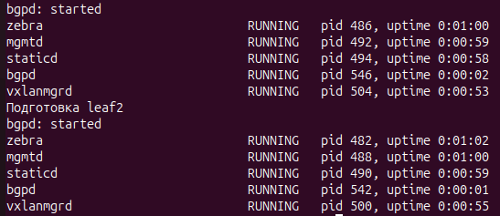

*Рисунок 3 – Службы FRR и vxlanmgrd на обоих leaf*

## 5 Проверка underlay

Между AS 65099 и AS 65199 настроен eBGP по адресам Ethernet4. В IPv4 unicast явно анонсированы только Loopback0. Management-сеть и сети доступа в underlay не объявлялись.

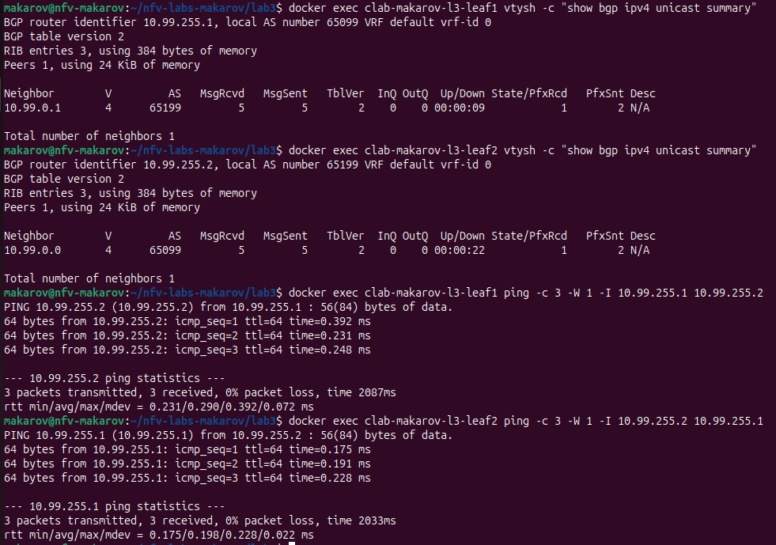

*Рисунок 4 – Сессии IPv4 unicast и ping между loopback-адресами*

| Проверка | Получено | Потери | Средний RTT |
| --- | --- | --- | --- |
| 10.99.255.1 → 10.99.255.2 | 3 из 3 | 0% | 0.290 ms |
| 10.99.255.2 → 10.99.255.1 | 3 из 3 | 0% | 0.198 ms |

Оба leaf принимают по одному префиксу — loopback соседа. Проверка с явно заданным исходным loopback подтверждает двустороннюю IP-доступность адресов, используемых как VTEP.

Loopback выбран как стабильная точка терминации туннеля. Его адрес не зависит от состояния конкретного физического канала; при наличии альтернативных путей underlay может сохранить доступность VTEP после отказа одного из них. В данной топологии резервного канала нет.

## 6 Настройка первого сегмента EVPN

На обоих leaf создан VLAN 199 с access-портом Ethernet0. Добавлены VTEP vtep с локальным Loopback0, объект NVO nvo и сопоставление VLAN 199 → VNI 10199. На leaf1 применены команды:

```text
sudo config vlan add 199
sudo config vlan member add -u 199 Ethernet0
sudo config vxlan add vtep 10.99.255.1
sudo config vxlan evpn_nvo add nvo vtep
sudo config vxlan map add vtep 199 10199
sudo config save -y
```

В FRR активирован сосед в address-family l2vpn evpn и включено advertise-all-vni. На leaf2 использован адрес VTEP 10.99.255.2. Удалённый VTEP вручную не задавался: сведения о нём поступили через EVPN.

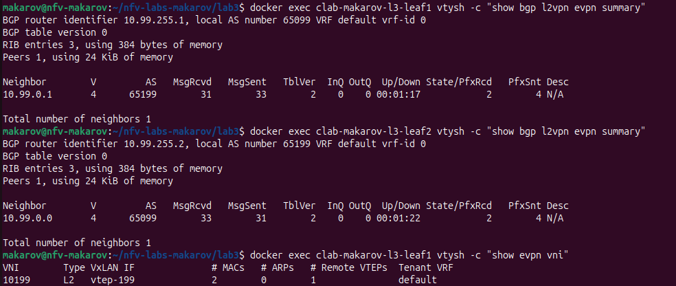

*Рисунок 5 – Сессии EVPN и первый L2 VNI*

Сессии установлены; для одного сегмента принято по два префикса. VNI 10199 имеет тип L2, интерфейс vtep-199 и один удалённый VTEP. Число ARP равно нулю: SVI и подавление ARP в этой конфигурации не настроены.

## 7 Маршруты Type-3 и удалённый VTEP

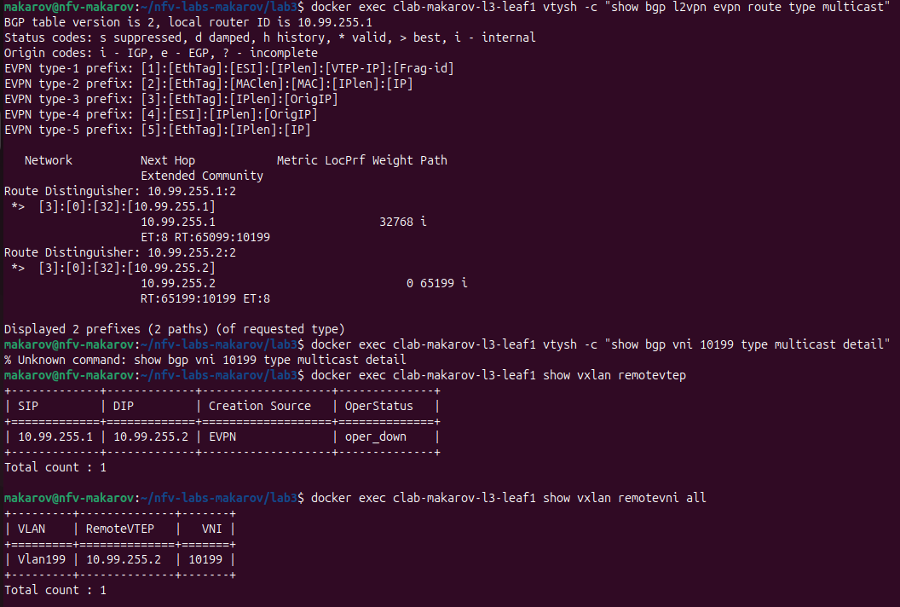

*Рисунок 6 – Type-3 IMET, удалённый VTEP и привязка удалённого VNI*

| Поле | Локальный маршрут leaf1 | Маршрут от leaf2 |
| --- | --- | --- |
| RD | 10.99.255.1:2 | 10.99.255.2:2 |
| RT | 65099:10199 | 65199:10199 |
| Originator / next hop | 10.99.255.1 | 10.99.255.2 |
| Тип туннеля | ET:8 — VXLAN | ET:8 — VXLAN |

Маршрут Type-3 IMET сообщает об участии VTEP в соответствующем L2-домене. Он используется для доставки BUM-трафика посредством ingress replication. RD различает маршруты, RT определяет импорт в EVPN-сегмент, originator содержит адрес объявляющего VTEP.

Команда show bgp vni 10199 type multicast detail в данной сборке FRR вернула Unknown command. Нужные поля получены поддерживаемой командой show bgp l2vpn evpn route type multicast. Значение oper_down рассмотрено отдельно в разделе 14.

## 8 Связность сегмента A и маршруты Type-2

Хосты 192.168.99.11 и 192.168.99.12 доступны в обе стороны: в каждой проверке получено 5 из 5 ответов, потери 0%. TTL внутреннего пакета равен 64, что согласуется с передачей внутри L2-сегмента.

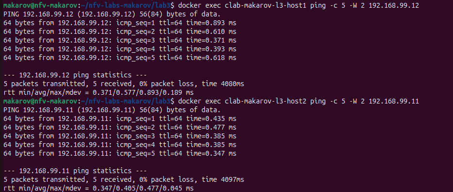

*Рисунок 7 – Двусторонний ping в сегменте A*

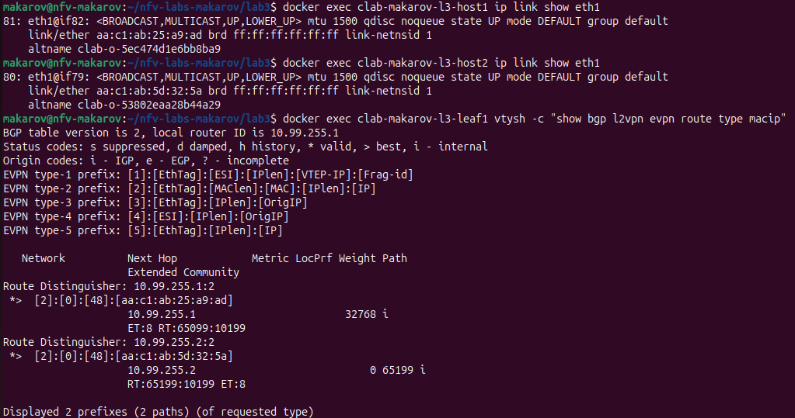

*Рисунок 8 – MAC-адреса хостов и маршруты EVPN Type-2*

MAC host1 — aa:c1:ab:25:a9:ad, host2 — aa:c1:ab:5d:32:5a. В Type-2 объявлены MAC без IP-привязки: это L2-конфигурация без SVI. Удалённый маршрут host2 имеет next hop 10.99.255.2 и AS path 65199.

## 9 Таблицы MAC и захват трафика

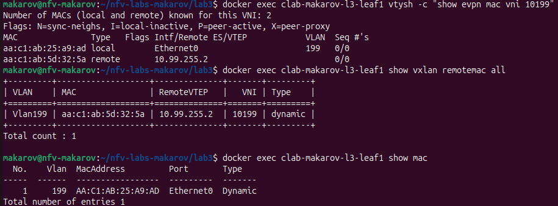

*Рисунок 9 – Локальная и удалённая записи MAC на leaf1*

В show evpn mac vni 10199 MAC host1 отмечен как local на Ethernet0, MAC host2 — как remote через 10.99.255.2. Удалённая запись также присутствует в show vxlan remotemac all. Команда show mac выводит только локальную запись VLAN 199.

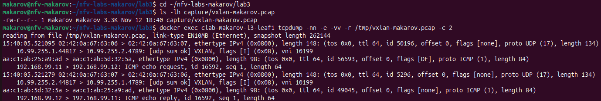

*Рисунок 10 – Чтение VXLAN-захвата tcpdump*

| Характеристика файла | Результат |
| --- | --- |
| Путь | capture/vxlan-makarov.pcap |
| Размер и формат | 3304 байта; PCAP 2.4; Ethernet |
| Число пакетов | 20: 10 Echo Request и 10 Echo Reply |
| Интервал захвата | 18:40:05.521095–18:40:10.059250 MSK |
| Адреса и VNI | 10.99.255.1 ↔ 10.99.255.2; VNI 10199 |

Все кадры сохранены полностью. Запросы и ответы совпадают по ICMP identifier, sequence и данным; последовательности — 1–10. Контрольные суммы внешнего и внутреннего IPv4, UDP и ICMP корректны. Захват выполнен до пересоздания контейнеров.

## 10 Слои инкапсуляции VXLAN

В Wireshark применён фильтр vxlan.vni == 10199 &amp;&amp; icmp.type == 8. Отображается 10 запросов из 20 пакетов. На рисунке выбран кадр 11; номера слева обозначают уровни вложенности заголовков.

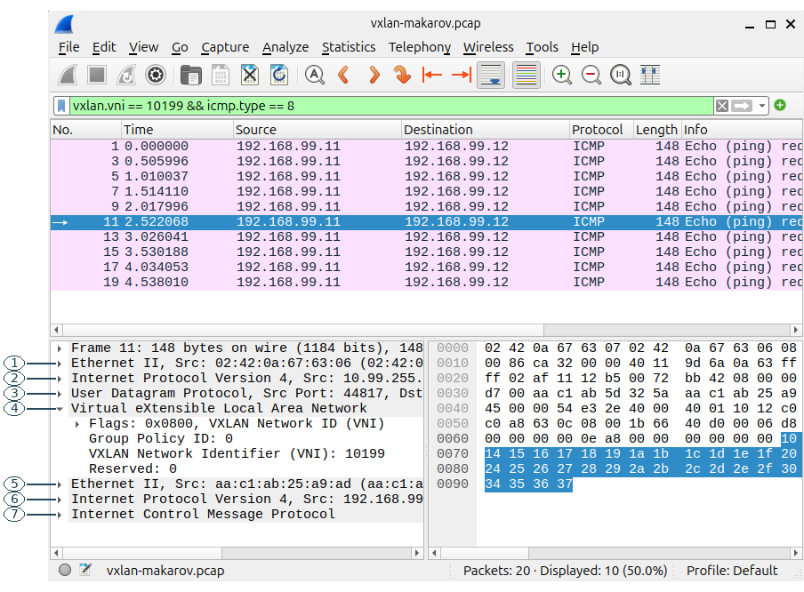

*Рисунок 11 – Слои внешнего пакета и внутреннего кадра в Wireshark*

| № | Слой | Байт | Поля запроса |
| --- | --- | --- | --- |
| 1 | Внешний Ethernet | 14 | 02:42:0a:67:63:06 → 02:42:0a:67:63:07 |
| 2 | Внешний IPv4 | 20 | 10.99.255.1 → 10.99.255.2 |
| 3 | UDP | 8 | 44817 → 4789 |
| 4 | VXLAN | 8 | I flag = 1; VNI = 10199 |
| 5 | Внутренний Ethernet | 14 | aa:c1:ab:25:a9:ad → aa:c1:ab:5d:32:5a |
| 6 | Внутренний IPv4 | 20 | 192.168.99.11 → 192.168.99.12 |
| 7 | ICMP и данные | 64 | Echo Request: 8 байт заголовка + 56 данных |

## 11 Размеры пакета и накладные расходы

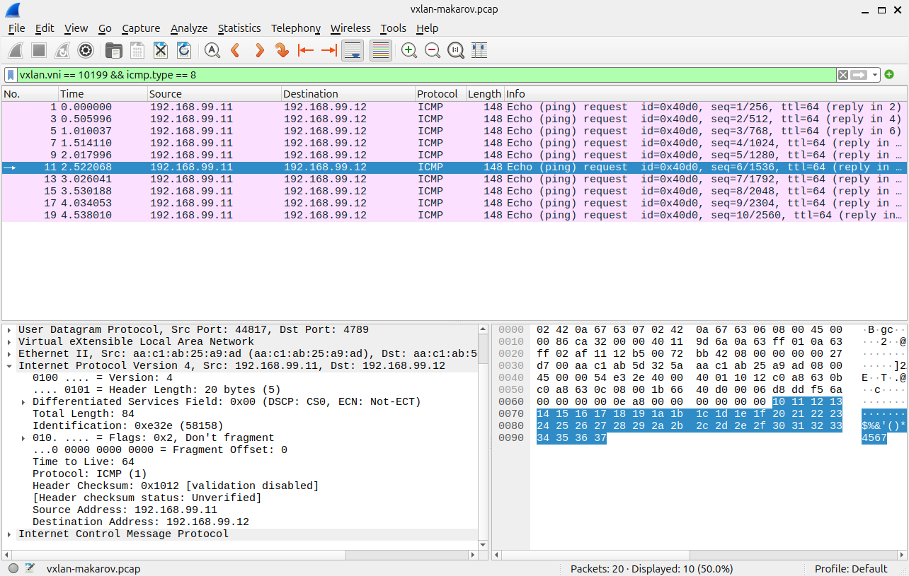

*Рисунок 12 – Внутренний IPv4 и размер захваченного кадра*

| Расчёт | Размер |
| --- | --- |
| Внутренний IPv4: 20 + 8 + 56 | 84 байта |
| Внутренний Ethernet: 14 + 84 | 98 байт |
| Новые заголовки: Ethernet 14 + IPv4 20 + UDP 8 + VXLAN 8 | 50 байт |
| Захваченный кадр: 98 + 50 | 148 байт |
| Внешний IPv4: 20 + 8 + 8 + 98 | 134 байта |

Для этого IPv4-захвата инкапсуляция добавляет 50 байт относительно внутреннего Ethernet-кадра. В расчёт не входят FCS, преамбула, межкадровый интервал и отсутствующие теги VLAN. Значение 148 байт подтверждено и списком пакетов Wireshark, и записями PCAP.

Внутренний IP-пакет сохраняет TTL 64 и флаг DF. Размер 84 байта существенно меньше MTU; такая проверка не показывает поведение при передаче максимальных кадров. Дополнительный опыт с уменьшением MTU underlay и большими ICMP-пакетами не выполнялся.

## 12 Второй сегмент VLAN 299 / VNI 10299

На обоих leaf добавлен VLAN 299 с портом Ethernet8 без тега и map VLAN 299 → VNI 10299. На host3 и host4 назначены 192.168.199.13/24 и 192.168.199.14/24. Для обоих VNI используется тот же VTEP.

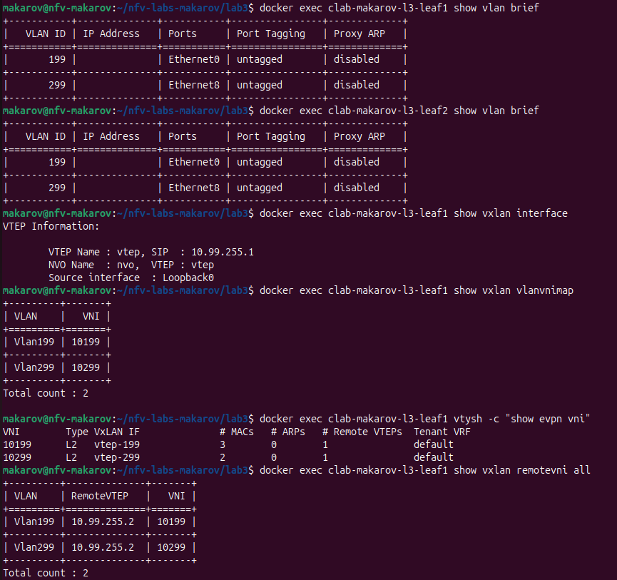

*Рисунок 13 – Порты VLAN, VTEP, два VNI и удалённые привязки*

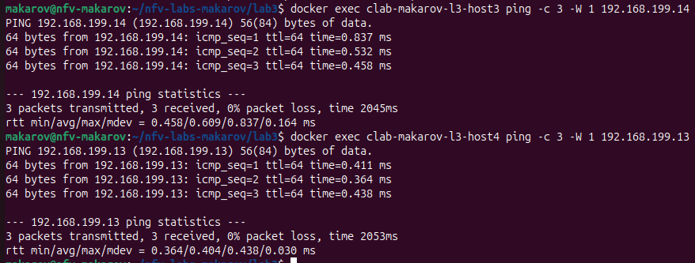

*Рисунок 14 – Двусторонний ping внутри сегмента B: по 3 из 3 ответов*

## 13 Проверка изоляции сегментов

Ping из host1 в адрес host4 сегмента B завершился с потерей всех пакетов. Поскольку подсети различаются и L3-шлюзы не настроены, этот результат дополнен проверкой изоляции на одном IP-префиксе.

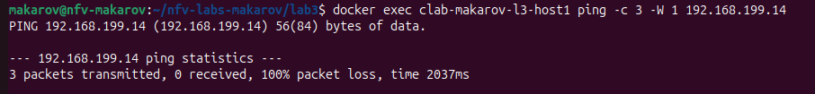

*Рисунок 15 – Отрицательная проверка A → B*

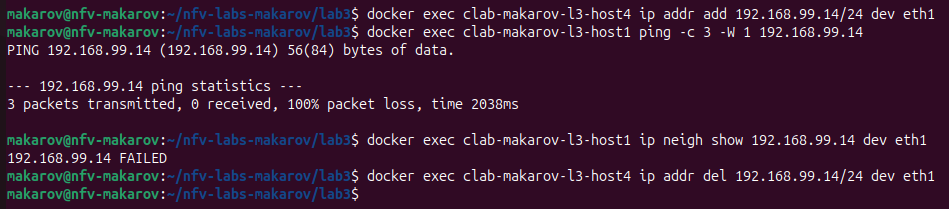

*Рисунок 16 – Временный адрес подсети A на host4 и отсутствие ответа ARP*

На host4 временно добавлен 192.168.99.14/24. С host1 отправлено 3 запроса на этот адрес: ответов нет, сосед имеет состояние FAILED. Следовательно, ARP из VLAN 199 не достиг хоста VLAN 299. Временный адрес после проверки удалён.

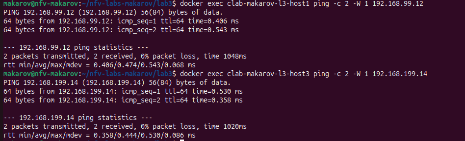

*Рисунок 17 – Положительные проверки внутри A и B после опыта*

Внутри каждого сегмента затем получено по 2 из 2 ответов без потерь. Это подтверждает работоспособность обоих сегментов во время проверки изоляции, а не общий отказ связи.

## 14 Состояние туннеля в SONiC VS

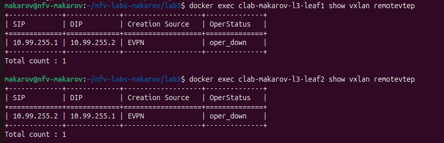

*Рисунок 18 – Удалённые VTEP обнаружены через EVPN, но имеют oper_down*

На обоих leaf CLI продолжает отображать oper_down, хотя ping проходит и в захвате присутствуют корректные VXLAN-пакеты. Дополнительно проверены Linux-интерфейсы и STATE_DB. Существенные поля вывода leaf1:

```text
vtep-199: UP, LOWER_UP; mtu 1500; master Bridge
  vxlan id 10199 local 10.99.255.1 dstport 4789
  state UNKNOWN; bridge slave state forwarding
vtep-299: UP, LOWER_UP; mtu 1500; master Bridge
  vxlan id 10299 local 10.99.255.1 dstport 4789
  state UNKNOWN; bridge slave state forwarding
VXLAN_TUNNEL_TABLE|EVPN_10.99.255.2
  src_ip     10.99.255.1
  dst_ip     10.99.255.2
  tnl_src    EVPN
  operstatus down
```

Состояние UNKNOWN у Linux VXLAN-интерфейса не означает DOWN: флаги UP/LOWER_UP установлены, bridge forwarding включён. В sonic-swss ветки 202511 запись состояния нового туннеля создаётся со значением down; последующее обновление связано с состоянием tunnel port через PortsOrch и SAI.

Источник отображаемого down установлен, но точная причина отсутствия обновления в up в этой VS-сборке не определена. STATE_DB вручную не менялась. Требуемое заданием отображение oper_up не получено; передача данных и обнаружение удалённого VTEP подтверждены отдельными проверками.

## 15 Конфигурация в файлах

Настройки вынесены в lab.env, lab3.clab.yml, apply.sh и четыре файла configs/. Полные тексты приведены в приложениях. apply.sh сначала ожидает порты, затем применяет настройки SONiC и FRR, после чего назначает адреса четырём хостам.

```text
lab3/
  lab.env
  lab3.clab.yml
  apply.sh
  configs/leaf1.sh
  configs/leaf2.sh
  configs/leaf1-frr.conf
  configs/leaf2-frr.conf
  capture/vxlan-makarov.pcap
  README.md
```

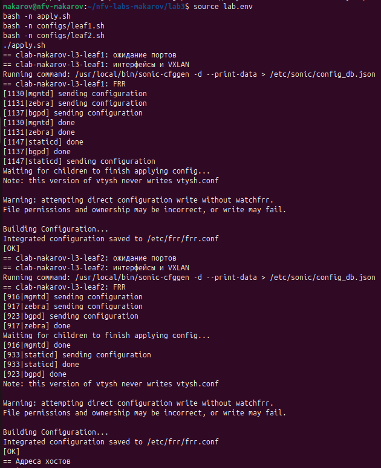

*Рисунок 19 – Применение файлов к уже настроенному стенду*

Повторное создание существующих объектов исключено проверками ключей CONFIG_DB. Подстановка envsubst ограничена переменными N, AS, VLAN и VNI, чтобы сохранить локальные переменные shell. Синтаксис трёх shell-скриптов проверен bash -n.

## 16 Повторное развёртывание

```text
source lab.env
containerlab destroy -t lab3.clab.yml --cleanup
containerlab deploy -t lab3.clab.yml
./apply.sh
```

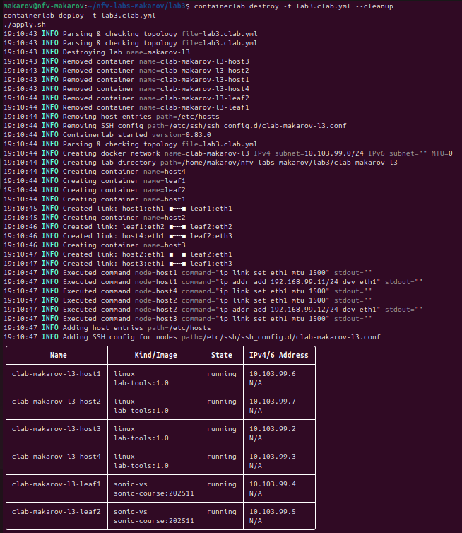

*Рисунок 20 – Удаление и создание шести контейнеров заново*

Удаление стенда начато в 19:10:43 MSK, новый deploy — в 19:10:44. Созданы все пять каналов, шесть узлов перешли в running. Затем применены те же файлы конфигурации без ручного восстановления адресов, VLAN или BGP.

В YAML адреса сегмента B не заданы: их восстановление относится к apply.sh. Изменение автоматически выданных адресов управления не изменяет адреса underlay и параметры VXLAN.

## 17 Применение настроек после deploy

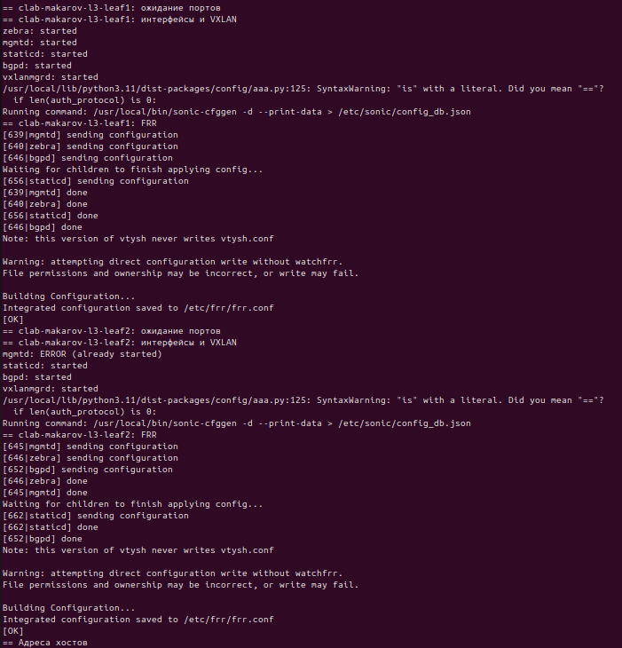

*Рисунок 21 – Запуск служб и сохранение конфигурации на новом стенде*

На leaf2 выведено mgmtd: ERROR (already started). Также присутствуют SyntaxWarning в config/aaa.py:125 и предупреждение vtysh о записи без watchfrr. Применение продолжилось, /etc/frr/frr.conf сохранён с [OK] на обоих leaf. Последующие проверки передачи прошли.

| Узел | eth0 до пересоздания | eth0 после пересоздания |
| --- | --- | --- |
| host1 | 10.103.99.2 | 10.103.99.6 |
| host2 | 10.103.99.3 | 10.103.99.7 |
| host3 | 10.103.99.4 | 10.103.99.2 |
| host4 | 10.103.99.5 | 10.103.99.3 |
| leaf1 | 10.103.99.6 | 10.103.99.4 |
| leaf2 | 10.103.99.7 | 10.103.99.5 |

## 18 Итоговая проверка

Финальный вывод зафиксирован 12.11.2026 в 19:12:15 MSK. VTEP leaf1 использует Loopback0 10.99.255.1, оба соответствия VLAN/VNI восстановлены, каждый VNI имеет один удалённый VTEP и два MAC-адреса.

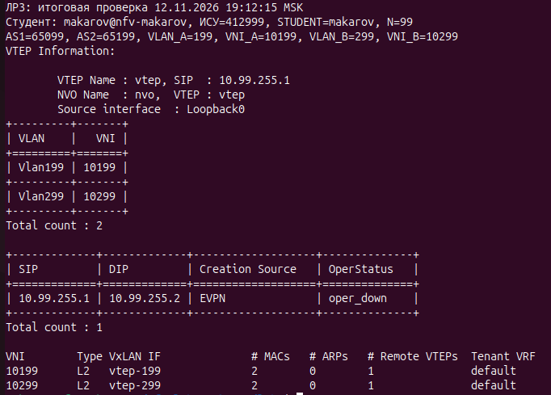

*Рисунок 22 – Персональные параметры и состояние восстановленного overlay*

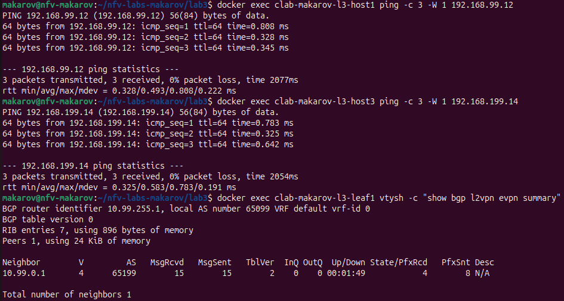

*Рисунок 23 – Ping в обоих сегментах и четыре принятых префикса EVPN*

В каждом сегменте получено по 3 из 3 ответов без потерь. Средний RTT: A — 0.493 ms, B — 0.583 ms. Сессия EVPN на leaf1 принимает четыре префикса. Значение oper_down сохраняется; его ограничение описано в разделе 14.

## 19 Ответы на вопросы

### 1. Почему VTEP размещается на Loopback?

Loopback даёт стабильный адрес точки инкапсуляции, не привязанный к конкретному физическому каналу. При изменении пути через underlay адрес VTEP остаётся тем же. Для работы туннеля нужна маршрутизируемая доступность этого адреса; её в стенде обеспечивает eBGP.

### 2. Что сообщает Type-3 от leaf2?

IMET сообщает об участии VTEP 10.99.255.2 в L2-домене VNI 10199 и используется при построении списка репликации BUM. Получены RD 10.99.255.2:2, RT 65199:10199 и originator IP 10.99.255.2. RD различает маршруты, а RT служит для их импорта в сегмент.

### 3. Как MAC host2 появился на leaf1?

Leaf2 изучает MAC aa:c1:ab:5d:32:5a на локальном access-порту и объявляет его маршрутом EVPN Type-2. Leaf1 принимает маршрут и связывает удалённый MAC с VTEP 10.99.255.2. Прямое получение access-кадра от host2 для этого не требуется. В захваченном обмене внутренний кадр приходит уже внутри VXLAN.

### 4. Что добавить для связи между A и B?

Для распределённой маршрутизации с symmetric IRB необходимо создать SVI со шлюзами сегментов, включить их в VRF, настроить L3 VNI и обмен маршрутами EVPN. На хостах задаются соответствующие шлюзы. Anycast gateway позволяет использовать одинаковые IP- и MAC-адреса шлюза на leaf-коммутаторах. В выполненной L2-конфигурации шлюзов и межсегментной маршрутизации нет.

## ЗАКЛЮЧЕНИЕ

Настроены eBGP underlay и L2 overlay с двумя VNI. Проверены доступность loopback-адресов, обмен маршрутами Type-3 и Type-2, локальные и удалённые MAC-адреса. В обоих сегментах обеспечена двусторонняя связность; изоляция подтверждена проверкой ARP при временном назначении адреса одной подсети хостам разных VLAN.

В PCAP подтверждена инкапсуляция между персональными VTEP с VNI 10199; дополнительные заголовки составили 50 байт. После удаления и повторного создания контейнеров настройки восстановлены из файлов, ping в обоих сегментах прошёл без потерь. В SONiC VS сохранилось расхождение oper_down с фактической передачей данных; отображение oper_up не подтверждено.

Репозиторий: github.com/DeltraWard/nfv-labs-makarov

## ПРИЛОЖЕНИЕ А Скрипт apply.sh

```text
#!/usr/bin/env bash
set -euo pipefail

cd -- "$(dirname -- "${BASH_SOURCE[0]}")"
: "${STUDENT:?Выполни source lab.env}" "${N:?Выполни source lab.env}"
export N AS1=$((65000 + N)) AS2=$((65100 + N))
export VLAN_A=$((100 + N)) VLAN_B=$((200 + N))
export VNI_A=$((10000 + VLAN_A)) VNI_B=$((10000 + VLAN_B))
command -v envsubst >/dev/null

for leaf in leaf1 leaf2; do
  test -s "configs/${leaf}.sh"
  test -s "configs/${leaf}-frr.conf"
done

for leaf in leaf1 leaf2; do
  router_container="clab-${STUDENT}-l3-${leaf}"
  echo "== ${router_container}: ожидание портов"
  ready=0

  for attempt in {1..60}; do
    if docker exec "$router_container" bash -c 'test "$(redis-cli -n 4 exists "PORT|Ethernet0" "PORT|Ethernet4" "PORT|Ethernet8")" = 3 && ip link show Ethernet0 >/dev/null 2>&1 && ip link show Ethernet4 >/dev/null 2>&1 && ip link show Ethernet8 >/dev/null 2>&1' >/dev/null 2>&1; then
      ready=1
      break
    fi
    sleep 5
  done

  if [ "$ready" = 0 ]; then
    echo "Ошибка: ${router_container} не подготовил порты за 5 минут" >&2
    exit 1
  fi

  echo "== ${router_container}: интерфейсы и VXLAN"
  envsubst '${N} ${VLAN_A} ${VLAN_B} ${VNI_A} ${VNI_B}' < "configs/${leaf}.sh" | docker exec -i "$router_container" bash -se

  echo "== ${router_container}: FRR"
  envsubst '${N} ${AS1} ${AS2}' < "configs/${leaf}-frr.conf" | docker exec -i "$router_container" bash -ec 'cat > /tmp/lab3-frr.conf; vtysh -f /tmp/lab3-frr.conf; vtysh -c "write memory"'
done

echo "== Адреса хостов"
for host in host1 host2 host3 host4; do
  docker exec "clab-${STUDENT}-l3-${host}" ip link set eth1 mtu 1500
done
segment_b_octet=$((100 + N))
docker exec "clab-${STUDENT}-l3-host1" ip addr replace "192.168.${N}.11/24" dev eth1
docker exec "clab-${STUDENT}-l3-host2" ip addr replace "192.168.${N}.12/24" dev eth1
docker exec "clab-${STUDENT}-l3-host3" ip addr replace "192.168.${segment_b_octet}.13/24" dev eth1
docker exec "clab-${STUDENT}-l3-host4" ip addr replace "192.168.${segment_b_octet}.14/24" dev eth1

echo "Конфигурация применена. Подожди 20–30 секунд для установления BGP EVPN."
```

## ПРИЛОЖЕНИЕ Б Конфигурация leaf1

```text
#!/usr/bin/env bash
set -euo pipefail

leaf_id=1
underlay_address="10.${N}.0.$((leaf_id - 1))/31"
loopback_address="10.${N}.255.${leaf_id}/32"

for service in zebra mgmtd staticd bgpd vxlanmgrd; do
  if ! supervisorctl status "$service" | grep -q RUNNING; then
    supervisorctl start "$service"
  fi
done

for port in Ethernet0 Ethernet4 Ethernet8; do
  sudo config interface startup "$port"
done

if [ "$(redis-cli -n 4 exists 'LOOPBACK_INTERFACE|Loopback0')" = 0 ]; then
  sudo config loopback add Loopback0
fi

if [ "$(redis-cli -n 4 exists "INTERFACE|Ethernet4|${underlay_address}")" = 0 ]; then
  sudo config interface ip add Ethernet4 "$underlay_address"
fi

if [ "$(redis-cli -n 4 exists "LOOPBACK_INTERFACE|Loopback0|${loopback_address}")" = 0 ]; then
  sudo config interface ip add Loopback0 "$loopback_address"
fi

if [ "$(redis-cli -n 4 exists 'VXLAN_TUNNEL|vtep')" = 0 ]; then
  sudo config vxlan add vtep "${loopback_address%/*}"
fi

if [ "$(redis-cli -n 4 exists 'VXLAN_EVPN_NVO|nvo')" = 0 ]; then
  sudo config vxlan evpn_nvo add nvo vtep
fi

for binding in "${VLAN_A}:Ethernet0:${VNI_A}" "${VLAN_B}:Ethernet8:${VNI_B}"; do
  IFS=: read -r vlan port vni <<< "$binding"

  if [ "$(redis-cli -n 4 exists "VLAN|Vlan${vlan}")" = 0 ]; then
    sudo config vlan add "$vlan"
  fi

  if [ "$(redis-cli -n 4 exists "VLAN_MEMBER|Vlan${vlan}|${port}")" = 0 ]; then
    sudo config vlan member add -u "$vlan" "$port"
  fi

  if [ "$(redis-cli -n 4 exists "VXLAN_TUNNEL_MAP|vtep|map_${vni}_Vlan${vlan}")" = 0 ]; then
    sudo config vxlan map add vtep "$vlan" "$vni"
  fi
done

sudo config save -y
```

## ПРИЛОЖЕНИЕ В Конфигурация leaf2

```text
#!/usr/bin/env bash
set -euo pipefail

leaf_id=2
underlay_address="10.${N}.0.$((leaf_id - 1))/31"
loopback_address="10.${N}.255.${leaf_id}/32"

for service in zebra mgmtd staticd bgpd vxlanmgrd; do
  if ! supervisorctl status "$service" | grep -q RUNNING; then
    supervisorctl start "$service"
  fi
done

for port in Ethernet0 Ethernet4 Ethernet8; do
  sudo config interface startup "$port"
done

if [ "$(redis-cli -n 4 exists 'LOOPBACK_INTERFACE|Loopback0')" = 0 ]; then
  sudo config loopback add Loopback0
fi

if [ "$(redis-cli -n 4 exists "INTERFACE|Ethernet4|${underlay_address}")" = 0 ]; then
  sudo config interface ip add Ethernet4 "$underlay_address"
fi

if [ "$(redis-cli -n 4 exists "LOOPBACK_INTERFACE|Loopback0|${loopback_address}")" = 0 ]; then
  sudo config interface ip add Loopback0 "$loopback_address"
fi

if [ "$(redis-cli -n 4 exists 'VXLAN_TUNNEL|vtep')" = 0 ]; then
  sudo config vxlan add vtep "${loopback_address%/*}"
fi

if [ "$(redis-cli -n 4 exists 'VXLAN_EVPN_NVO|nvo')" = 0 ]; then
  sudo config vxlan evpn_nvo add nvo vtep
fi

for binding in "${VLAN_A}:Ethernet0:${VNI_A}" "${VLAN_B}:Ethernet8:${VNI_B}"; do
  IFS=: read -r vlan port vni <<< "$binding"

  if [ "$(redis-cli -n 4 exists "VLAN|Vlan${vlan}")" = 0 ]; then
    sudo config vlan add "$vlan"
  fi

  if [ "$(redis-cli -n 4 exists "VLAN_MEMBER|Vlan${vlan}|${port}")" = 0 ]; then
    sudo config vlan member add -u "$vlan" "$port"
  fi

  if [ "$(redis-cli -n 4 exists "VXLAN_TUNNEL_MAP|vtep|map_${vni}_Vlan${vlan}")" = 0 ]; then
    sudo config vxlan map add vtep "$vlan" "$vni"
  fi
done

sudo config save -y
```

## ПРИЛОЖЕНИЕ Г FRR и переменные

### configs/leaf1-frr.conf

```text
router bgp ${AS1}
 bgp router-id 10.${N}.255.1
 no bgp ebgp-requires-policy
 neighbor 10.${N}.0.1 remote-as ${AS2}
 address-family ipv4 unicast
  neighbor 10.${N}.0.1 activate
  network 10.${N}.255.1/32
 exit-address-family
 address-family l2vpn evpn
  neighbor 10.${N}.0.1 activate
  advertise-all-vni
 exit-address-family
exit
```

### configs/leaf2-frr.conf

```text
router bgp ${AS2}
 bgp router-id 10.${N}.255.2
 no bgp ebgp-requires-policy
 neighbor 10.${N}.0.0 remote-as ${AS1}
 address-family ipv4 unicast
  neighbor 10.${N}.0.0 activate
  network 10.${N}.255.2/32
 exit-address-family
 address-family l2vpn evpn
  neighbor 10.${N}.0.0 activate
  advertise-all-vni
 exit-address-family
exit
```

### lab.env

```text
export ISU=412999
export STUDENT=makarov
export N=99
export AS1=$((65000 + N))
export AS2=$((65100 + N))
export VLAN_A=$((100 + N))
export VLAN_B=$((200 + N))
export VNI_A=$((10000 + VLAN_A))
export VNI_B=$((10000 + VLAN_B))
```

Шаблоны FRR применяются после назначения loopback-адресов. В IPv4 unicast объявляются /32 Loopback0, в l2vpn evpn активированы тот же сосед и advertise-all-vni. Параметры вычисляются из N = 99.
