# Лабораторная работа 4

Макаров Максим Вячеславович, К3420, ИСУ 412999.

## ВВЕДЕНИЕ

Цель работы — исследовать управление коммутаторами Open vSwitch с помощью контроллера OpenDaylight и протокола OpenFlow 1.3. Правила пересылки устанавливаются через RESTCONF, а обработка трафика выполняется коммутаторами.

В работе проверены подключение двух OVS, проактивная установка потоков, работа ACL и поведение сети при отключении и возвращении контроллера.

| Параметр | Значение |
| --- | --- |
| ФИО, группа, ИСУ | Макаров Максим Вячеславович; К3420; 412999 |
| STUDENT / N | makarov / 99 |
| Management / ODL | 10.104.99.0/24 / 10.104.99.100 |
| Адреса хостов | 10.99.4.1/24, 10.99.4.2/24, 10.99.4.3/24 |
| Приоритет ACL | 599 = 500 + 99 |
| Префикс ID потоков | makarov- |
| Окружение | Ubuntu 24.04.5 LTS, Docker 27.5.1, containerlab 0.83.0 |
| Дата | 12–13 ноября 2026 года |

## 1 Схема сети и адресный план

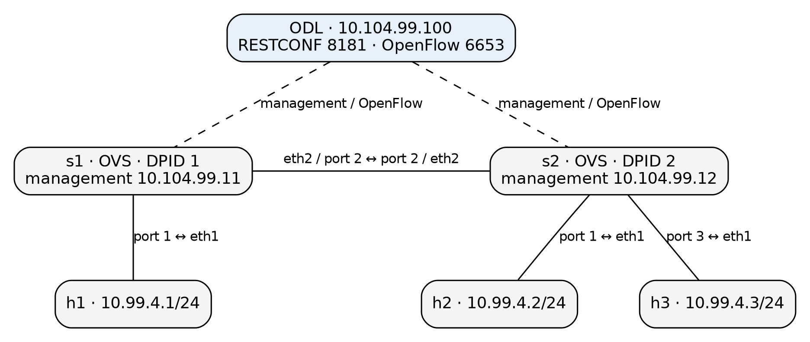

*Рисунок 1 – Управление OVS и каналы передачи данных*

| Узел | Адрес / назначение |
| --- | --- |
| ODL | 10.104.99.100; OpenFlow 6653, RESTCONF 8181 |
| s1 / s2 | 10.104.99.11 / 10.104.99.12; DPID 1 / 2 |
| h1 | 10.99.4.1/24; подключение s1 port 1 |
| h2 | 10.99.4.2/24; подключение s2 port 1 |
| h3 | 10.99.4.3/24; подключение s2 port 3 |
| Канал s1–s2 | eth2 / OpenFlow port 2 на обоих OVS |

Управляющее соединение проходит через отдельную management-сеть. Такое out-of-band управление отделяет доступ к контроллеру от правил в сети данных и позволяет управлять устройствами при нарушениях в управляемом канале.

## 2 Топология containerlab

В lab.env заданы персональные значения. В файле топологии создаются контроллер, два OVS и три Linux-хоста. Для хостовых интерфейсов отключён TX offload и заданы IP-адреса.

```text
name: ${STUDENT}-l4

mgmt:
  network: clab-${STUDENT}-l4
  ipv4-subnet: 10.104.${N}.0/24

topology:
  kinds:
    linux:
      image: lab-tools:1.0
  nodes:
    odl:
      kind: linux
      image: odl:chromium
      mgmt-ipv4: 10.104.${N}.100
    s1:
      kind: linux
      image: ovs-lab:latest
      mgmt-ipv4: 10.104.${N}.11
    s2:
      kind: linux
      image: ovs-lab:latest
      mgmt-ipv4: 10.104.${N}.12
    h1:
      kind: linux
      exec:
        - ethtool -K eth1 tx off
        - ip addr add 10.${N}.4.1/24 dev eth1
    h2:
      kind: linux
      exec:
        - ethtool -K eth1 tx off
        - ip addr add 10.${N}.4.2/24 dev eth1
    h3:
      kind: linux
      exec:
        - ethtool -K eth1 tx off
        - ip addr add 10.${N}.4.3/24 dev eth1
  links:
    - endpoints: ["h1:eth1", "s1:eth1"]
    - endpoints: ["s1:eth2", "s2:eth2"]
    - endpoints: ["h2:eth1", "s2:eth1"]
    - endpoints: ["h3:eth1", "s2:eth3"]
```

## 3 Развёртывание и запуск контроллера

Использованы образы odl:chromium, ovs-lab:latest и lab-tools:1.0. В локальной VM созданы шесть контейнеров и четыре канала; все узлы перешли в состояние running.

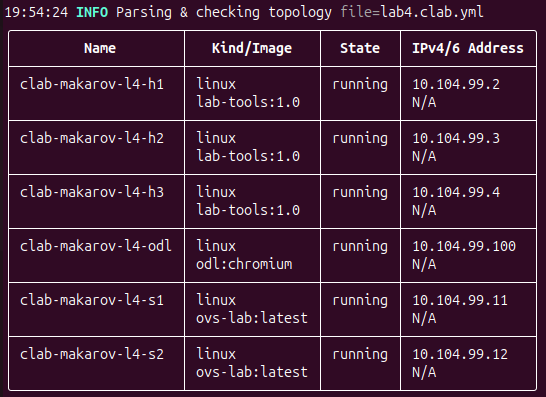

*Рисунок 2 – Состав развёрнутого стенда*

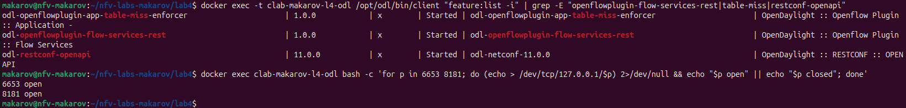

*Рисунок 3 – Компоненты ODL и проверка портов 6653 и 8181*

В Karaf установлены openflowplugin-flow-services-rest, table-miss-enforcer и restconf-openapi. Открыты TCP-порты OpenFlow и RESTCONF. Компонент table-miss-enforcer устанавливает правило отправки несовпавших пакетов контроллеру.

## 4 Подключение OVS к ODL

На обоих коммутаторах создан br0 с datapath_type=netdev, OpenFlow 1.3 и fail_mode=secure. Скрипт сопоставляет номера OpenFlow портам eth1–eth3 и задаёт контроллер 10.104.99.100:6653.

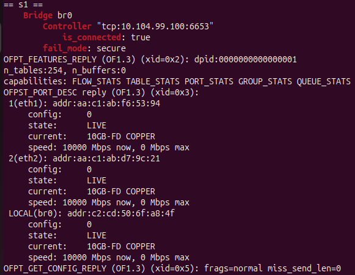

*Рисунок 4 – Подключение s1, DPID 1 и порты OpenFlow*

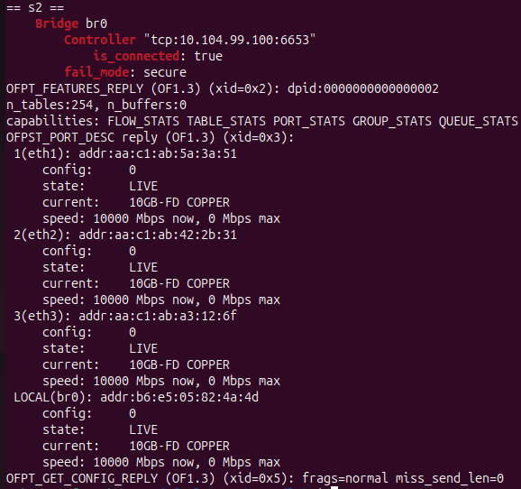

*Рисунок 5 – Подключение s2, DPID 2 и порты OpenFlow*

## 5 Проверка до установки потоков

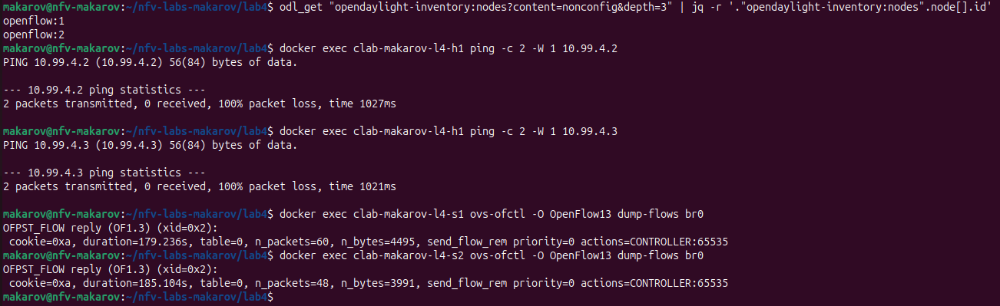

*Рисунок 6 – Инвентарь контроллера и отсутствие связности до установки потоков*

RESTCONF показывает openflow:1 и openflow:2. До добавления пользовательских правил два ping к h2 и h3 завершились со 100% потерь. На обоих OVS присутствовало правило priority=0 с действием CONTROLLER:65535.

Несовпавшие пакеты передавались контроллеру по правилу table-miss. Приложение, устанавливающее правила коммутации по таким пакетам, в этом опыте не было включено, поэтому связь не устанавливалась.

## 6 Проактивные правила пересылки

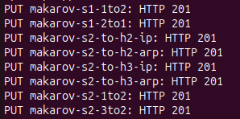

*Рисунок 7 – Установка восьми потоков с персональными ID*

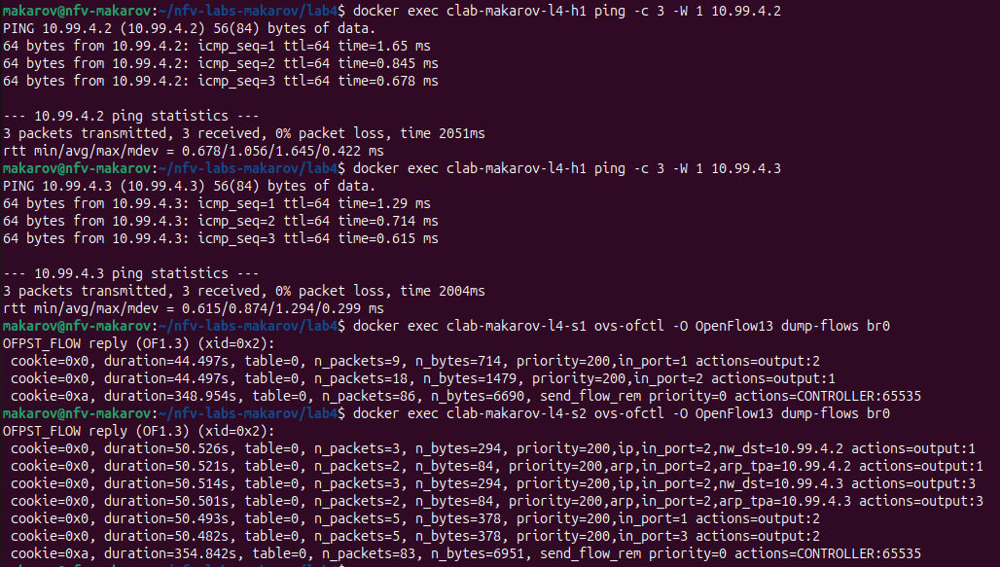

*Рисунок 8 – Ping к h2 и h3 и потоки OpenFlow на обоих OVS*

Все восемь запросов PUT вернули HTTP 201. После применения получено по 3 из 3 ответов для h1–h2 и h1–h3. В dump-flows видны правила priority=200 и ненулевые счётчики использованных потоков.

## 7 Правила и хранилище ODL

| ID без префикса makarov- | Условие / действие |
| --- | --- |
| s1-1to2 / s1-2to1 | вход 1 → выход 2 / вход 2 → выход 1 |
| s2-to-h2-ip / -arp | вход 2; IPv4 / ARP для 10.99.4.2 → выход 1 |
| s2-to-h3-ip / -arp | вход 2; IPv4 / ARP для 10.99.4.3 → выход 3 |
| s2-1to2 / s2-3to2 | вход 1 / вход 3 → выход 2 |
| acl-icmp-h3 | s1, вход 1, ICMP к 10.99.4.3; приоритет 599 → drop |

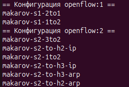

*Рисунок 9 – Восемь ID потоков в конфигурации контроллера*

Config-хранилище содержит заданное контроллеру состояние, operational-хранилище — сведения о наблюдаемом состоянии устройств и статистике. Удаление правила непосредственно на OVS не означает удаления желаемой конфигурации в ODL; дальнейшее восстановление зависит от механизма reconciliation и его состояния.

## 8 Установка и проверка ACL

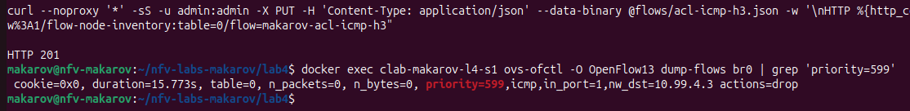

*Рисунок 10 – Установка ACL с приоритетом 599*

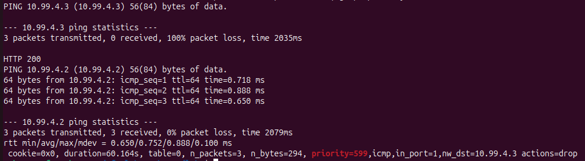

*Рисунок 11 – Проверка ICMP и HTTP при действующем ACL*

Правило установлено с HTTP 201. Ping h1 → h3 потерял 3 пакета из 3, HTTP к h3 вернул 200, а ping h1 → h2 прошёл без потерь. В OVS счётчик ACL увеличился до 3 пакетов и 294 байт.

## 9 Статистика и удаление ACL

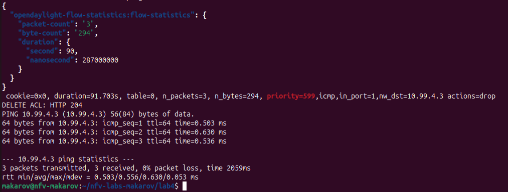

*Рисунок 12 – Счётчики ODL и OVS, удаление ACL и повторный ping*

В ODL получены packet-count=3 и byte-count=294; те же значения показал OVS. Команда DELETE вернула HTTP 204, после чего ping h1 → h3 прошёл: 3 пакета передано и получено, потерь нет. JSON ACL сохранён среди конфигурационных файлов.

## 10 Отключение контроллера: secure

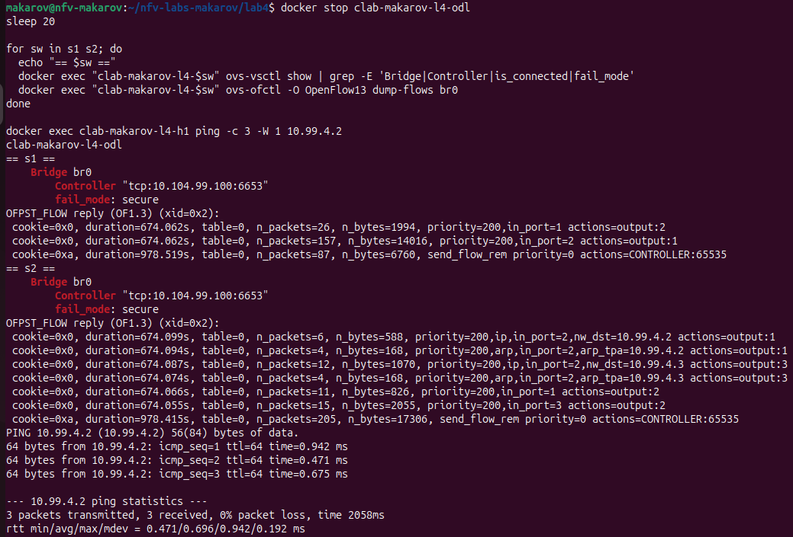

*Рисунок 13 – Состояние OVS и ping после остановки контроллера*

После остановки ODL у обоих OVS отсутствует признак is_connected: true; режим остался secure. Ранее установленные потоки priority=200 сохранились. Ping h1 → h2 прошёл без потерь: установленные правила продолжили обрабатывать трафик.

В secure OVS не переходит к самостоятельному обучению при потере контроллера. Работа заранее установленных потоков зависит от их наличия и времени жизни.

## 11 Отключение контроллера: standalone

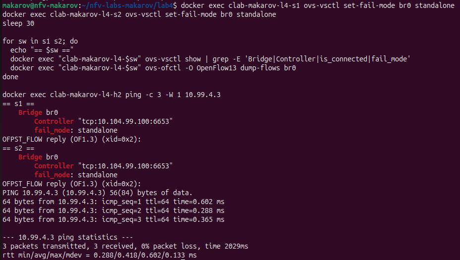

*Рисунок 14 – Режим standalone и ping h2 → h3*

После переключения обоих OVS в standalone команда dump-flows показала пустые таблицы. При этом ping h2 → h3 завершился успешно: 3 из 3, потерь нет. Это подтверждает фактическую связность в данном режиме.

Обычный dump-flows не показал правила, по которому передавался трафик. Внутренний механизм пересылки в этом опыте отдельно не исследовался; его конкретные записи по данному выводу не определяются.

## 12 Возвращение контроллера

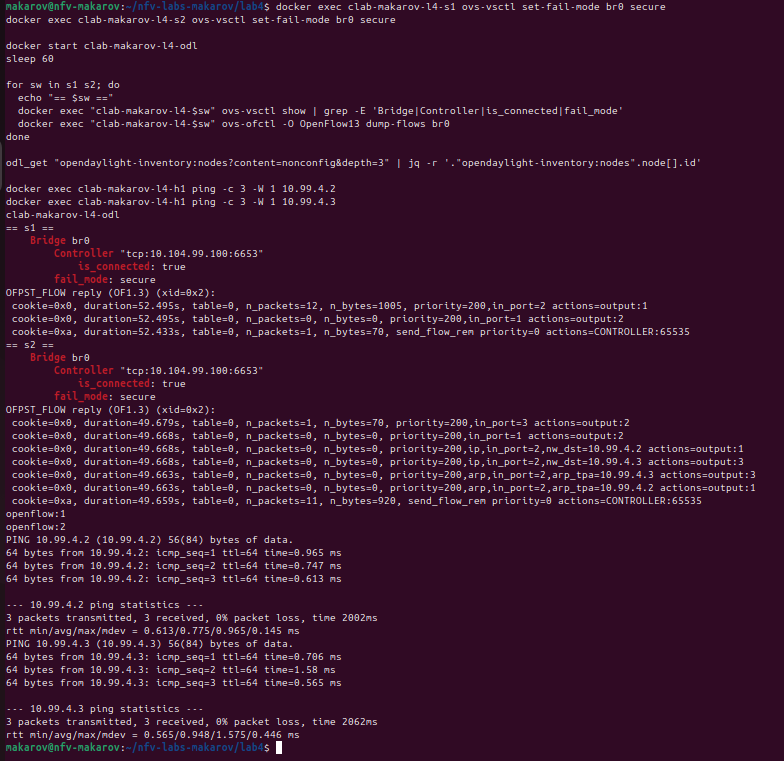

*Рисунок 15 – Подключение OVS, потоки и ping после запуска ODL*

После возврата secure и запуска ODL оба OVS снова показали is_connected: true. В инвентаре появились openflow:1 и openflow:2, а правила priority=200 снова присутствовали в таблицах без повторного запуска push-flows.sh. Оба ping от h1 прошли 3/3.

Reconciliation — согласование состояния коммутатора с конфигурацией контроллера. В наблюдаемом эксперименте связь и правила восстановились после переподключения. Полный механизм и последовательность внутренних операций контроллера отдельно не трассировались.

## 13 Итоговая проверка

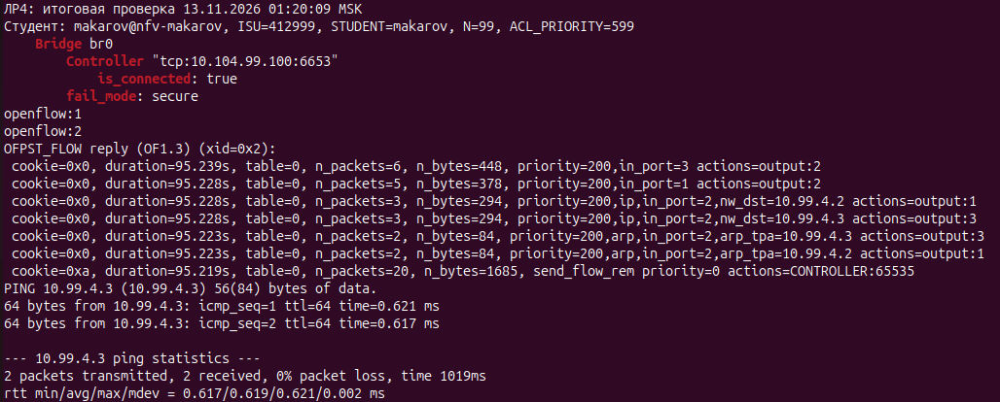

*Рисунок 16 – Итоговое состояние стенда и персональные данные*

Финальная проверка выполнена 13.11.2026 в 01:20:09 MSK. S2 подключён к контроллеру и работает в secure; оба устройства присутствуют в инвентаре. Правила имеют ненулевые счётчики, ping h1 → h3 прошёл: 2 из 2 ответа.

## 14 Ответы на вопросы и вывод

Out-of-band управление использует отдельную сеть для связи с контроллером. Это снижает зависимость канала управления от состояния правил на портах данных; доступность самой management-сети по-прежнему необходима.

Table-miss — правило для пакетов, не совпавших с другими записями. В стенде оно отправляло такие пакеты контроллеру; само по себе оно не создавало правила коммутации.

Config отражает заданные правила, operational — состояние и статистику. Ручное удаление правила в OVS изменяет устройство, но не обязательно конфигурацию ODL. При переподключении контроллер может согласовать состояния; в проведённой проверке правила восстановились.

Secure безопаснее с точки зрения соблюдения заданной политики, поскольку OVS не начинает самостоятельно обучаться при отказе контроллера. Standalone может сохранить локальную связность, но допускает пересылку вне ранее заданной политики.

В работе настроены проактивные правила и ACL, подтверждены счётчики и рассмотрено поведение при отключении ODL. Восстановление связи и потоков проверено после повторного подключения контроллера.

Репозиторий: https://github.com/DeltraWard/nfv-labs-makarov

## ПРИЛОЖЕНИЕ А Скрипт настройки OVS

```text
#!/bin/sh
set -e
: "${DPID:?Не задан DPID}" "${ODL_IP:?Не задан ODL_IP}"

datapath_id=$(printf '%016x' "$DPID")

ovs-vsctl --may-exist add-br br0 -- set bridge br0 datapath_type=netdev protocols=OpenFlow13 fail_mode=secure "other-config:datapath-id=$datapath_id" other-config:disable-in-band=true

for i in 1 2 3; do
  ip link show "eth$i" >/dev/null 2>&1 || continue
  ethtool -K "eth$i" tx off >/dev/null 2>&1 || true
  ip link set "eth$i" up
  ovs-vsctl --may-exist add-port br0 "eth$i" -- set interface "eth$i" ofport_request="$i"
done

ip link set br0 up
ovs-vsctl set-controller br0 "tcp:${ODL_IP}:6653"
ovs-vsctl show
```

## ПРИЛОЖЕНИЕ Б Скрипт отправки потоков

```text
#!/usr/bin/env bash
set -euo pipefail

cd -- "$(dirname -- "${BASH_SOURCE[0]}")/.."
source lab.env

response=$(mktemp)
trap 'rm -f "$response"' EXIT

for name in s1-1to2 s1-2to1 s2-to-h2-ip s2-to-h2-arp s2-to-h3-ip s2-to-h3-arp s2-1to2 s2-3to2; do
  switch=${name:1:1}
  flow_id="${STUDENT}-${name}"
  file="flows/${name}.json"
  url="${ODL}/rests/data/opendaylight-inventory:nodes/node=openflow%3A${switch}/flow-node-inventory:table=0/flow=${flow_id}"

  test -s "$file"
  status=$(curl --noproxy '*' -sS -u admin:admin -X PUT -H 'Content-Type: application/json' --data-binary "@${file}" -o "$response" -w '%{http_code}' "$url")

  echo "PUT ${flow_id}: HTTP ${status}"

  if [[ "$status" != 201 && "$status" != 204 ]]; then
    cat "$response"
    exit 1
  fi
done
```

## ПРИЛОЖЕНИЕ В Конфигурации потоков

Ниже приведены полные JSON-данные файлов flows в компактном формате. Каждая запись относится к указанному файлу.

acl-icmp-h3.json

```text
{"flow-node-inventory:flow":[{"id":"makarov-acl-icmp-h3","table_id":0,"priority":599,"match":{"in-port":"openflow:1:1","ethernet-match":{"ethernet-type":{"type":2048}},"ip-match":{"ip-protocol":1},"ipv4-destination":"10.99.4.3/32"},"instructions":{"instruction":[{"order":0,"apply-actions":{"action":[{"order":0,"drop-action":{}}]}}]}}]}
```

s1-1to2.json

```text
{"flow-node-inventory:flow":[{"id":"makarov-s1-1to2","table_id":0,"priority":200,"match":{"in-port":"openflow:1:1"},"instructions":{"instruction":[{"order":0,"apply-actions":{"action":[{"order":0,"output-action":{"output-node-connector":"2"}}]}}]}}]}
```

s1-2to1.json

```text
{"flow-node-inventory:flow":[{"id":"makarov-s1-2to1","table_id":0,"priority":200,"match":{"in-port":"openflow:1:2"},"instructions":{"instruction":[{"order":0,"apply-actions":{"action":[{"order":0,"output-action":{"output-node-connector":"1"}}]}}]}}]}
```

s2-1to2.json

```text
{"flow-node-inventory:flow":[{"id":"makarov-s2-1to2","table_id":0,"priority":200,"match":{"in-port":"openflow:2:1"},"instructions":{"instruction":[{"order":0,"apply-actions":{"action":[{"order":0,"output-action":{"output-node-connector":"2"}}]}}]}}]}
```

s2-3to2.json

```text
{"flow-node-inventory:flow":[{"id":"makarov-s2-3to2","table_id":0,"priority":200,"match":{"in-port":"openflow:2:3"},"instructions":{"instruction":[{"order":0,"apply-actions":{"action":[{"order":0,"output-action":{"output-node-connector":"2"}}]}}]}}]}
```

s2-to-h2-arp.json

```text
{"flow-node-inventory:flow":[{"id":"makarov-s2-to-h2-arp","table_id":0,"priority":200,"match":{"in-port":"openflow:2:2","ethernet-match":{"ethernet-type":{"type":2054}},"arp-target-transport-address":"10.99.4.2/32"},"instructions":{"instruction":[{"order":0,"apply-actions":{"action":[{"order":0,"output-action":{"output-node-connector":"1"}}]}}]}}]}
```

s2-to-h2-ip.json

```text
{"flow-node-inventory:flow":[{"id":"makarov-s2-to-h2-ip","table_id":0,"priority":200,"match":{"in-port":"openflow:2:2","ethernet-match":{"ethernet-type":{"type":2048}},"ipv4-destination":"10.99.4.2/32"},"instructions":{"instruction":[{"order":0,"apply-actions":{"action":[{"order":0,"output-action":{"output-node-connector":"1"}}]}}]}}]}
```

s2-to-h3-arp.json

```text
{"flow-node-inventory:flow":[{"id":"makarov-s2-to-h3-arp","table_id":0,"priority":200,"match":{"in-port":"openflow:2:2","ethernet-match":{"ethernet-type":{"type":2054}},"arp-target-transport-address":"10.99.4.3/32"},"instructions":{"instruction":[{"order":0,"apply-actions":{"action":[{"order":0,"output-action":{"output-node-connector":"3"}}]}}]}}]}
```

s2-to-h3-ip.json

```text
{"flow-node-inventory:flow":[{"id":"makarov-s2-to-h3-ip","table_id":0,"priority":200,"match":{"in-port":"openflow:2:2","ethernet-match":{"ethernet-type":{"type":2048}},"ipv4-destination":"10.99.4.3/32"},"instructions":{"instruction":[{"order":0,"apply-actions":{"action":[{"order":0,"output-action":{"output-node-connector":"3"}}]}}]}}]}
```

## ПРИЛОЖЕНИЕ Г Переменные и RESTCONF

```text
export ISU=412999
export STUDENT=makarov
export N=99
export ODL_IP=10.104.99.100
export ODL=http://10.104.99.100:8181
export ACL_PRIORITY=$((500 + N))
```

```text
odl_get() {
  curl --noproxy '*' -fsS --connect-timeout 5 --max-time 30 -u admin:admin -H 'Accept: application/yang-data+json' "$ODL/rests/data/$1" | jq .
}
```
