# Лабораторная работа 5

Макаров Максим Вячеславович, К3420, ИСУ 412999.

## ВВЕДЕНИЕ

Цель работы — построить мультивендорную сеть ЦОД и филиала, настроить eBGP между SONiC и MikroTik CHR, выход к учебному провайдеру через NAT, защиту межсетевым экраном, соединение филиала по WireGuard и управление RouterOS через REST API.

Стенд создан в containerlab в виртуальной машине Ubuntu. Проверены маршруты, фильтрация входящего трафика, двусторонняя связность между ЦОД и филиалом, обмен WireGuard через сеть ISP и операции REST API.

## 1 Персональные параметры и окружение

| Параметр | Значение |
| --- | --- |
| Обучающийся | Макаров Максим Вячеславович, К3420, ИСУ 412999 |
| STUDENT; N | makarov; 99 |
| Дата проверки | 16.11.2026 |
| Платформа | VMware Workstation, Ubuntu VM NFV-Makarov |
| Узлы | hq и br — MikroTik CHR; dc1 — SONiC VS; isp, pcb, srv1 — Linux |
| Образы | mikrotik/chr:7.23.8, sonic-course:202511, lab-tools:1.0 |
| Сеть управления | 10.105.99.0/24 |
| BGP AS | DC1: 65099; HQ: 65199 |
| Порт WireGuard | 13000 + N = UDP 13099 |

Для экземпляра CHR на отдельной предварительной проверке отображалась лицензия free. Она ограничивает исходящую скорость каждого интерфейса 1 Мбит/с; поэтому результаты измерения пропускной способности нельзя считать характеристикой производительности платных вариантов CHR.

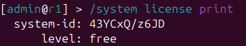

*Рисунок 1 – Уровень лицензии предварительного экземпляра CHR*

На VM устройство /dev/kvm отсутствовало. Образы CHR работали через QEMU в режиме программной эмуляции TCG, поэтому запуск был медленнее. SONiC VS использовал контейнер и ядро Ubuntu; аппаратная виртуализация для его контейнерного запуска не требовалась.

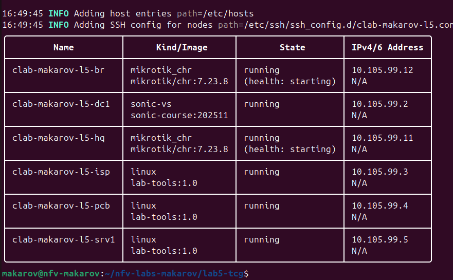

*Рисунок 2 – Состав развёрнутого стенда и адреса управления*

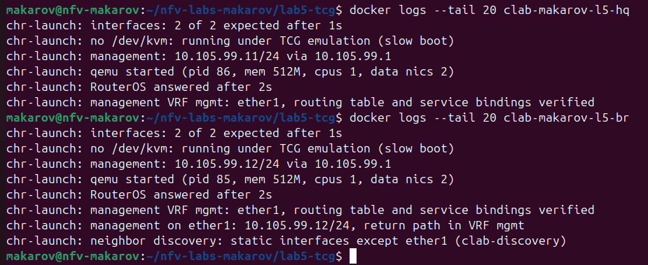

*Рисунок 3 – Запуск CHR в режиме TCG и инициализация VRF управления*

## 2 Схема сети и адресный план

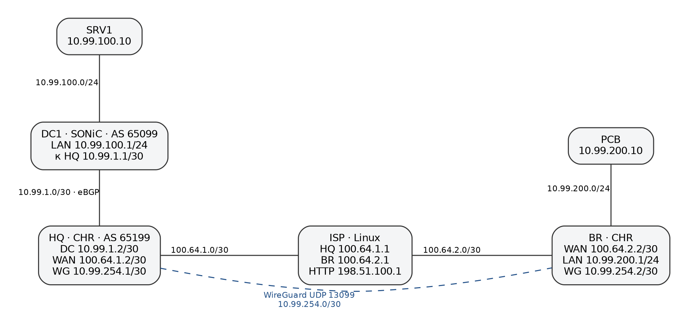

*Рисунок 4 – Топология ЦОД, сети провайдера и филиала; пунктиром обозначен туннель WireGuard*

| Узел / интерфейс | Адрес / назначение |
| --- | --- |
| HQ ether1 | 10.105.99.11/24, управление в VRF mgmt |
| HQ ether2 | 10.99.1.2/30, канал к DC1 |
| HQ ether3 | 100.64.1.2/30, канал к ISP |
| HQ wg-br | 10.99.254.1/30 |
| BR ether1 | 10.105.99.12/24, управление в VRF mgmt |
| BR ether2 | 100.64.2.2/30, канал к ISP |
| BR ether3 | 10.99.200.1/24, сеть филиала |
| BR wg-hq | 10.99.254.2/30 |
| DC1 Ethernet4 / Ethernet0 | 10.99.1.1/30 к HQ; 10.99.100.1/24 в ЦОД |
| SRV1 / PCB | 10.99.100.10 / 10.99.200.10 |
| ISP | 100.64.1.1 и 100.64.2.1 — шлюзы; 198.51.100.1 — учебный HTTP-сервер |

Сеть 198.51.100.0/24 используется в стенде как модель внешней сети. HTTP 200 от 198.51.100.1 подтверждает доступ к учебному серверу ISP, а не к произвольным узлам глобального интернета.

## 3 Настройка адресов и проверка каналов

На HQ задано имя hq-makarov, на BR — br-makarov. На обоих CHR настроены адреса и маршруты по умолчанию через соответствующие шлюзы ISP; адрес управления ether1 находится в отдельном VRF mgmt.

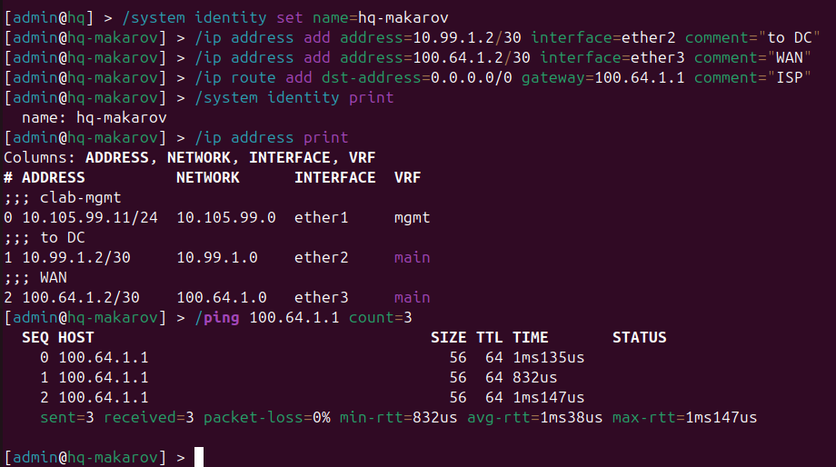

*Рисунок 5 – Имя и адреса HQ; три успешных ping к 100.64.1.1*

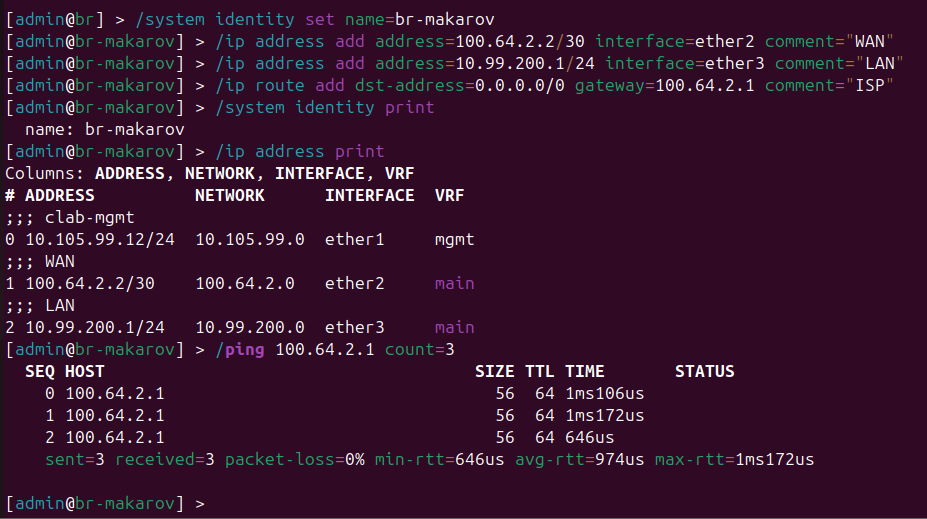

*Рисунок 6 – Имя и адреса BR; три успешных ping к 100.64.2.1*

На DC1 включены Ethernet0 и Ethernet4 и назначены адреса 10.99.100.1/24 и 10.99.1.1/30. Проверка DC1 → HQ по 10.99.1.2 дала три ответа из трёх.

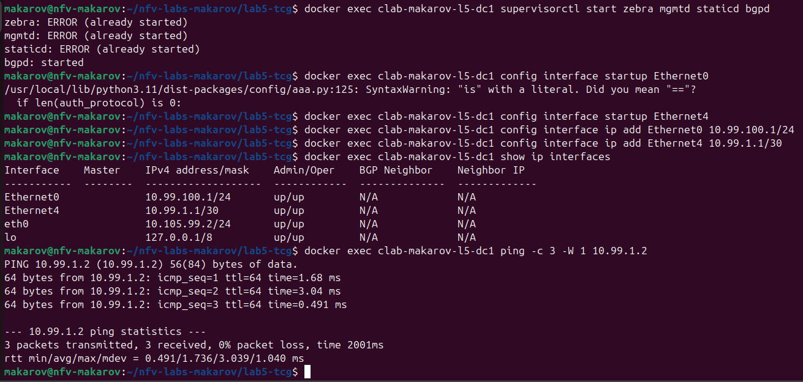

*Рисунок 7 – Интерфейсы DC1 и проверка соседнего адреса HQ*

## 4 eBGP между DC1 и HQ

На DC1 был удалён созданный для управления маршрут по умолчанию через eth0. Затем между DC1 AS 65099 и HQ AS 65199 настроена eBGP-сессия по сети 10.99.1.0/30. HQ получил маршрут к сети 10.99.100.0/24 через DC1, а DC1 — маршрут по умолчанию через HQ.

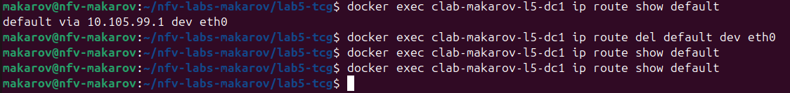

*Рисунок 8 – Удаление маршрута по умолчанию через management-интерфейс DC1*

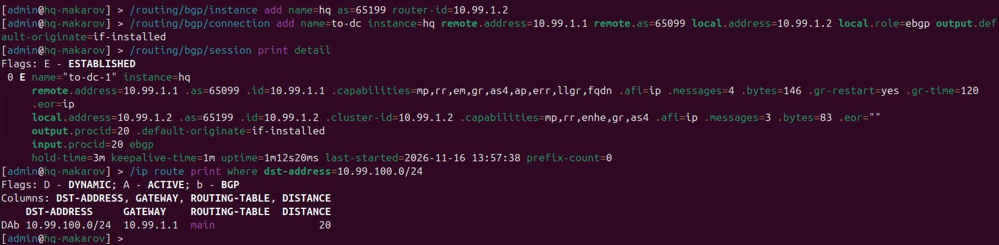

*Рисунок 9 – Установленная сессия eBGP на HQ и маршрут к сети ЦОД*

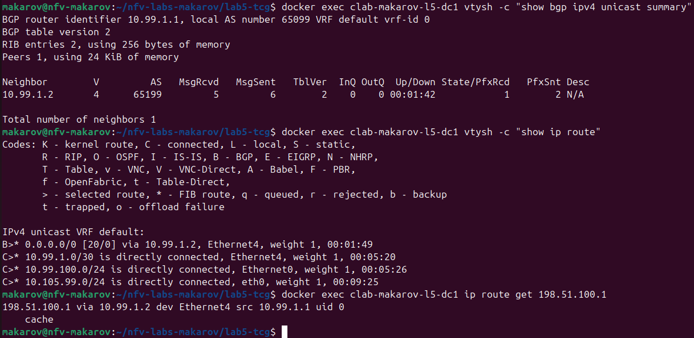

*Рисунок 10 – Состояние BGP и маршрут по умолчанию на DC1*

В таблице DC1 BGP-маршрут 0.0.0.0/0 установлен через 10.99.1.2 по Ethernet4. Команда ip route get 198.51.100.1 показала тот же следующий переход.

## 5 NAT и фильтрация трафика

На HQ добавлено правило srcnat masquerade для выхода через ether3. При HTTP-запросе от SRV1 учебный сервер ISP вернул 200, а в его журнале исходным адресом показан 100.64.1.2. Счётчик NAT после запроса увеличился.

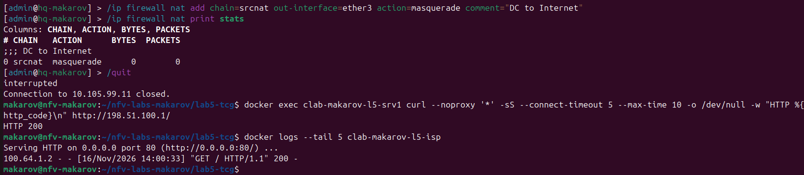

*Рисунок 11 – Проверка masquerade, HTTP 200 и запись в журнале ISP*

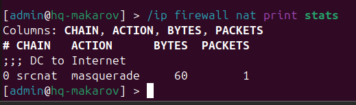

*Рисунок 12 – Счётчик правила masquerade после запроса*

На HQ использовалась политика запрета всего, что явно не разрешено. Ниже приведены наблюдавшиеся правила для входящего в маршрутизатор и транзитного трафика после добавления разрешений для туннеля.

| Цепочка и условие | Действие / назначение |
| --- | --- |
| input established, related | Разрешить установленные и связанные соединения |
| input invalid | Отбросить некорректные пакеты |
| input ICMP | Разрешить ICMP к маршрутизатору |
| input in-interface=mgmt | Разрешить управление |
| input TCP ether2 dst-port=179 | Разрешить eBGP от DC1 |
| input UDP ether3 dst-port=13099 | Разрешить WireGuard с WAN |
| input ether3; затем input по умолчанию | Отбросить остальные обращения |
| forward established, related | Разрешить ответы и связанный трафик |
| forward invalid | Отбросить некорректные пакеты |
| forward ether2 → ether3 | Разрешить трафик ЦОД в сеть ISP |
| forward wg-br → ether2 | Разрешить филиал → ЦОД |
| forward ether2 → wg-br | Разрешить ЦОД → филиал |
| forward по умолчанию | Отбросить остальные пакеты |

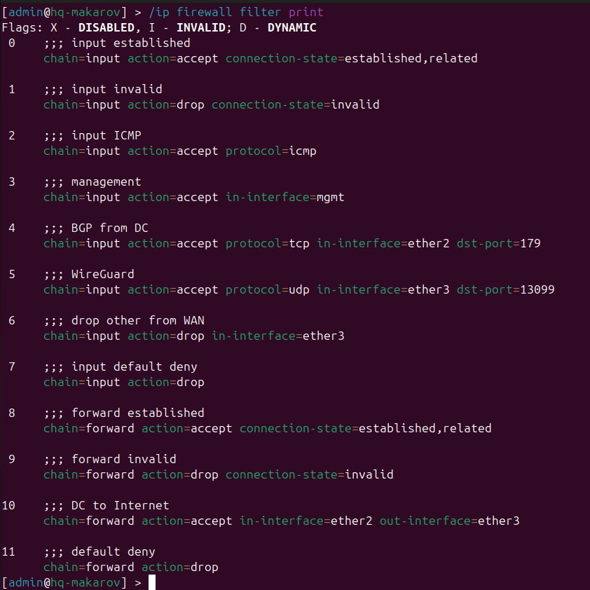

*Рисунок 13 – Исходные правила фильтрации на HQ*

Для отрицательной проверки на ISP был добавлен маршрут к 10.99.0.0/16 через HQ, после чего три ICMP-запроса к SRV1 не получили ответа. В статистике конечного правила forward drop показано три пакета. Проверен именно этот входящий сценарий.

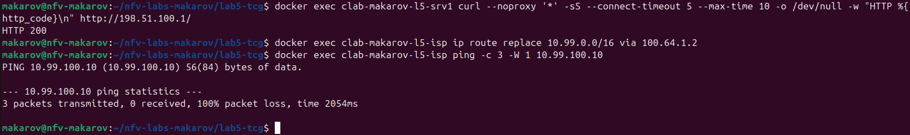

*Рисунок 14 – Запрос HTTP и попытка ping к серверу ЦОД со стороны ISP*

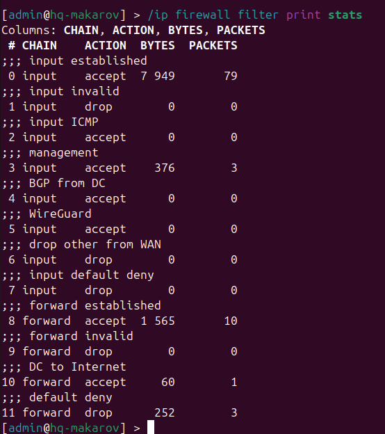

*Рисунок 15 – Счётчики правил после проверки блокировки*

## 6 WireGuard и связь с филиалом

На HQ создан интерфейс wg-br с адресом 10.99.254.1/30, на BR — wg-hq с адресом 10.99.254.2/30. Оба интерфейса слушают UDP 13099. Пиры используют публичные ключи противоположной стороны, конечные точки 100.64.2.2 и 100.64.1.2, а также разрешённые адреса туннеля и соответствующих сетей. Закрытые ключи в отчёте не приводятся.

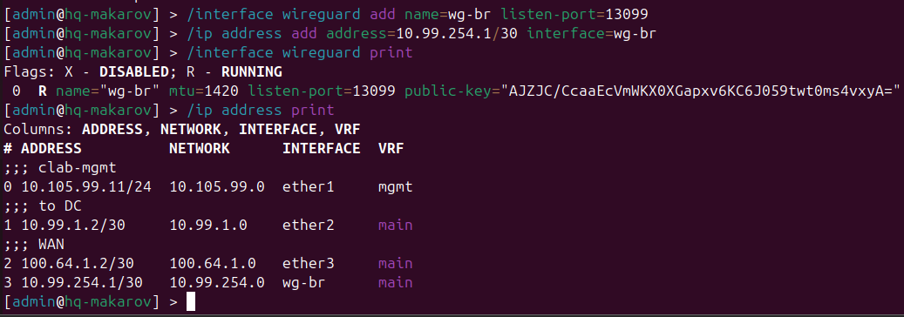

*Рисунок 16 – Интерфейс WireGuard и адрес туннеля на HQ*

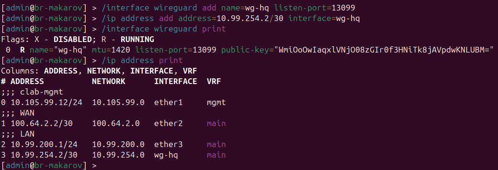

*Рисунок 17 – Интерфейс WireGuard и адрес туннеля на BR*

На HQ маршрут к 10.99.200.0/24 направлен через wg-br, на BR маршрут к 10.99.100.0/24 — через wg-hq. На HQ в цепочке forward разрешена передача между интерфейсами wg-br и ether2. DC1 получил маршрут к филиалу по BGP через 10.99.1.2.

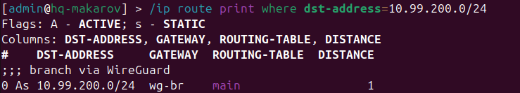

*Рисунок 18 – Статический маршрут HQ к сети филиала*

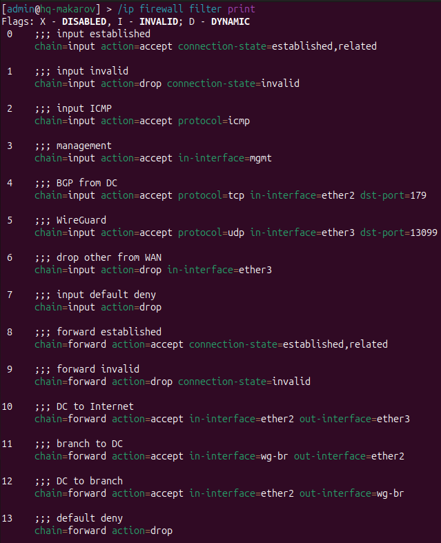

*Рисунок 19 – Правила HQ для передачи между WireGuard и ЦОД*

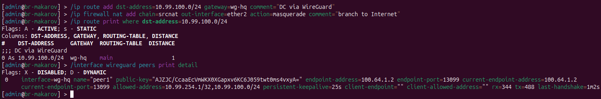

*Рисунок 20 – Маршрут BR к сети ЦОД и состояние пира WireGuard*

Проверка ping из PCB в SRV1 и в обратном направлении прошла без потерь: по три ответа из трёх. На HQ отображался недавний handshake и изменялись счётчики приёма и передачи.

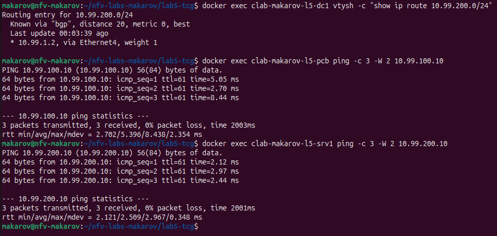

*Рисунок 21 – BGP-маршрут к филиалу и успешный ping в обоих направлениях*

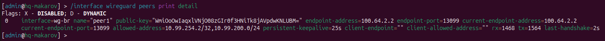

*Рисунок 22 – Недавний handshake и счётчики пира на HQ*

Во время ping в точке ISP выполнен tcpdump с фильтром UDP 13099. В показанных строках видны только внешние адреса 100.64.2.2 и 100.64.1.2 с портом 13099. Это соответствует передаче WireGuard через провайдера; конкретный краткий вывод tcpdump показывает внешние заголовки, а не является самостоятельным криптографическим анализом полезной нагрузки.

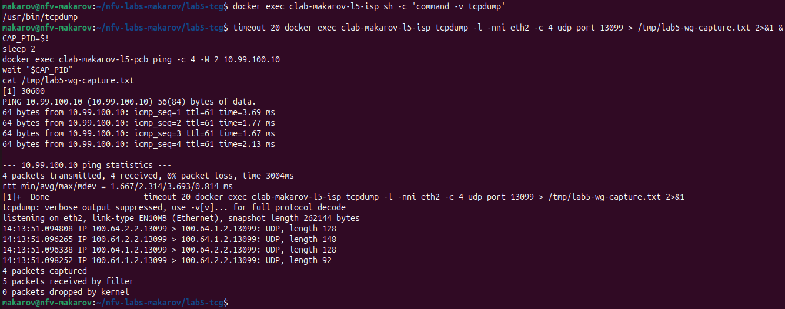

*Рисунок 23 – Ping и захват внешних UDP-пакетов WireGuard на ISP*

## 7 REST API и файлы конфигурации

Через REST API HQ получены имя устройства и адреса интерфейсов, затем состояние BGP-сессии. В списке firewall address-list создана тестовая запись 192.0.2.99, её комментарий изменён через PATCH, после чего запись удалена через DELETE. Ответ удаления — HTTP 204; повторный запрос с фильтром ID вернул пустой список.

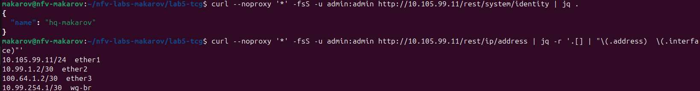

*Рисунок 24 – Чтение имени HQ и адресов интерфейсов через REST*

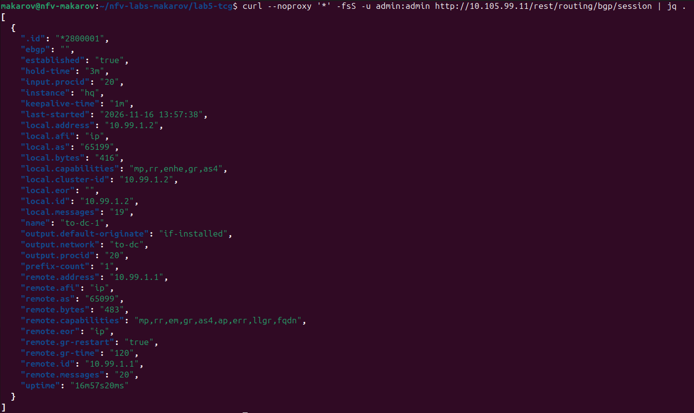

*Рисунок 25 – Состояние установленной BGP-сессии в ответе REST*

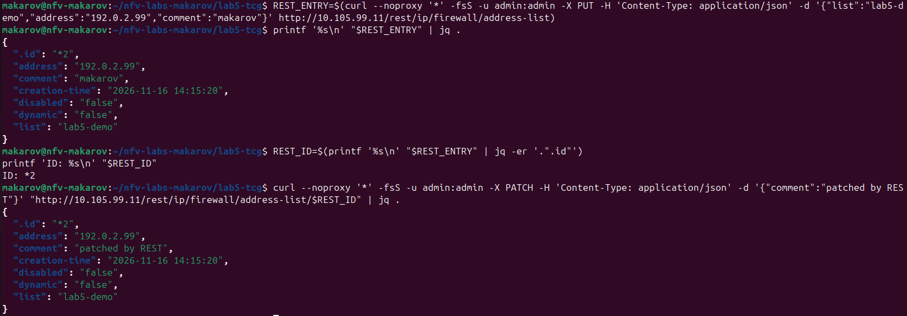

*Рисунок 26 – Создание тестовой записи и изменение комментария*

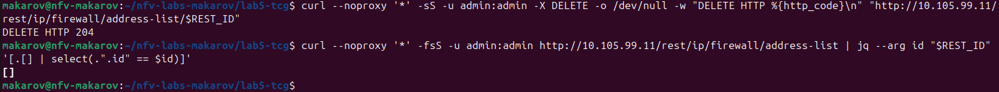

*Рисунок 27 – Удаление тестовой записи и проверка результата*

Работа с HTTP и демонстрационной учётной записью относится к изолированному учебному стенду. Для реального управления используют защищённый канал и отдельные учётные данные с необходимыми правами.

В каталоге configs/ сохранены hq.rsc, br.rsc и dc1-frr.conf. Полное содержимое предоставленных файлов приведено в приложении. Экспорты RouterOS содержат публичные ключи пиров; закрытые ключи в них отсутствуют.

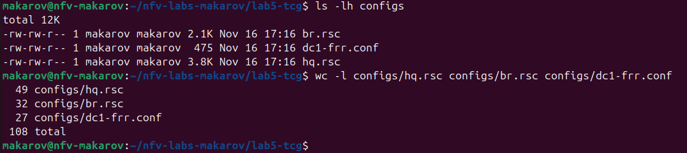

*Рисунок 28 – Файлы выгруженных конфигураций*

## 8 Итоговая проверка

На DC1 отображались два BGP-маршрута: 0.0.0.0/0 и 10.99.200.0/24 через 10.99.1.2. Проверка PCB → SRV1 дала два ответа из двух; HTTP-запрос от SRV1 к учебному ISP вернул 200. На снимке также показаны дата, имя пользователя и имя хоста.

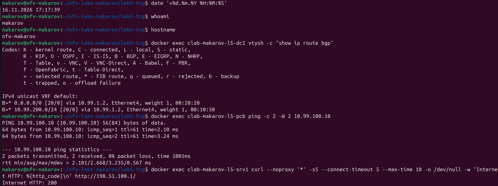

*Рисунок 29 – Маршруты BGP, ping филиал → ЦОД и HTTP 200 от ISP*

Проверки identity, установленного BGP и свежего handshake зафиксированы на отдельных снимках выше. Требуемый заданием единый непрерывный вывод всех итоговых команд на одном скриншоте представленными материалами не подтверждён.

## 9 Ответы на вопросы

Почему CHR нуждается в виртуализации, а SONiC VS в этом стенде — нет? CHR — отдельная гостевая система, запускаемая в виртуальной машине QEMU; KVM ускоряет её выполнение. В этом опыте аппаратное ускорение отсутствовало, но программная эмуляция TCG позволила CHR работать. SONiC VS запускался контейнером и использовал ядро Ubuntu-хоста.

Почему удалён маршрут через eth0? Маршрут по умолчанию для управления мог оказаться предпочтительнее BGP-маршрута и увести проверочный трафик в management-сеть. После удаления в показанной таблице выбран BGP-маршрут через HQ. Выбор зависит от типа маршрутов, метрик и настроек конкретной системы.

Почему if-installed надёжнее always? HQ объявляет маршрут по умолчанию при наличии подходящего маршрута в собственной таблице. Это уменьшает риск объявлять доступ наружу при отсутствии маршрута. При этом наличие маршрута само по себе ещё не гарантирует работоспособность конечного ресурса.

Почему проходит ответ ISP на исходящий запрос? Межсетевой экран отслеживает состояние соединений. Правило forward established,related пропускает ответные пакеты уже разрешённого соединения; отдельное общее разрешение новых соединений с WAN в ЦОД не требуется.

Что видит провайдер? В зафиксированном выводе — внешние IP-адреса CHR и UDP-порт 13099. Внутренние адреса туннелируемого обмена в показанных внешних заголовках не отображаются; содержимое транспортных сообщений WireGuard защищено шифрованием.

Почему приватный ключ не приводится в экспорте и где хранить секреты? Обычный export RouterOS скрывает чувствительные параметры. Закрытые ключи, пароли и токены нельзя публиковать в открытом Git-репозитории; их следует хранить отдельно в защищённом хранилище и передавать по защищённому каналу.

## ЗАКЛЮЧЕНИЕ

Построен стенд из MikroTik CHR, SONiC VS и Linux-узлов. Между ЦОД и HQ установлена eBGP-сессия, проверены маршрут по умолчанию и маршрут филиала. На HQ настроены NAT и межсетевой экран; между HQ и BR организован WireGuard. Связность ЦОД и филиала, блокировка одного входящего сценария, запрос к учебному ISP и операции REST подтверждены результатами проверок.

Полное воспроизведение после destroy/deploy в представленных материалах не показано. Поскольку закрытые ключи WireGuard не входят в приведённые экспорты, при восстановлении потребуется сохранить действующие ключи отдельно или создать новые и обновить публичные ключи пиров.

## ПРИЛОЖЕНИЕ А Файлы конфигурации

Ниже приведено содержимое полученных файлов. В экспорт RouterOS не включены закрытые ключи и пароли. Конфигурация dc1-frr.conf приведена как получена, включая служебные строки вывода.

### configs/hq.rsc

```text
# 2026-11-16 14:16:41 by RouterOS 7.23.8
# system id = DolDD9UDRVI
#
/interface ethernet set [ find default-name=ether1 ] disable-running-check=no
/interface ethernet set [ find default-name=ether2 ] disable-running-check=no
/interface ethernet set [ find default-name=ether3 ] disable-running-check=no
/interface wireguard add listen-port=13099 mtu=1420 name=wg-br
/interface list add comment=clab-mgmt name=clab-management
/interface list add comment=clab-mgmt exclude=clab-management include=static name=clab-discovery
/ip vrf add comment=clab-mgmt interfaces=ether1 name=mgmt
/routing bgp instance add as=65199 name=hq router-id=10.99.1.2
/ip neighbor discovery-settings set discover-interface-list=clab-discovery
/interface list member add comment=clab-mgmt interface=ether1 list=clab-management
/interface wireguard peers add allowed-address=10.99.254.2/32,10.99.200.0/24 endpoint-address=100.64.2.2 endpoint-port=13099 interface=wg-br name=peer1 persistent-keepalive=25s public-key="WmiOoOwIaqxlVNjO08zGIr0f3HNiTk8jAVpdwKNLUBM="
/ip address add address=10.105.99.11/24 comment=clab-mgmt interface=ether1 network=10.105.99.0
/ip address add address=10.99.1.2/30 comment="to DC" interface=ether2 network=10.99.1.0
/ip address add address=100.64.1.2/30 comment=WAN interface=ether3 network=100.64.1.0
/ip address add address=10.99.254.1/30 interface=wg-br network=10.99.254.0
/ip dhcp-client add disabled=yes interface=ether1 name=client1
/ip firewall address-list add address=10.99.200.0/24 list=to-dc
/ip firewall filter add action=accept chain=input comment="input established" connection-state=established,related
/ip firewall filter add action=drop chain=input comment="input invalid" connection-state=invalid
/ip firewall filter add action=accept chain=input comment="input ICMP" protocol=icmp
/ip firewall filter add action=accept chain=input comment=management in-interface=mgmt
/ip firewall filter add action=accept chain=input comment="BGP from DC" dst-port=179 in-interface=ether2 protocol=tcp
/ip firewall filter add action=accept chain=input comment=WireGuard dst-port=13099 in-interface=ether3 protocol=udp
/ip firewall filter add action=drop chain=input comment="drop other from WAN" in-interface=ether3
/ip firewall filter add action=drop chain=input comment="input default deny"
/ip firewall filter add action=accept chain=forward comment="forward established" connection-state=established,related
/ip firewall filter add action=drop chain=forward comment="forward invalid" connection-state=invalid
/ip firewall filter add action=accept chain=forward comment="DC to Internet" in-interface=ether2 out-interface=ether3
/ip firewall filter add action=accept chain=forward comment="branch to DC" in-interface=wg-br out-interface=ether2
/ip firewall filter add action=accept chain=forward comment="DC to branch" in-interface=ether2 out-interface=wg-br
/ip firewall filter add action=drop chain=forward comment="default deny"
/ip firewall nat add action=masquerade chain=srcnat comment="DC to Internet" out-interface=ether3
/ip route add comment=clab-mgmt dst-address=0.0.0.0/0 gateway=10.105.99.1@mgmt routing-table=mgmt
/ip route add comment=ISP dst-address=0.0.0.0/0 gateway=100.64.1.1
/ip route add comment="branch via WireGuard" dst-address=10.99.200.0/24 gateway=wg-br
/ip service set ssh vrf=mgmt
/ip service set telnet vrf=mgmt
/ip service set www vrf=mgmt
/ip service set www-ssl vrf=mgmt
/ip service set winbox vrf=mgmt
/ip service set api vrf=mgmt
/ip service set api-ssl vrf=mgmt
/ipv6 nd add interface=ether1 ra-lifetime=none
/routing bgp connection add instance=hq local.address=10.99.1.2 .role=ebgp name=to-dc output.default-originate=if-installed .network=to-dc remote.address=10.99.1.1 .as=65099
/snmp set vrf=mgmt
/system identity set name=hq-makarov
```

### configs/br.rsc

```text
# 2026-11-16 14:16:51 by RouterOS 7.23.8
# system id = dmyQrFUlrkP
#
/interface ethernet set [ find default-name=ether1 ] disable-running-check=no
/interface ethernet set [ find default-name=ether2 ] disable-running-check=no
/interface ethernet set [ find default-name=ether3 ] disable-running-check=no
/interface wireguard add listen-port=13099 mtu=1420 name=wg-hq
/interface list add comment=clab-mgmt name=clab-management
/interface list add comment=clab-mgmt exclude=clab-management include=static name=clab-discovery
/ip vrf add comment=clab-mgmt interfaces=ether1 name=mgmt
/ip neighbor discovery-settings set discover-interface-list=clab-discovery
/interface list member add comment=clab-mgmt interface=ether1 list=clab-management
/interface wireguard peers add allowed-address=10.99.254.1/32,10.99.100.0/24 endpoint-address=100.64.1.2 endpoint-port=13099 interface=wg-hq name=peer1 persistent-keepalive=25s public-key="AJZJC/CcaaEcVmWKX0XGapxv6KC6J059twt0ms4vxyA="
/ip address add address=10.105.99.12/24 comment=clab-mgmt interface=ether1 network=10.105.99.0
/ip address add address=100.64.2.2/30 comment=WAN interface=ether2 network=100.64.2.0
/ip address add address=10.99.200.1/24 comment=LAN interface=ether3 network=10.99.200.0
/ip address add address=10.99.254.2/30 interface=wg-hq network=10.99.254.0
/ip dhcp-client add disabled=yes interface=ether1 name=client1
/ip firewall nat add action=masquerade chain=srcnat comment="branch to Internet" out-interface=ether2
/ip route add comment=clab-mgmt dst-address=0.0.0.0/0 gateway=10.105.99.1@mgmt routing-table=mgmt
/ip route add comment=ISP dst-address=0.0.0.0/0 gateway=100.64.2.1
/ip route add comment="DC via WireGuard" dst-address=10.99.100.0/24 gateway=wg-hq
/ip service set ssh vrf=mgmt
/ip service set telnet vrf=mgmt
/ip service set www vrf=mgmt
/ip service set www-ssl vrf=mgmt
/ip service set winbox vrf=mgmt
/ip service set api vrf=mgmt
/ip service set api-ssl vrf=mgmt
/ipv6 nd add interface=ether1 ra-lifetime=none
/snmp set vrf=mgmt
/system identity set name=br-makarov
```

### configs/dc1-frr.conf

```text
Building configuration...

Current configuration:
!
frr version 10.4.1
frr defaults traditional
hostname dc1
zebra nexthop-group keep 1
fpm address 127.0.0.1
no fpm use-next-hop-groups
service integrated-vtysh-config
!
router bgp 65099
 bgp router-id 10.99.1.1
 no bgp ebgp-requires-policy
 neighbor 10.99.1.2 remote-as 65199
 !
 address-family ipv4 unicast
  network 10.99.100.0/24
 exit-address-family
exit
!
ip nht resolve-via-default
!
ipv6 nht resolve-via-default
!
end
```
