# Лабораторная работа 6

Цепочка сервисных функций и жизненный цикл VNF под управлением SDN.

Макаров Максим Вячеславович, К3420, ИСУ 412999.

[Отчёт DOCX](ЛР6_Макаров_МВ_412999.docx) · [Отчёт PDF](ЛР6_Макаров_МВ_412999.pdf)

## Введение

Цель работы — развернуть сервисную цепочку из межсетевого экрана и шейпера, управлять её потоками через OpenDaylight и выполнить создание, настройку, масштабирование, восстановление и удаление экземпляров VNF.

Стенд работал в виртуальной машине Ubuntu на личном ПК. Проверены отсутствие связи до установки потоков, фильтрация и ограничение скорости, перенос одной цепочки на второй firewall и восстановление после отказа первого.

## 1 Персональные параметры

| Параметр | Значение |
| --- | --- |
| Обучающийся | Макаров Максим Вячеславович, К3420, ИСУ 412999 |
| STUDENT / N | makarov / 99 |
| Дата выполнения | 16.11.2026 |
| Окружение | Ubuntu VM NFV-Makarov, Docker, containerlab |
| Management-подсеть | 10.106.99.0/24 |
| Контроллер / коммутатор | 10.106.99.100 / 10.106.99.10 |
| client1 / client2 | 10.99.6.11/24 / 10.99.6.12/24 |
| server | 10.99.6.100/24 |
| Запрещённый порт | 8000 + 99 = TCP 8099 |
| Ограничение шейпера | 10 + (99 mod 10) = 19 Мбит/с |
| Имена цепочек | makarov-c1 и makarov-c2 |

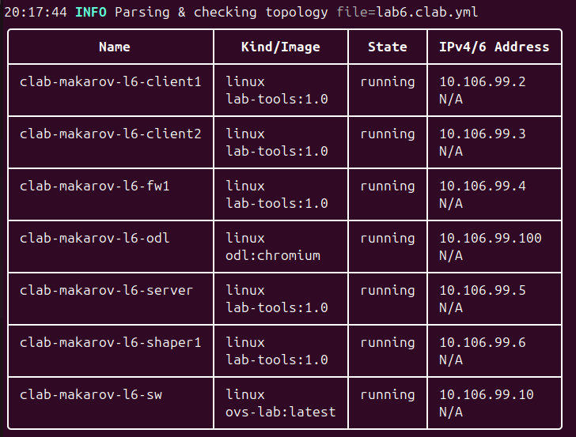

*Рисунок 1 — Развёрнутые узлы и адреса управления.*

## 2 Топология и компоненты NFV

Клиенты и сервер подключены к одному OVS. Каждая сетевая функция включена в разрыв через два порта коммутатора. Исходно обе цепочки проходили через fw1 и shaper1. После scale-out цепочка c2 была переведена на fw2, а после отказа fw1 на fw2 переведена и c1.

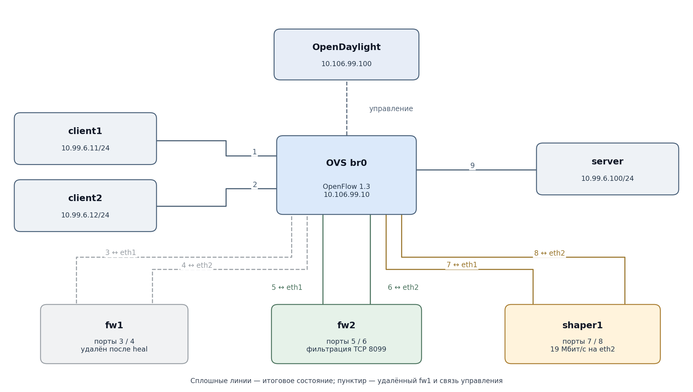

*Рисунок 2 — Схема NFVI и подключения VNF; fw1 показан как удалённый после восстановления.*

| Компонент | Назначение в работе |
| --- | --- |
| NFVI | Виртуальная машина, Docker, OVS с userspace datapath и контейнеры VNF |
| VIM | Docker и containerlab для контейнеров и виртуальных каналов |
| SDN-контроллер | OpenDaylight управляет потоками OpenFlow 1.3 в OVS |
| VNFM | vnfm.sh создаёт, настраивает и удаляет экземпляры VNF |
| NFVO | nfvo.py читает VNFFG и программирует потоки через RESTCONF |
| VNFD / VNFFGD | descriptors/*.yaml / vnffg.yaml: описания функций и цепочек |

Мост br0 коммутатора работал в режиме fail-mode secure и был подключён к контроллеру. До установки потоков ping от client1 к серверу не проходил: два пакета отправлены, ответов нет.

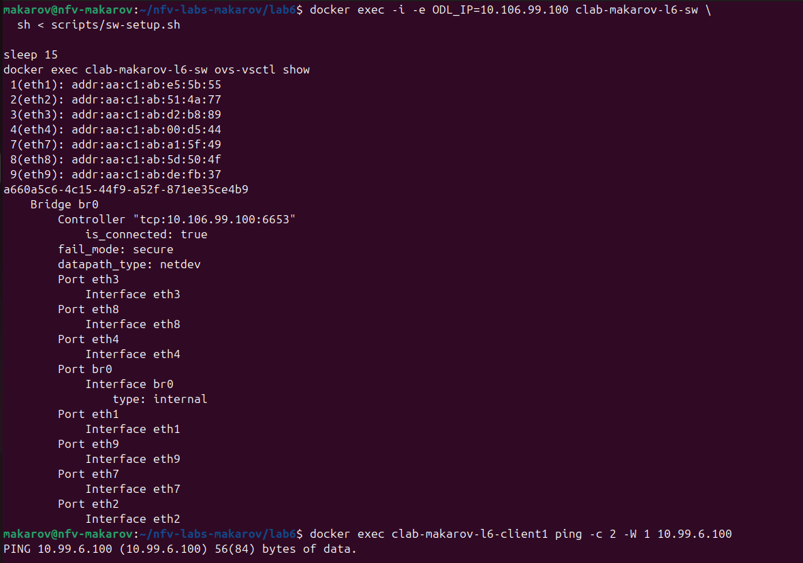

*Рисунок 3 — OVS подключён к контроллеру; интерфейсы коммутатора.*

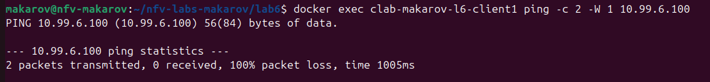

*Рисунок 4 — Проверка client1 до установки сервисной цепочки.*

## 3 Дескрипторы и настройка VNF

В дескрипторе fw-vnfd.yaml указан provider makarov. По его образцу создан shaper-vnfd.yaml с интерфейсами eth1 и eth2, настройкой tc и max_instances: 1. Внутри каждой VNF создан прозрачный мост br0 между eth1 и eth2; IP-адреса в сети данных VNF не назначались.

```bash
./vnfm.sh configure fw1 fw
./vnfm.sh configure shaper1 shaper
./vnfm.sh list
docker exec clab-makarov-l6-fw1 nft list ruleset
docker exec clab-makarov-l6-shaper1 tc qdisc show dev eth2
```

На сервере были запущены HTTP на портах 80 и 8099 и iperf3 на порту 5201. Правила nftables блокируют TCP 8099, учитывают разрешённый HTTP на 80 и ICMP; политика цепочки forward — accept, поэтому другие типы трафика этими правилами не запрещаются.

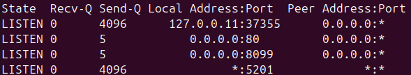

*Рисунок 5 — Прослушиваемые порты серверных приложений.*

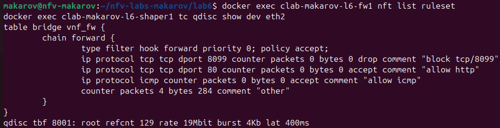

*Рисунок 6 — Исходные правила fw1 и настройка шейпера на 19 Мбит/с.*

Первоначальная команда tc использовала burst 32kbit, что отображалось как burst 4Kb. Прямой iperf3 оборвался с ошибкой. После пробного увеличения burst до 128kb тест завершился; этот параметр также внесён в vnfm.sh и shaper-vnfd.yaml. Это наблюдение показывает, что изменение помогло в данном запуске, но само по себе не устанавливает единственную причину первоначальной ошибки.

```bash
tc qdisc replace dev eth2 root tbf rate 19mbit burst 128kb latency 400ms
```

## 4 Построение сервисных цепочек

На исходном этапе в vnffg.yaml обе цепочки ссылались на [fw1, shaper1]. Команда nfvo.py apply сформировала 24 записи: для каждого из трёх переходов в двух направлениях для каждого клиента создаются отдельные правила IPv4 и ARP. В снимке dump-flows показаны правила с приоритетом 300.

```bash
python3 nfvo.py apply vnffg.yaml
docker exec clab-makarov-l6-sw ovs-ofctl -O OpenFlow13 dump-flows br0 | grep "priority=300"
python3 nfvo.py show vnffg.yaml
```

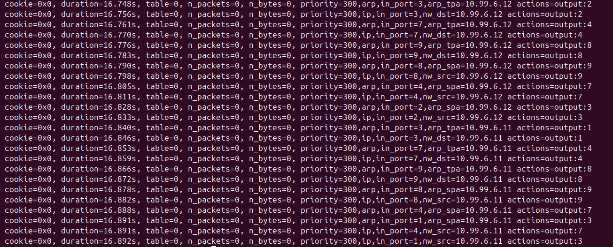

*Рисунок 7 — Правила OpenFlow исходных цепочек.*

Таблица показывает переходы цепочки c1 на OVS. В каждом переходе устанавливаются отдельные правила для IPv4 и ARP; обработка внутри самой VNF выполняется её мостом br0.

| Направление | Исходная цепочка через fw1 | Итоговая цепочка через fw2 |
| --- | --- | --- |
| К серверу, шаг 1 | 1 → 3 | 1 → 5 |
| К серверу, шаг 2 | 4 → 7 | 6 → 7 |
| К серверу, шаг 3 | 8 → 9 | 8 → 9 |
| К клиенту, шаг 1 | 9 → 8 | 9 → 8 |
| К клиенту, шаг 2 | 7 → 4 | 7 → 6 |
| К клиенту, шаг 3 | 3 → 1 | 5 → 1 |

В прямом направлении правила выбирают трафик по исходному адресу клиента. В обратном направлении адрес клиента является адресом назначения; такое сопоставление позволяет вернуть ответы по нужной цепочке.

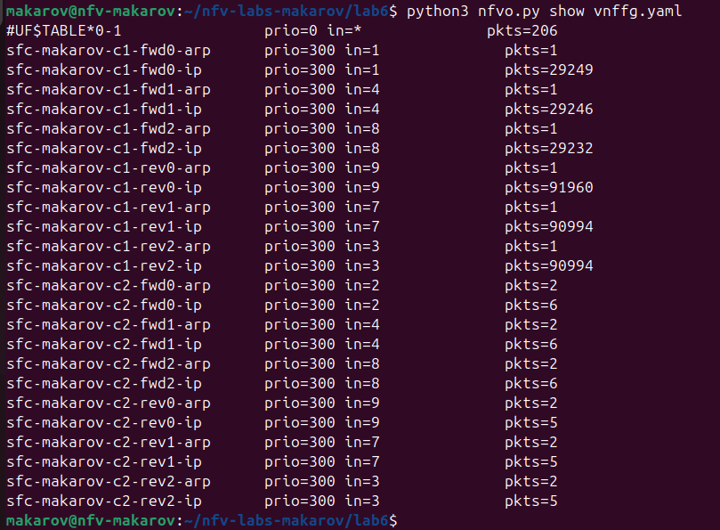

*Рисунок 8 — Счётчики потоков обеих цепочек после проверочного трафика.*

## 5 Проверка функций исходной цепочки

После применения правил client1 получил три ответа ping из трёх. HTTP на порту 80 вернул код 200 у обоих клиентов. Запрос client1 к TCP 8099 завершился кодом 000; счётчик правила block на fw1 вырос до трёх пакетов.

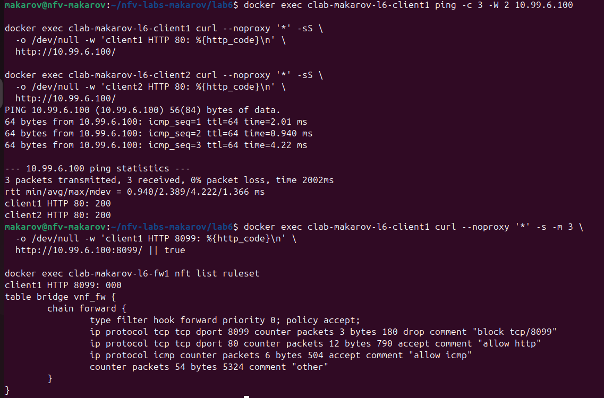

*Рисунок 9 — Связность, разрешённый HTTP и блокировка TCP 8099 на fw1.*

В исходной попытке прямой iperf3 завершился ошибкой control socket has closed unexpectedly после первого интервала. Обратный тест при этом завершился: 1,37 Гбит/с на приёмнике и 1387 повторных передач на отправителе. Ограничение tc установлено на выходе eth2 шейпера, поэтому эта обратная передача не сравнима напрямую с ограниченным направлением.

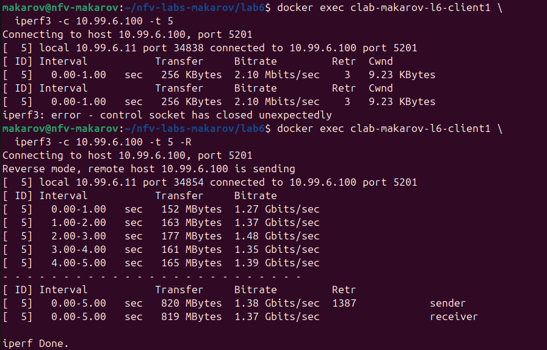

*Рисунок 10 — Первоначальная ошибка прямого теста и результат обратного направления.*

После увеличения burst прямой тест за 8 секунд завершился. На приёмнике получено 18,9 Мбит/с, на отправителе — 20,1 Мбит/с; показано 14 повторных передач. На qdisc зафиксировано 15 отброшенных пакетов. Значение приёмника близко к установленным 19 Мбит/с.

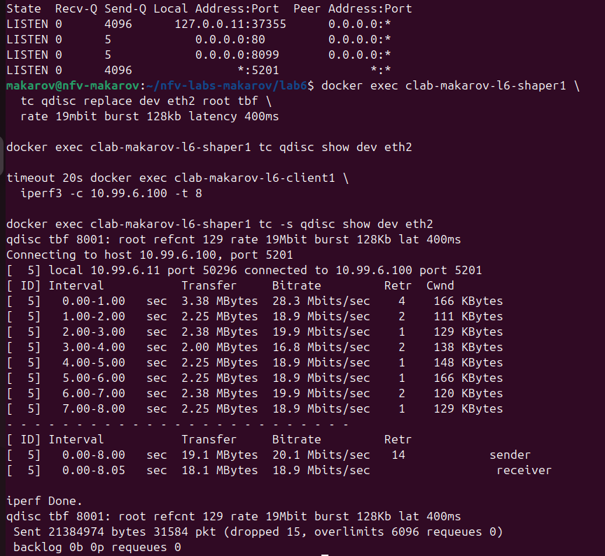

*Рисунок 11 — Прямой iperf3 после изменения burst и статистика qdisc.*

## 6 Scale-out и распределение цепочек

Второй экземпляр создан командой vnfm.sh instantiate fw2 fw 5 6. Скрипт запускает привилегированный контейнер без сети Docker, создаёт две пары veth, подключает их к портам OVS 5 и 6 и применяет настройку моста и nftables. Оба порта были видны в ovs-ofctl show.

```bash
./vnfm.sh instantiate fw2 fw 5 6
./vnfm.sh list
docker exec clab-makarov-l6-sw ovs-ofctl -O OpenFlow13 show br0
```

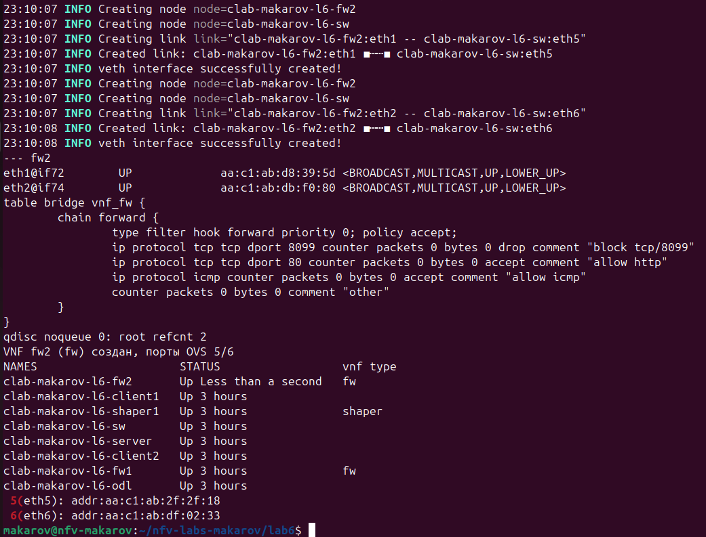

*Рисунок 12 — Создание fw2 и подключение портов 5 и 6.*

Затем в vnffg.yaml путь makarov-c2 изменён на [fw2, shaper1] и правила применены повторно. У обоих клиентов HTTP вернул 200. После запроса client2 счётчик разрешённого HTTP на fw2 вырос с 0 до 6 при неизменных 12 на fw1; после запроса client1 счётчик fw1 вырос до 18, а fw2 остался равен 6.

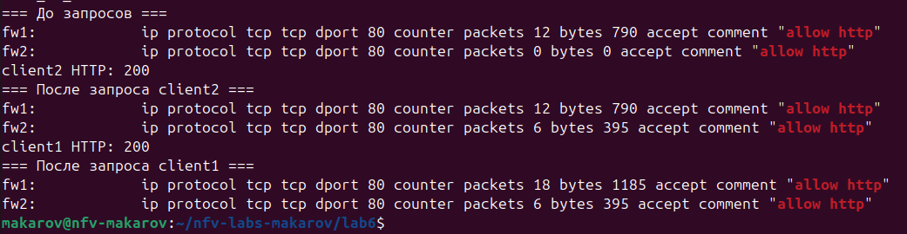

*Рисунок 13 — Проверка распределения запросов между fw1 и fw2.*

## 7 Отказ и восстановление

Остановкой fw1 смоделирован отказ. В этот момент client1 потерял оба отправленных ping, а client2 получил два ответа через fw2. После перевода c1 на [fw2, shaper1] и повторного применения 24 потоков оба клиента вновь получили ответы.

От начала команды остановки fw1 до первого успешного ping client1 прошло 13,46 с. Интервал измерялся в одном запущенном вручную сценарии и включает остановку контейнера, отрицательную и положительную проверки ping и применение правил контроллером; он не равен отдельно измеренному времени сходимости OpenFlow.

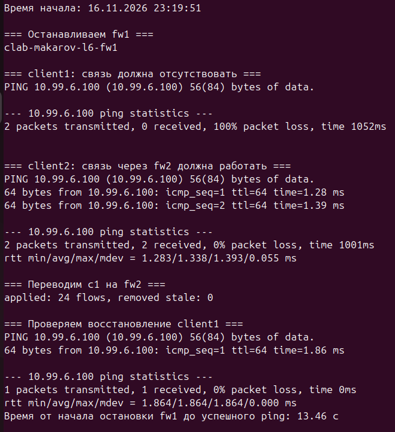

*Рисунок 14 — Остановка fw1, проверки связи и время восстановления client1.*

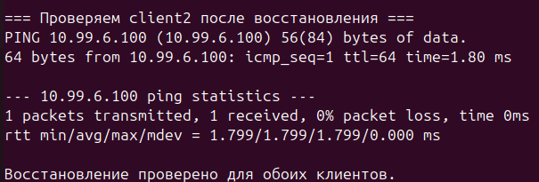

*Рисунок 15 — Проверка client2 после восстановления.*

После проверки выполнена команда terminate для fw1 и портов 3/4. В списке остались работающие fw2 и shaper1. Непрерывный фоновый мониторинг и команда watch в этом опыте не реализованы: переключение выполнял запущенный вручную сценарий.

```bash
./vnfm.sh terminate fw1 3 4
./vnfm.sh list
```

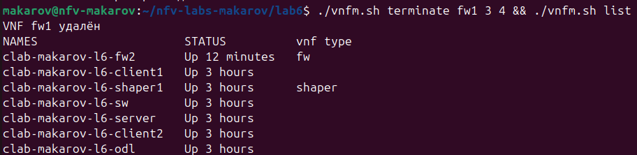

*Рисунок 16 — Список контейнеров после удаления fw1.*

После восстановления HTTP на 80 вернул 200 для обоих клиентов. Запрос client1 к 8099 дал 000, а счётчик блокирующего правила fw2 увеличился с нуля до трёх пакетов.

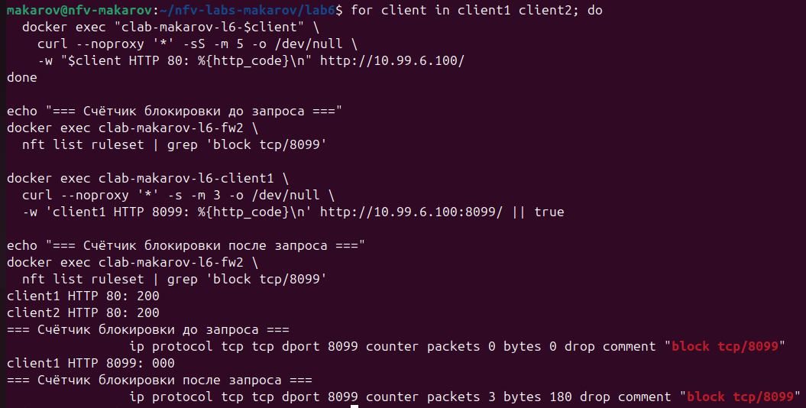

*Рисунок 17 — Проверка HTTP и блокировки на fw2 после восстановления.*

## 8 Производительность и нагрузка

После восстановления запущен обратный тест iperf3 длительностью 10 с с четырьмя параллельными потоками. Итоговая сумма составила 1,89 Гбит/с на отправителе и приёмнике; отправитель показал 7087 повторных передач. Эта передача направлена от сервера к клиенту и не характеризует ограничение на выходе eth2 в прямом направлении.

```bash
docker exec clab-makarov-l6-client1 iperf3 -c 10.99.6.100 -t 10 -R -P 4
docker exec clab-makarov-l6-sw sh -c "top -b -n 1 | head -15"
```

Во время теста снимок top показал 100,0% CPU у ovs-vswitchd; docker stats показал 94,84% CPU у контейнера OVS. Это отдельные моментальные наблюдения при нагрузке, а не средняя загрузка за весь тест и не доказательство единственного узкого места.

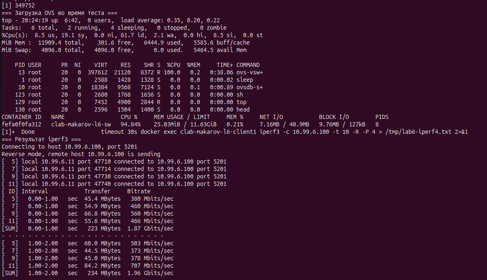

*Рисунок 18 — Нагрузка OVS во время обратного теста с четырьмя потоками.*

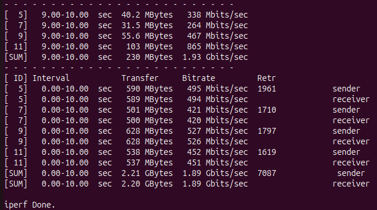

*Рисунок 19 — Итоговая скорость четырёх потоков и повторные передачи.*

## 9 Итоговая проверка и история Git

В итоговом выводе от 16.11.2026 23:27:02 показаны работающие fw2 и shaper1, ненулевые счётчики потоков c1, блокирующее правило TCP 8099 и HTTP 200. Повторный прямой iperf3 дал 18,9 Мбит/с на приёмнике за 5,06 с и 29 повторных передач на отправителе.

История содержит отдельные коммиты 6ef13f0 lab6: initial service chain, cd3c11c lab6: chain c2 -> fw2 и 11699fa lab6: heal c1 -> fw2. На момент снимка локальная ветка опережала origin/main на три коммита; последующая публикация на GitHub этим снимком не подтверждена.

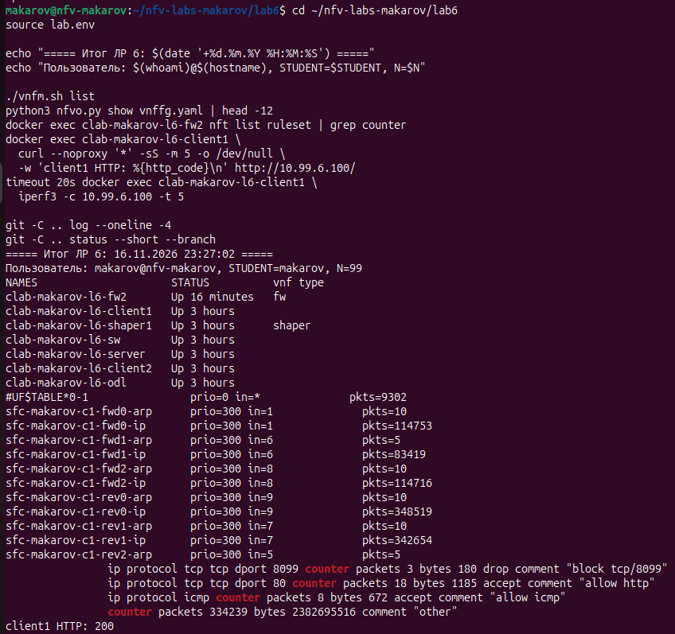

*Рисунок 20 — Итоговая проверка: контейнеры, потоки, правила fw2 и HTTP.*

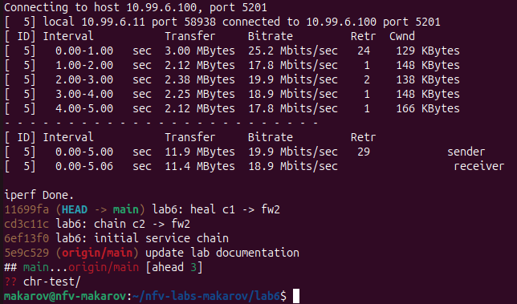

*Рисунок 21 — Продолжение итогового вывода: iperf3 и история Git.*

Итоговый вывод показан на двух последовательных снимках экрана. Ссылка на репозиторий: https://github.com/DeltraWard/nfv-labs-makarov

## 10 Ответы на вопросы

### Почему до установки цепочки ping не проходил?

Адреса клиентов и сервера находятся в одной подсети, но OVS в режиме secure не пересылал кадры без подходящих потоков. Запросы ARP и пакеты IP не имели заданного пути через VNF, поэтому одной принадлежности к подсети было недостаточно.

### Как поля VNFD соотносятся с ETSI NFV?

vdu описывает ресурсы экземпляра, ext_cp — внешние точки подключения, scaling — ограничения числа экземпляров, lcm_operations — операции жизненного цикла. Это учебный упрощённый YAML; до полноценного дескриптора не хватает стандартизованной модели, формального пакета, зависимостей и подробных требований к размещению и жизненному циклу.

### Зачем нужны отдельные потоки IPv4 и ARP?

Для сетевого обмена необходимы и IP-пакеты, и разрешение адресов ARP. Их EtherType и поля различаются, поэтому для одного перехода заданы два правила. На обратном пути адрес клиента используется как адрес назначения, чтобы выбрать цепочку получателя.

### Что изменится при stateful firewall?

При использовании conntrack решение может учитывать состояние соединения и отдельно разрешать установленные и связанные пакеты. Прямой и обратный трафик такого соединения должен попадать на экземпляр, имеющий нужное состояние, либо состояние должно согласованно разделяться между экземплярами. Здесь правила не используют ct state.

### Чем опасна балансировка через select для stateful VNF?

Разные направления одного соединения или его пакеты после изменения набора участников могут попасть на разные экземпляры без общего состояния. Группа select не обязательно выбирает экземпляр независимо для каждого пакета: реализация может хешировать поля потока. Для stateful обработки нужны согласованное сопоставление направлений и сохранение привязки либо синхронизация состояния.

### Что требуется автоматизировать для heal?

Нужно отслеживать состояние VNF и портов, обнаруживать отказ, выбирать работающий резервный экземпляр, обновлять нужные цепочки и проверять результат. Для stateful функций дополнительно требуется сохранить или восстановить состояние соединений. Выполненный вручную сценарий не заменяет такой постоянный мониторинг.

### Что может ограничивать производительность и как её повышают?

В лабораторной схеме обработка OVS в userspace, передача через виртуальные интерфейсы и дополнительные переходы через ядро для VNF создают накладные расходы. DPDK и OVS-DPDK могут ускорять обработку пакетов, но требуют настройки и выделенных ресурсов; SR-IOV и аппаратная разгрузка переносят часть обработки на сетевое оборудование ценой ограничений гибкости и переносимости. vhost-user и SmartNIC применяются в подходящих архитектурах с собственными требованиями к настройке и оборудованию.

## 11 Воспроизведение итогового состояния

Ниже приведён порядок запуска из итоговой версии vnffg.yaml, в которой обе цепочки ссылаются на fw2. Образы lab-tools:1.0, ovs-lab:latest и odl:chromium должны быть подготовлены заранее. Полное повторное развёртывание после destroy в зафиксированном опыте не выполнялось.

```bash
cd ~/nfv-labs-makarov/lab6
source lab.env
containerlab deploy -t lab6.clab.yml
docker exec -d clab-makarov-l6-server iperf3 -s
docker exec -d clab-makarov-l6-server python3 -u -m http.server 8099
sleep 30
docker exec -t clab-makarov-l6-odl /opt/odl/bin/client \
  "feature:install odl-openflowplugin-flow-services-rest odl-openflowplugin-app-table-miss-enforcer"
docker exec -i -e ODL_IP=10.106.99.100 clab-makarov-l6-sw sh < scripts/sw-setup.sh
sleep 20
./vnfm.sh configure fw1 fw
./vnfm.sh configure shaper1 shaper
./vnfm.sh instantiate fw2 fw 5 6
python3 nfvo.py apply vnffg.yaml
./vnfm.sh terminate fw1 3 4
```

Сначала нужно дождаться готовности контроллера и подтвердить подключение OVS. В итоговом VNFFG запись fw1 остаётся в перечне возможных VNF, но ни одна из двух цепочек на неё не ссылается. Для исходного этапа работы следует использовать начальную версию файла из коммита 6ef13f0.

## Заключение

На учебном стенде построена цепочка FW → Shaper под управлением OpenDaylight. Подтверждены связность, фильтрация TCP 8099 и ограничение прямого трафика примерно до 19 Мбит/с. Выполнены scale-out fw2, переключение цепочек после отказа fw1 и удаление отказавшего экземпляра. Обратный тест с четырьмя потоками показал 1,89 Гбит/с и значительное число повторных передач.

## Приложение А Итоговый VNFFG и дескрипторы

В итоговой версии обе цепочки проходят через fw2 и shaper1. Ниже приведены конфигурации, соответствующие выданному комплекту и выполненным изменениям.

### vnffg.yaml

```yaml
# Описание сервисных цепочек (VNF Forwarding Graph) — упрощённый аналог ETSI VNFFGD.
# Переменные ${N} и ${STUDENT} подставляются из окружения.
controller: {url: "http://10.106.${N}.100:8181", user: admin, password: admin}
switch: "openflow:1"

# Конечные точки: номер порта OpenFlow на OVS и IP-адрес
endpoints:
  client1: {port: 1, ip: "10.${N}.6.11"}
  client2: {port: 2, ip: "10.${N}.6.12"}
  server:  {port: 9, ip: "10.${N}.6.100"}

# Экземпляры VNF: порт входа (со стороны клиентов) и выхода (со стороны сервера)
vnfs:
  fw1:     {type: fw,     in: 3, out: 4}
  fw2:     {type: fw,     in: 5, out: 6}     # появится после scale-out (этап 4)
  shaper1: {type: shaper, in: 7, out: 8}

# Цепочки: от кого, к кому и через какие VNF
chains:
  - {name: "${STUDENT}-c1", from: client1, to: server, path: [fw2, shaper1]}
  - {name: "${STUDENT}-c2", from: client2, to: server, path: [fw2, shaper1]}
```

### descriptors/fw-vnfd.yaml

```yaml
# Упрощённый дескриптор VNF (по мотивам ETSI NFV SOL001/TOSCA) — VNF «межсетевой экран»
vnfd:
  id: vnf-fw
  provider: "makarov"
  version: "1.0"
  description: "Прозрачный межсетевой экран (bridge + nftables), вставляется в разрыв"
  sw_image: lab-tools:1.0          # образ (VDU)
  vdu:
    resources: {vcpu: 1, memory_mb: 64}
  ext_cp:                          # внешние точки подключения
    - {id: cp-in,  iface: eth1, role: "сторона клиентов"}
    - {id: cp-out, iface: eth2, role: "сторона сервера"}
  config: vnf/fw-rules.nft         # day-1 конфигурация
  scaling: {min_instances: 1, max_instances: 2}
  lcm_operations: [instantiate, configure, scale_out, heal, terminate]
```

### descriptors/shaper-vnfd.yaml

```yaml
# Упрощённый дескриптор прозрачного шейпера, выполненный по образцу fw-vnfd.yaml.
vnfd:
  id: vnf-shaper
  provider: "makarov"
  version: "1.0"
  description: "Прозрачный шейпер трафика (bridge + tc)"
  sw_image: lab-tools:1.0
  vdu:
    resources: {vcpu: 1, memory_mb: 64}
  ext_cp:
    - {id: cp-in, iface: eth1, role: "сторона клиентов"}
    - {id: cp-out, iface: eth2, role: "сторона сервера"}
  config: "tc qdisc replace dev eth2 root tbf rate 19mbit burst 128kb latency 400ms"
  scaling: {min_instances: 1, max_instances: 1}
  lcm_operations: [instantiate, configure, heal, terminate]
```
